<!-- DEFENSE_SLIDES_FA_R2 (۲۰۲۶-۱۰-۰۷، درخواست نویسنده: «پاورپوینت جدید بساز»).
     ساخته‌شده از DEFENSE_PRESENTATION_CONTENT_FA_R2.md. بازنگری (۲۰۲۶-۱۰-۱۱، درخواست نویسنده):
     بیان مسئله از فصل ۱ و پیشینه از فصل ۲ بازنویسی شد (۱۲ اسلاید به‌جای ۳)، تأکید بر برتری
     لرد–شولمن کم شد، تنها از شکل‌های خودِ پایان‌نامه استفاده شده. ۳۸ اسلاید اصلی + ۲ اسلاید
     پشتیبان (به‌جز اسلاید جداکننده). یادداشت‌های ارائه در Notes هر اسلاید هستند.
     ساخت: از پوشهٔ claude/defense/ اجرا شود (مسیر شکل‌ها نسبت به همین پوشه است):
       pandoc DEFENSE_SLIDES_FA_R2.md -o _raw.pptx --slide-level=1 --reference-doc=reference_defense_R2.pptx
       powershell -ExecutionPolicy Bypass -File make_rtl_pptx_R2.ps1 -SrcPptx _raw.pptx -OutPptx DEFENSE_SLIDES_FA_R2.pptx
     (reference_defense_R2.pptx = قالب سفارشی: پالت، عنوان راست‌چین، شمارهٔ اسلاید، چیدمان «متن بالای شکل»)
     R1 منجمد. -->

# فهرست مطالب

- بیان مسئله و هدف پژوهش
- پیشینهٔ پژوهش: تئوری‌ها، سازه‌های مدرج، مواد متخلخل، ترموالاستیسیتهٔ تعمیم‌یافته
- شکاف تحقیقاتی و جایگاه پژوهش
- مدل‌سازی: هندسه، مواد و الگوها
- معادلات حاکم و روش حل عددی
- صحت‌سنجی و همگرایی
- نتایج و بحث
- نوآوری‌ها، نتیجه‌گیری و پیشنهادها

# استوانه‌های جدارضخیم: سازه‌ای پرکاربرد در معرض بارهای حرارتی سریع

- سیلندرها استوانه‌هایی توخالی و معمولاً جدارضخیم‌اند و بارهای محوری، برشی، پیچشی، خمشی، هیدرواستاتیک و هیدرودینامیک را تحمل می‌کنند.
- کاربرد: مخازن نگهداری و انتقال سیال، فضاپیماها، رآکتورهای هسته‌ای، مبدل‌های حرارتی.
- این اجزا اغلب در معرض بارهای حرارتیِ سریع و شدید قرار می‌گیرند.
- پیش‌بینی دقیق دما و تنش‌های حرارتیِ گذرا برای ایمنی و طول عمر سازه حیاتی است.

::: notes
منبع: فصل ۱، بندهای ۱-۱ و ۱-۶. با کاربردهای ملموس شروع کنید؛ هنوز وارد نظریه نشوید.
:::

# مواد نوین: گرافن برای استحکام، تخلخل برای سبکی و عایق‌بودن

- نانولوله‌های کربنی (۱۹۹۱) و گرافن (۲۰۰۴): استحکام و مدول بسیار زیاد، رسانش الکتریکی و حرارتی عالی [۱].
- نانوکامپوزیت‌های گرافنی از کامپوزیت‌های نانولوله و نانوگرافیت خواص مکانیکی بهتری نشان داده‌اند؛ سطح تماس زیاد، انتقال بار را بهبود می‌دهد.
- مواد متخلخل: سبک، جاذب انرژی، با سطح ویژهٔ زیاد و مقاوم در برابر حرارت؛ اما تخلخل استحکام را کم می‌کند.
- افزودن ورقه‌های گرافنی به مادهٔ متخلخل یکی از راه‌های جبران این افت است [۲].
- ترکیب این دو در ماده‌ای مدرجِ لایه‌ای، توزیع هدفمند ماده در ضخامت را ممکن می‌کند.

::: notes
منبع: فصل ۱، بندهای ۱-۱ و ۱-۶.
:::

# مسئله: پاسخ ترموالاستیک گذرا؛ انتخاب مدل هدایت و الگوی ماده

- قانون فوریه سرعت انتشار حرارت را نامحدود می‌گیرد؛ در بارهای حرارتی پیچیده مانند شوک حرارتی و بار انفجاری دقت کافی ندارد [۳].
- تئوری‌های غیرممزوج، دما و جابجایی را مستقل حساب می‌کنند.
- برای دقت بیشتر، تئوری‌های تعمیم‌یافته و ممزوج معرفی شده‌اند؛ یکی از آن‌ها تئوری لرد–شولمن (۱۹۶۷) با زمان تخفیف $\tau_0$ است [۴].
- **مسئلهٔ این پژوهش:** توزیع دما، تنش، کرنش و جابجایی در استوانهٔ متخلخلِ تقویت‌شده با پلاکت‌های گرافنی تحت بار ترمو-مکانیکی.

::: notes
منبع: فصل ۱، بندهای ۱-۱ (بند چهارم) و ۱-۳. لرد–شولمن را فقط یکی از تئوری‌های تعمیم‌یافته معرفی کنید؛ مقایسهٔ تئوری‌ها در پیشینه و در نتیجهٔ ۷ می‌آید.
:::

# هدف و پرسش‌های پژوهش

- **هدف:** تحلیل ترموالاستیک استوانهٔ توخالیِ متخلخل تقویت‌شده با پلاکت‌های گرافنی تحت بار ترمو-مکانیکی، برای الگوهای مختلف گرافن و تخلخل در ضخامت.
- پاسخ دما، تنش و جابجایی با سرعت متناهی موج حرارتی چه تفاوتی با هدایت فوریه دارد؟
- الگوی گرافن و الگو و شدت تخلخل چگونه بر بیشینهٔ دما، تنش و جابجایی اثر می‌گذارند؟
- برهم‌کنش هم‌زمان دو الگو هم‌افزاست یا خنثی‌کننده؟
- اثر کسر وزنی، نسبت ابعادی، زمان تخفیف، تکیه‌گاه، فشار و ضخامت بر پاسخ گذرا چیست؟

::: notes
منبع: فصل ۱، بند ۱-۴. این چهار پرسش را در بخش نتایج دوباره به‌ترتیب پاسخ می‌دهید.
:::

# پیشینه ۱: تئوری‌های تحلیل استوانه — از پوسته تا الاستیسیتهٔ سه‌بعدی

- تئوری‌های پوسته و ورق: کلاسیک، برشی مرتبهٔ اول و مراتب بالا [۵].
- **کلاسیک:** از کرنش عمودی و برش عرضی صرف‌نظر می‌کند؛ با افزایش ضخامت دقتش کم می‌شود.
- **برشی مرتبهٔ اول:** برش عرضی و اینرسی چرخشی را وارد می‌کند اما کرنش برشی را ثابت می‌گیرد (ضریب تصحیح برشی)؛ مراتب بالاتر جملات بیشتری نگه می‌دارند.
- مزیت پوسته‌ها: حجم محاسباتی کم؛ ضعف: افت دقت در ضخامت زیاد و در رفتار محلی.
- **راه‌حل:** الاستیسیتهٔ سه‌بعدی و ترموالاستیسیتهٔ سه‌بعدی — جابجایی، تنش و کرنش در هر نقطه.

::: notes
منبع: فصل ۲، بند ۲-۲. این اسلاید توجیه می‌کند چرا مسئله را در صفحهٔ (r,z) و نه با تئوری پوسته حل کرده‌اید.
:::

# پیشینه ۲: خانوادهٔ تئوری‌های ترموالاستیسیته

- **کلاسیک** (فوریه، سرعت موج نامحدود): غیرممزوج و ممزوج. **تعمیم‌یافته** (هذلولوی، سرعت موج متناهی، «صوت دوم»): لرد–شولمن، گرین–لیندزی، گرین–نقدی، تأخیر دوفازی.
- مرور جامع: شاکری‌اسکی و همکاران (۲۰۲۱) [۷۸].

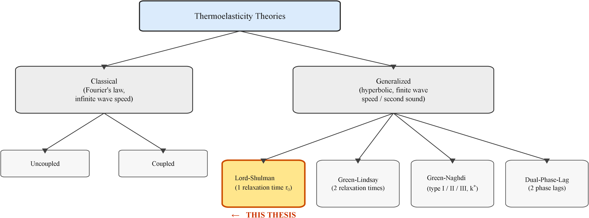

::: notes
شکل ۲-۱ پایان‌نامه. فقط جایگاه نظریه‌ها را نشان دهید؛ دربارهٔ برتری هیچ‌کدام صحبت نکنید.
:::

# پیشینه ۳: استوانه، کره، مخروط و دیسکِ مدرج و کامپوزیتی

- پلتیر و ول (۲۰۰۶)، جباری و همکاران (۲۰۰۶): حل دقیق و تحلیلیِ پوسته و استوانهٔ مدرج تابعی (بسل و انتگرال فوریه) [۸، ۹].
- چن و لین (۲۰۰۸)، پنگ و لی (۲۰۱۰): تنش در استوانه و کرهٔ مدرج؛ بار ترمو-مکانیکی با انتگرال‌گیری عددی [۱۰، ۱۱].
- ملک‌زاده و همکاران (۲۰۱۲): استوانهٔ مدرج تحت بار حرارتی متحرک با هدایت هذلولوی [۱۲]؛ بورلاینکو و همکاران (۲۰۱۷): اجزای محدود [۱۴].
- علی‌بیگ‌لو (۲۰۲۰)، هوانگ و همکاران (۲۰۲۱): استوانه و پانل تقویت‌شده با پلاکت‌های گرافنی؛ اثر کسر وزنی، الگو و ابعاد [۱۶، ۱۸].
- ژانگ و همکاران (۲۰۲۰)، شیا و همکاران (۲۰۲۲): دیسک حلقوی مدرج با DQM و نیومارک [۱۷، ۲۱]؛ الفار و همکاران (۲۰۲۳): آزمایش شوک حرارتی [۲۰].

::: notes
منبع: فصل ۲، بند ۲-۳. نام‌ها را مرور سریع بگویید؛ پیام: روش‌ها متنوع‌اند و DQM + نیومارک در این خانواده سابقه دارد.
:::

# پیشینه ۴: استوانه تحت بار ترمو-مکانیکی و نقش روش DQM

- هفت‌چناری و درویزه (۲۰۰۷): DQM با شبکهٔ کم‌گره و دقت بالا [۲۳]؛ حیدرپور و همکاران (۲۰۱۲): استوانهٔ مدرج دوار با خواص وابسته به دما [۲۸].
- ملک‌زاده و همکاران (۲۰۱۲): پاسخ گذرای پوستهٔ چندلایه با DQM در مکان و **نیومارک** در زمان [۳۱]؛ ملک‌زاده و حیدرپور (۲۰۱۲): بار متحرک با هدایت هذلولوی [۳۲].
- ینگ و وانگ (۲۰۱۰): شوک حرارتی غیریکنواخت [۲۷]؛ کانلیکاما و همکاران (۲۰۱۳): استوانه تحت فشار داخلی [۳۵]؛ نجیبی و طالبی‌توتی (۲۰۱۷): خواص غیرخطی وابسته به دما [۳۹].
- دانشجو و طالبی‌توتی (۲۰۱۴): DQM لایه‌ای؛ دقت و همگرایی سریع [۳۶].
- حیدرپور و همکاران (۲۰۲۰): پوستهٔ تقویت‌شده با گرافن، بار ترمو-مکانیکی دینامیکی [۴۶]؛ رحیمی و همکاران (۲۰۲۰): تحلیل سه‌بعدی استوانهٔ متخلخل گرافنی با هالپین–تسای [۴۷].

::: notes
منبع: فصل ۲، بند ۲-۴. تأکید: ترکیب «DQM لایه‌ای + نیومارک» که در این پایان‌نامه به‌کار رفته، روشی جاافتاده است [۳۱، ۳۶].
:::

# پیشینه ۵: مواد مرکب متخلخل تقویت‌شده با گرافن

- یاس و رحیمی (۲۰۲۰): کمانش حرارتی تیر؛ تخلخل دمای بحرانی را کم و گرافن مقاومت را زیاد می‌کند. مدل سلول‌باز این کار، مبنای مدل تخلخل پژوهش حاضر است [۵۱].
- مرادی‌دستجردی و بهدینان (۲۰۲۱): تنش در استوانهٔ جدارضخیم مدرج متخلخل گرافنی در حالت پایا [۵۲]؛ سلمانی و همکاران (۲۰۲۱): پس‌کمانش پوستهٔ استوانه‌ای [۵۳].
- بابایی و همکاران (۲۰۲۲): مخروط ناقص دوار تحت بار حرارتی گذرا؛ گرافن جابجایی را کم و تخلخل آن را زیاد می‌کند [۵۵].
- چو (۲۰۲۳)، ژانگ و همکاران (۲۰۲۳): پانل استوانه‌ای؛ پاسخ به مقدار و الگوی توزیع گرافن و تخلخل بسیار وابسته است؛ تبدیل کسر وزنی به حجمی [۵۷، ۵۸، ۶۰].
- هوانگ و همکاران (۲۰۲۴)، جمشیدی و عارف (۲۰۲۴)، سیتلی و همکاران (۲۰۲۴): کمانش مخروط، رفتار الاستیک استوانه، خمش تیر [۶۱–۶۳].

::: notes
منبع: فصل ۲، بند ۲-۵. نکتهٔ مشترک: الگوی توزیع گرافن و تخلخل در همهٔ این کارها اثر تعیین‌کننده دارد، و بیشترشان مکانیکی یا حرارتی پایا هستند.
:::

# پیشینه ۶: ترموالاستیسیتهٔ تعمیم‌یافته در سازه‌های مدرج

- باهتویی و اسلامی (۲۰۰۷): پوستهٔ استوانه‌ای مدرج تحت شوک حرارتی؛ مقایسهٔ لرد–شولمن و گرین–لیندزی (اجزای محدود + لاپلاس) [۶۴، ۶۵].
- بگری و اسلامی (۲۰۰۸): دیسک حلقوی مدرج با لرد–شولمن [۶۶]؛ حسینی و ابول‌بشری (۲۰۱۲): موج ترموالاستیک در استوانه با گرین–نقدی [۶۷].
- حیدرپور و ملک‌زاده (۲۰۱۹): کرهٔ مدرج چندلایه با لرد–شولمن، DQM لایه‌ای + نیومارک [۶۸]؛ حیدرپور و همکاران (۲۰۱۹): پوستهٔ کروی گرافنی — نزدیک‌ترین کار به چارچوب پژوهش حاضر [۳].
- حیدرپور و همکاران (۲۰۲۰): پوستهٔ استوانه‌ای با لایهٔ پیزوالکتریک (قرارداد بی‌بعدسازی فصل ۴) [۶۹]؛ مخروط ناقص گرافنی دوار (مبنای معادلات فصل ۳) [۷۰].
- حسینی (۲۰۲۱، ۲۰۲۲)، کاظمی و همکاران (۲۰۲۳): انتشار موج حرارتی با گرین–نقدی در استوانه و فراماده [۷۱–۷۳].

::: notes
منبع: فصل ۲، بند ۲-۶. مرجع‌های نزدیک را نام ببرید: [۳]، [۶۸]، [۷۰]. اگر داور پرسید «تفاوت شما با کار حیدرپور چیست؟» پاسخ در اسلاید بعد است.
:::

# جمع‌بندی پیشینه: چهار شکاف پژوهشی

- سه شاخه جداگانه بالغ شده‌اند: ترموالاستیک استوانه‌های کامپوزیتی، مدل‌سازی مواد متخلخل گرافنی و تئوری‌های تعمیم‌یافته؛ بررسی هم‌زمانشان به‌ندرت انجام شده است.
- **۱.** کارهای گذرا اغلب بر تئوری پوسته‌اند؛ حل کاملاً دوبعدی $(r,z)$ برای استوانهٔ جدارضخیم کمتر به‌کار رفته است.
- **۲.** تحلیل‌های استوانهٔ متخلخل گرافنی عمدتاً مکانیکی یا حرارتیِ پایا و بر پایهٔ فوریه‌اند.
- **۳.** کارهای لرد–شولمن با DQM لایه‌ای و نیومارک بر کره، مخروط ناقص یا پوسته‌اند؛ استوانهٔ جدارضخیم چندلایه با گرافن و تخلخل هم‌زمان پوشش داده نشده است.
- **۴.** برهم‌کنش کاملِ الگوهای گرافن و تخلخل (ماتریس ۵×۵) و مقایسهٔ نظریه‌ها در یک مسئلهٔ استوانه‌ای گزارش نشده است.

::: notes
منبع: فصل ۲، بند ۲-۷. «تا آنجا که در این مرور بررسی شد» را بگویید؛ ادعای مطلق نکنید.
:::

# جایگاه پژوهش حاضر در ادبیات

- تحلیل ترموالاستیک گذرا و کاملاً ممزوج برای استوانهٔ توخالیِ جدارضخیمِ چندلایهٔ متخلخل تقویت‌شده با گرافن.
- خواص مؤثر: هالپین–تسای، قاعدهٔ مخلوط‌ها و مدل سلول‌باز.
- معادلات به‌صورت دوبعدی در صفحهٔ $(r,z)$ و بدون تحویل به فرضیات پوسته.
- گسسته‌سازی: DQM لایه‌ای (گره‌های چبیشف–گاوس–لوباتو) در مکان و نیومارک در زمان.
- گرافن و تخلخل، هر یک در پنج الگوی UD، O، X، V و A.

::: notes
منبع: فصل ۲، بند ۲-۷ (بند پایانی). هر مورد این فهرست یکی از شکاف‌های اسلاید قبل را پاسخ می‌دهد.
:::

# استوانهٔ توخالیِ هفت‌لایه با خواص متغیر در ضخامت

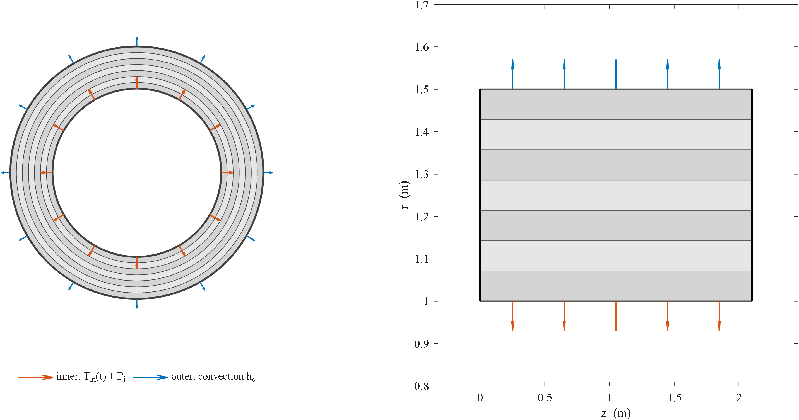{height=4.6in}

# حالت مرجع و شرایط مرزی

- ابعاد: $R_i=1$ m، $R_o=1.5$ m، طول $L=2.1$ m.
- حرارت: سطح داخلی $300 \to 600$ K؛ سطح خارجی همرفت با $h_c=10$ W/m²K.
- مکانیک: فشار داخلی $P_i=50$ MPa؛ انتهاها تکیه‌گاه ساده و عایق.
- $\tau^*\approx 0.15$ (معادل $\tau_0=418$ s)؛ زمان کل ۳۰۰۰ ثانیه.
- خواص: **هالپین-تسای** + قانون مخلوط‌ها؛ تخلخل: **سلول باز**.

::: notes
تأکید: $\tau^*=0.15$ پارامتر بی‌بعدِ اصلی است؛ $\tau_0=418$ s مقیاس‌گذاریِ جدارهٔ ۰٫۵ متری است، نه خاصیتِ اندازه‌گیری‌شدهٔ یک ماده. اگر پرسیدند، بگویید این یک مطالعهٔ پارامتریِ بی‌بعد است.
:::

# پنج الگوی توزیع گرافن در ضخامت

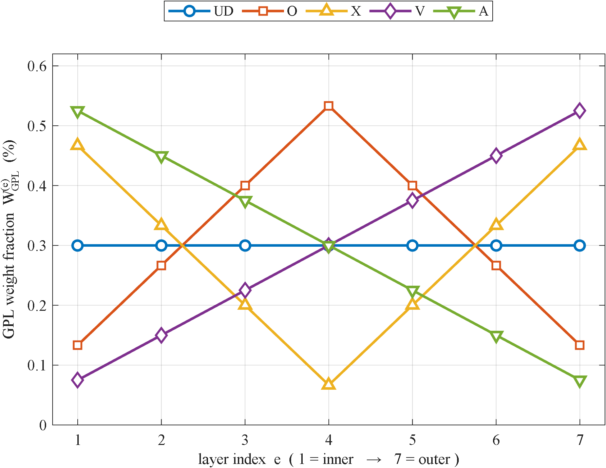{height=4.4in}

# پنج الگوی توزیع تخلخل در ضخامت

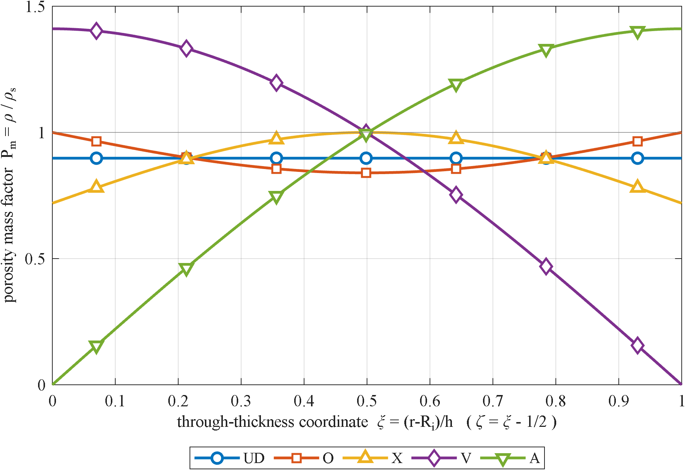{height=4.4in}

::: notes
تأکید کنید V و A آینهٔ یکدیگرند — این نکته بعداً در یافتهٔ هم‌افزایی کلیدی می‌شود.
:::

# معادلهٔ انرژی لرد–شولمن

$$\rho c\left(\dot{\theta} + \tau_0\ddot{\theta}\right) + \beta T_0\left(\dot{e} + \tau_0\ddot{e}\right) = \nabla\cdot(k\nabla\theta)$$

- جملهٔ $\tau_0\ddot{\theta}$ معادله را **هذلولوی** می‌کند؛ سرعت موج $C=\sqrt{\alpha/\tau_0}$.
- جملهٔ $\beta T_0\dot{e}$ **پیوند ممزوج** دما و تغییرشکل است.
- $\tau_0 \to 0$: **فوریهٔ کلاسیک**.

::: notes
فقط همین یک معادله را نشان دهید. اگر جزئیات استخراج را خواستند، اسلاید پشتیبان (فصل ۳) را باز کنید.
:::

# DQM لایه‌ای + نیومارک: ۱۵ برابر نقطهٔ کمتر

- **مکان:** مربعات تفاضلی (DQM) لایه‌ای در $(r,z)$ با نقاط چبیشف-گاوس-لوباتو.
- **زمان:** نیومارک ($\beta=1/4$، $\gamma=1/2$) — بدون قید پایداری.
- شرایط مرزی و **سازگاری بین‌لایه‌ای** (دما، شار، جابجایی، تنش) به‌صورت سطرهای جبری.
- DQM در هر راستا حدود **۱۵ برابر** نقطهٔ کمتر از تفاضل محدود و اجزای محدود خطی.

# شبکهٔ DQM

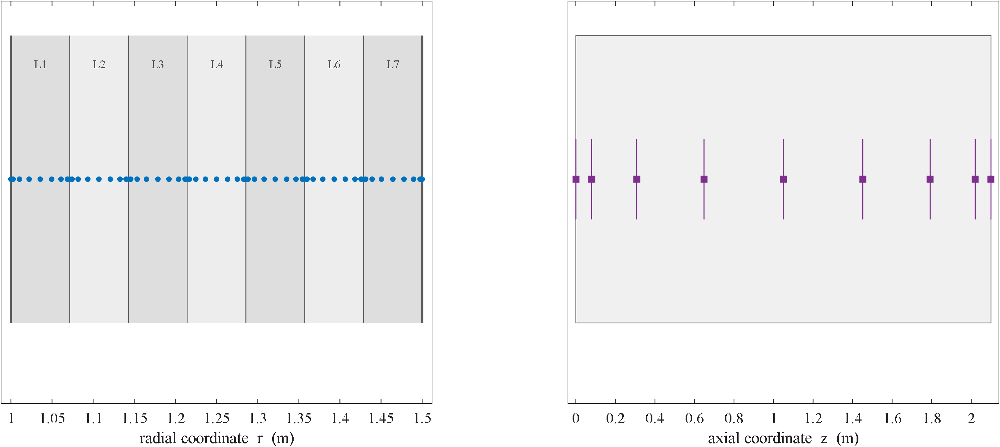{height=4.4in}

# فلوچارت حل

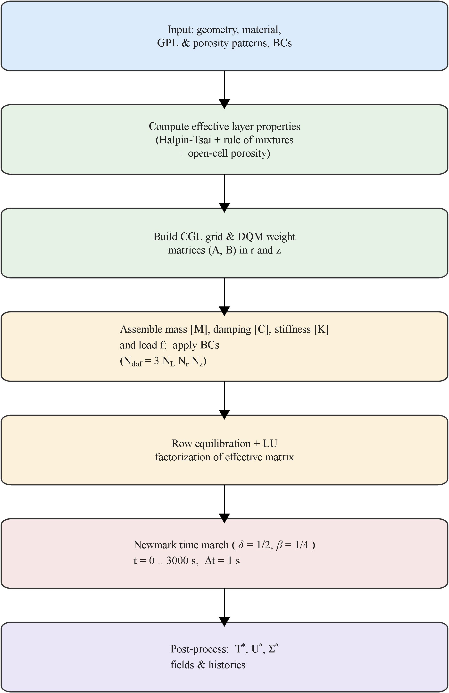{height=4.6in}

::: notes
اگر زمان کم است، این اسلاید و اسلاید قبل را حذف یا به پشتیبان ببرید.
:::

# صحت‌سنجی: پنج آزمون مستقل

1. **حد استاتیکی** — حل‌گر استاتیکی مستقل: اختلاف نسبی $\sim 2\times10^{-11}$.
2. **پاسخ مکانیکی** — ملک‌زاده و ANSYS: اختلاف **۰٫۱ تا ۰٫۲٪**.
3. **هدایت گذرا** — حل دقیق سری بسل: خطای $10^{-5}$ تا $10^{-7}$.
4. **انتگرال‌گیر زمانی** — `ode15s`: اختلاف **۰٫۰۰۳ K**.
5. **موج صوت دوم** — حل دقیق تحلیلی: صحت‌سنجی **کمّی**.

::: notes
این مهم‌ترین سپرِ دفاعی شماست. آرام و با اعتمادبه‌نفس بخوانید.
:::

# آزمون ۲: جابجایی شعاعی با مرجع و ANSYS منطبق است

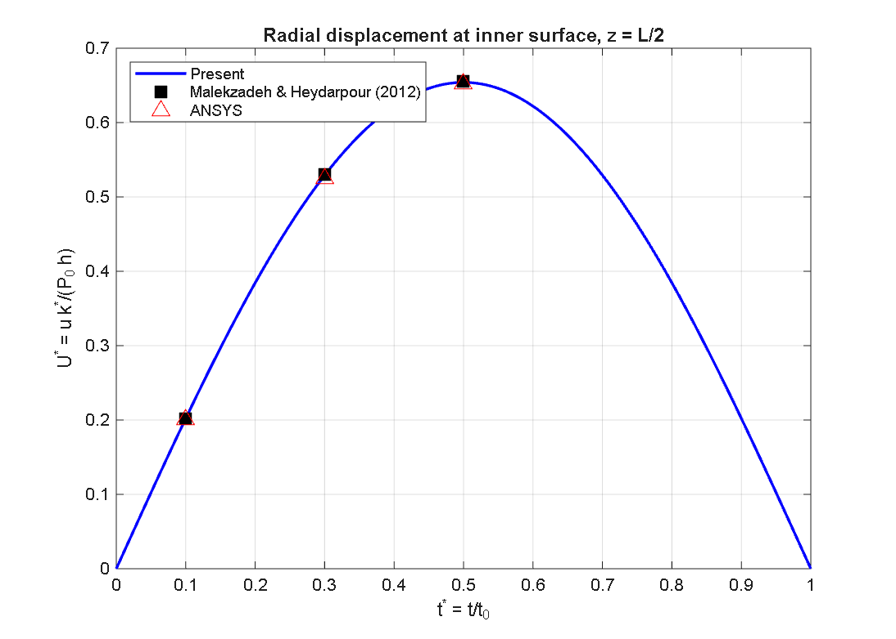{height=4.6in}

::: notes
جابجایی شعاعی بی‌بعد سطح داخلی در برابر زمان؛ حل حاضر، مرجع و ANSYS. اختلاف ۰٫۱ تا ۰٫۲٪.
:::

# آزمون ۳: پروفیل دما با حل دقیق بسل منطبق است

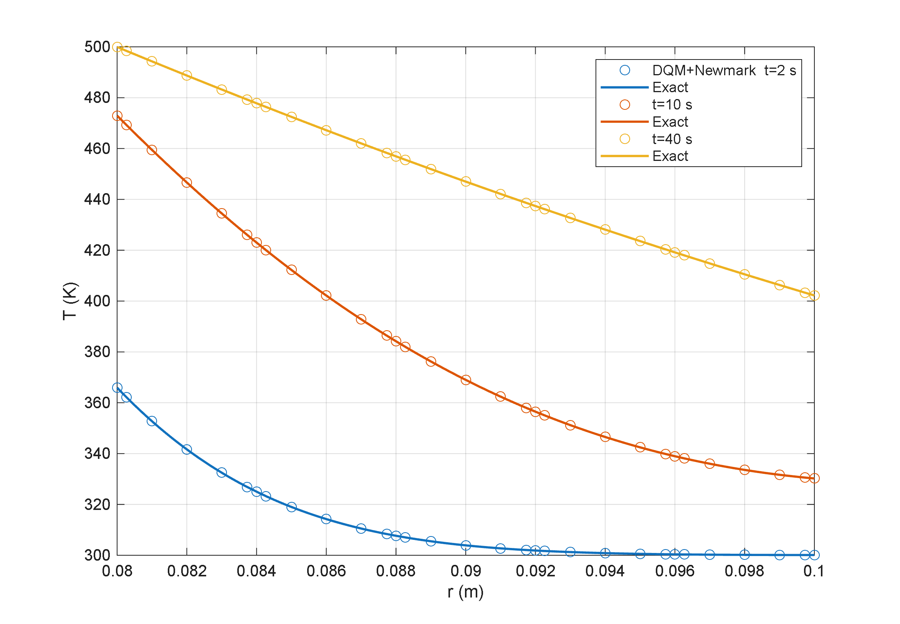{height=4.6in}

::: notes
نشانگرها حل حاضر و خط پیوسته حل دقیق سری بسل است؛ خطای $10^{-5}$ تا $10^{-7}$.
:::

# موج صوت دوم: خطای ۰٫۳۲٪ در برابر حل دقیق تحلیلی

- مرجع: حل دقیق فوریه-بسل برای **همین هندسه**؛ خطا $0.32\%$ ($L_\infty$) و $0.065\%$ ($L_2$).
- خطا با ریزسازی شبکه **یکنواخت کاهش** می‌یابد ← نوسان‌های پشت پیشانی **اثر گیبس** است، نه ناپایداری.

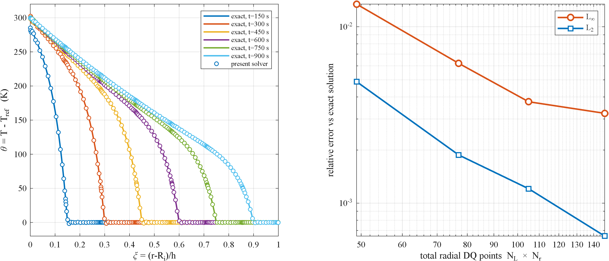{height=3.6in}

::: notes
اگر پرسیدند «چرا مرجع تحلیلی و نه مقالهٔ چاپ‌شده؟» بگویید: حل دقیق برای همین هندسه استخراج شده، پس مقایسه بدون خطای رقمی‌سازیِ شکلِ مرجع و بدون اختلاف در فرضیات انجام می‌شود. پیشانی موج با دقت کمتر از یک فاصلهٔ شبکه ردیابی می‌شود.
:::

# مش قفل‌شده: $N_r=15$، $N_z=11$، $N_L=7$

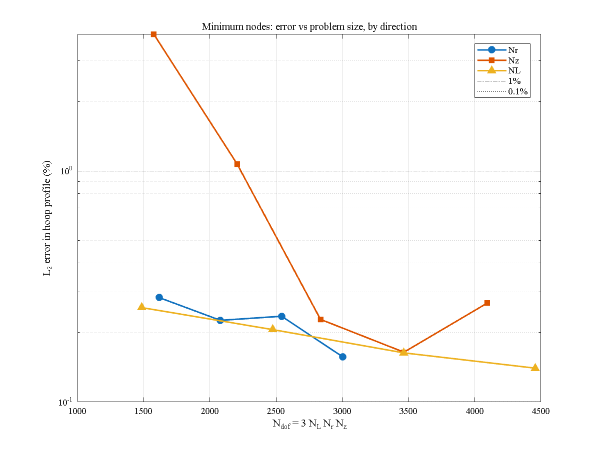{height=4.2in}

::: notes
راستای محوری راستای مقیدکننده است.
:::

# نتیجه ۱: دمای میان‌جداری از مقدار محرک فراتر می‌رود (۱٫۱۱۵)

- تا **۱٫۱۱۵** در کسر وزنی بالای گرافن و **۱٫۱۰۹** در تخلخل V؛ الگوی «قله-قعر» از بازتاب موج.
- در مدل کلاسیک **قابل بازتولید نیست**.

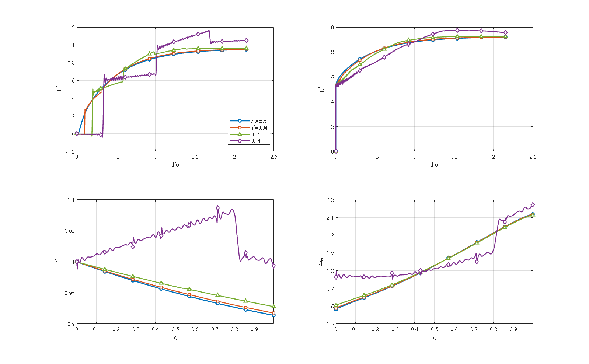{height=3.6in}

# نتیجه ۲: گرافن V دما را ۲۹٪ و تنش را تا ۳ برابر کم می‌کند

- **V** (رسانا در سطح داخلیِ گرم): دمای بیشینه **۲۹٪** کمتر؛ تنش محیطی داخلی تا **۳ برابر** کمتر.
- **A** (آینهٔ V) **بدترین** حالت در هر سه کمیت است.

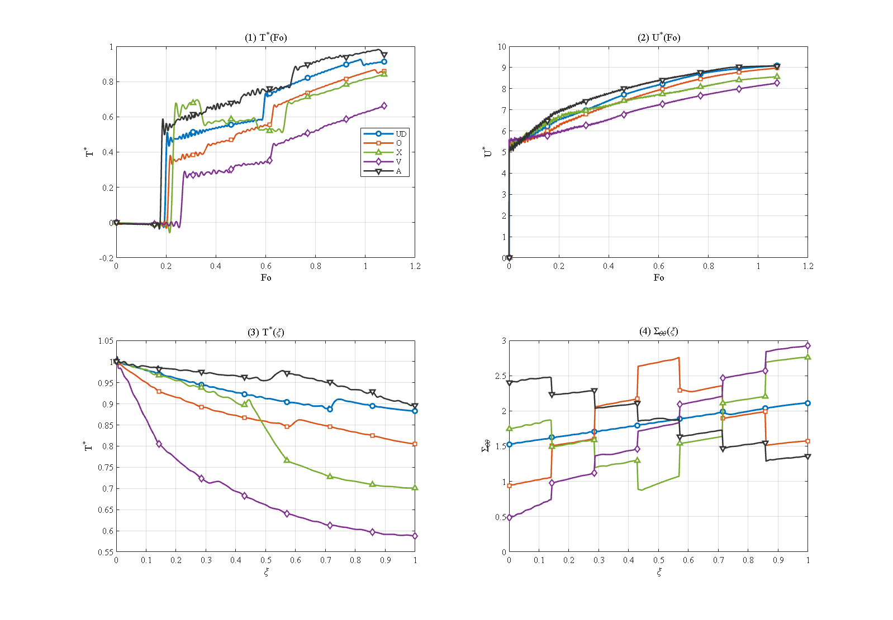{height=3.6in}

# نتیجه ۳: تخلخل A همچون سد حرارتی، دمای سطح خارجی را ۸ برابر کم می‌کند

- حفره‌ها در سطح خارجی **سد حرارتی** می‌سازند؛ اما **علامت** تنش محیطی داخلی را وارون می‌کنند.
- الگوی V بیشترین قلهٔ گذرا را دارد (**۱٫۱۱**).

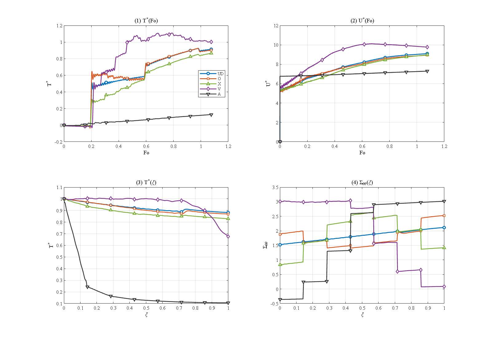{height=3.6in}

# نتیجه ۴ ★: گرافن V + تخلخل A هم‌افزاست — تا ۲۶ برابر کاهش دما

- **هم‌افزا:** V-گرافن با A-تخلخل $\to 0.034$؛ **خنثی‌کننده:** V-گرافن با V-تخلخل $\to 0.692$.
- **هم‌راستایی یا تقابل دو الگو** تعیین‌کننده است، نه انتخاب یک الگوی «خوب».

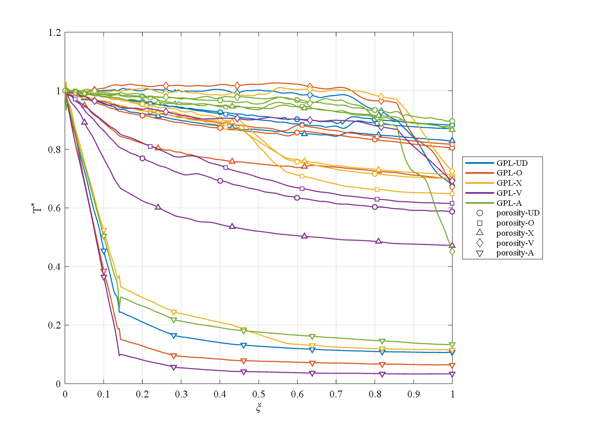{height=3.5in}

::: notes
این مهم‌ترین یافتهٔ پایان‌نامه است. اینجا سرعت را کم کنید، جمله‌بندی را دقیق بگویید و توصیهٔ طراحی را صریح اعلام کنید.
:::

# نتیجه ۵: آستانهٔ پرکولاسیون در کسر وزنی ≈ ۱٪

- گذر از «عایق» به «رسانا»؛ بیشتر از آن، نفوذ حرارتی فقط **هموار** بهتر می‌شود اما **تنش حرارتی دو برابر** می‌شود (در ۸٪).
- نسبت ابعادی پلاکت اثر **درجهٔ دوم** دارد (تنش < ۲٪).

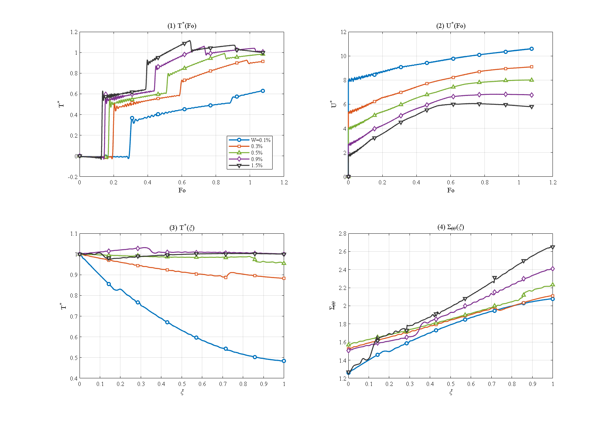{height=3.6in}

# نتیجه ۶: در شوک گاوسی، بیشینهٔ دمای فوریه حدود ۲٫۵ برابر کمتر است

- در شوک کوتاه‌مدت، انتخاب مدل هدایت بر پیش‌بینی بیشینهٔ دما اثر زیادی دارد.
- حل ممزوج موج را حدود **۱٪** میرا می‌کند (میرایی ترموالاستیک).

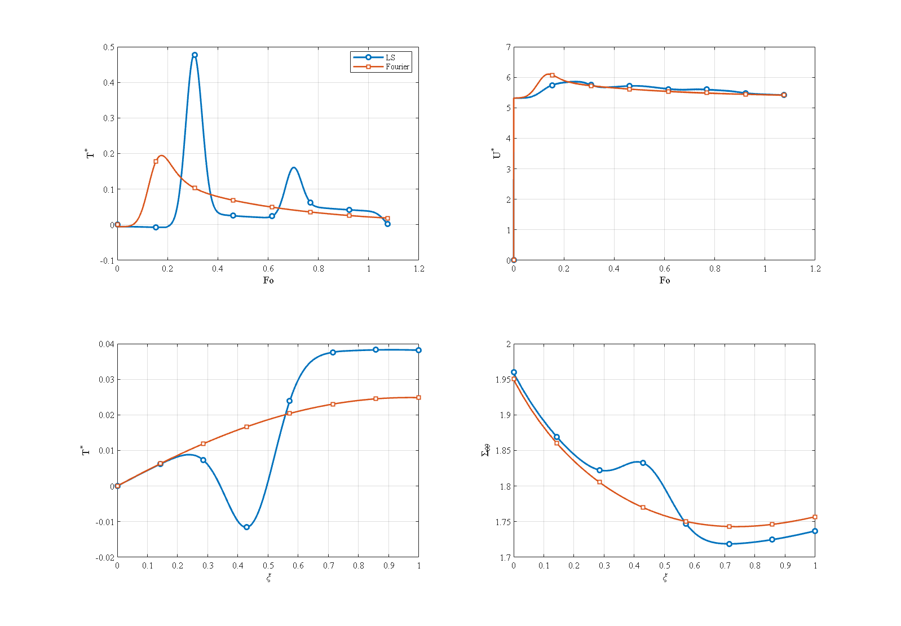{height=3.6in}

::: notes
این یافته را با ذکر شرایط (پالس گاوسی) و بدون مبالغه بیان کنید.
:::

# نتیجه ۷: مقایسهٔ چهار تئوری ترموالاستیسیته

- فوریه / لرد-شولمن / DPL / گرین-نگدی III؛ تباهیدگی DPL در $\tau_T=\tau_q$؛ فراجهش ماندگار GN-III.

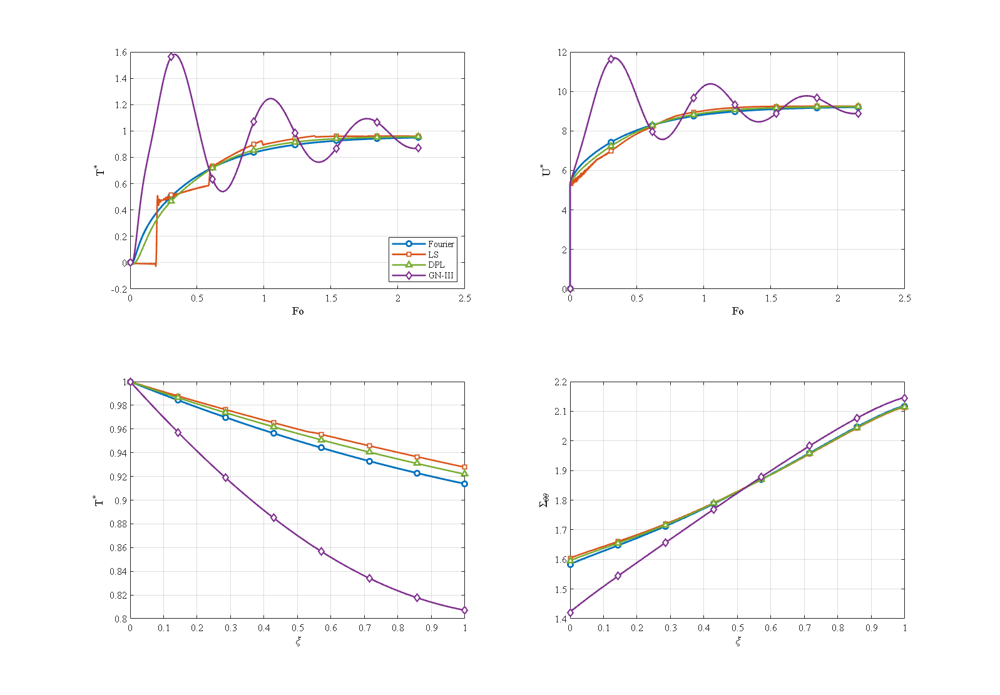{height=3.8in}

# نوآوری‌های پژوهش

1. حل **کاملاً ممزوج** لرد-شولمن برای استوانهٔ چندلایهٔ متخلخلِ گرافنی با DQM لایه‌ایِ دوبعدی.
2. **برهم‌کنش هم‌افزای V-گرافن و A-تخلخل** و **ماتریس کامل ۵×۵** که در مراجع پیشین همتا ندارد.
3. رفتار **«قله-قعر»** و آینه‌ایِ الگوها و پیوند آن با سرشت موجی هدایت.
4. سه مطالعهٔ گسترشی: شش انتگرال‌گیر زمانی، چهار روش مکانی، چهار تئوری.
5. صحت‌سنجی **کمّی** موج صوت دوم در برابر حل دقیق تحلیلی.

# نتیجه‌گیری

- در **شوک حرارتی گذرا**، پیش‌بینی دما و تنش به انتخاب مدل هدایت حساس است؛ در پالس گاوسی فوریه بیشینهٔ دما را حدود ۲٫۵ برابر کمتر می‌دهد.
- از دیدگاه طراحی، **هم‌راستاسازی گرافن و تخلخل (V-A)** بهترین رفتار حرارتی را با کمترین جریمهٔ تنش می‌دهد.
- انتخاب الگو باید **هم‌زمان** از منظر دما و تنش سنجیده شود.
- **DQM لایه‌ای + نیومارک** ابزاری کارآمد و صحت‌سنجی‌شده است.

# محدودیت‌ها و پیشنهادها

**محدودیت‌ها**

- خواص مادی **مستقل از دما**.
- مدل **الاستیک خطی**، بدون معیار آسیب/شکست.
- پیوند **کامل** بین‌لایه‌ای (بدون مقاومت حرارتی فصل‌مشترک).

**پیشنهادها**

- وابستگی خواص به دما و رفتار **غیرخطی/آسیب**؛ **مقاومت حرارتی فصل‌مشترک**.
- **صحت‌سنجی تجربی** و نمودار طراحیِ مهندسی بر پایهٔ یافتهٔ V-A.

# با تشکر از توجه شما

پرسش و پاسخ

# اسلایدهای پشتیبان

# پشتیبان ۱ — آزمون ۱: حد استاتیکی (شکل ۴-۵)

- ۴۵ نقطهٔ شعاعی؛ بیشینهٔ اختلاف مطلق $2.1\times10^{-14}$ m و نسبی $2.2\times10^{-11}$.

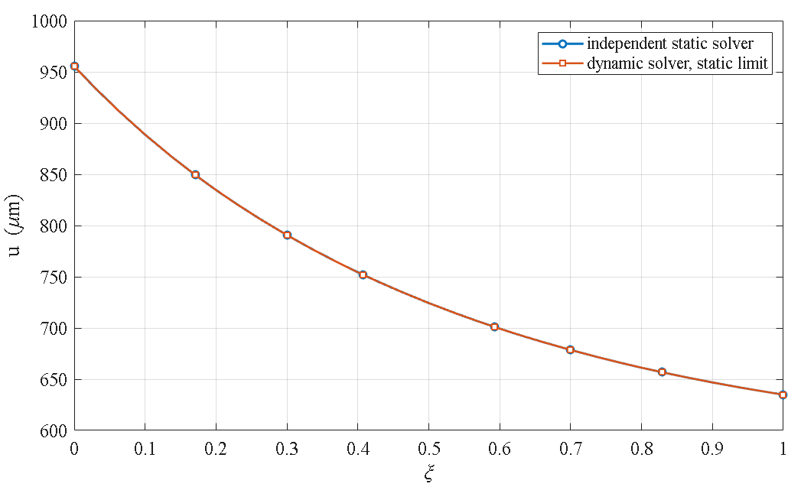{height=3.8in}

# پشتیبان ۲ — آزمون ۴: انتگرال‌گیر زمانی (شکل ۴-۸)

- خطای بیشینه: نیومارک **۰٫۰۰۳۱۹ K**، `ode15s` **۰٫۰۰۰۲۶ K**؛ هزینهٔ نیومارک حدود یک‌دهم.

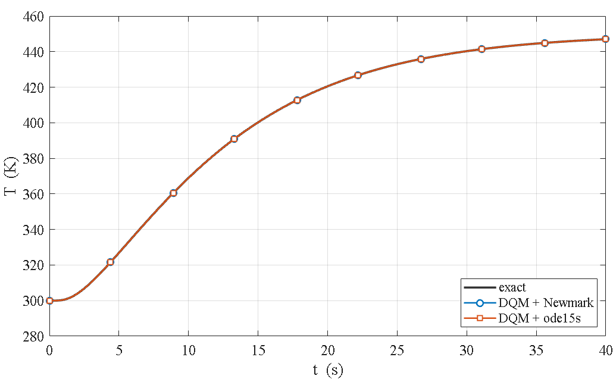{height=3.8in}

