<!-- ARTICLE_FULL_THESIS_EN_R2 — R1 with the V/Λ pattern direction changed to the Chapter 4/5 convention (author decision 2026-11-01: "the basis is Chapter 4"; solver and Chapter 3 equations are not the basis), abstract and highlights rewritten in the findings-then-conclusions style without numbers, and figure paths updated after the move of the figures_ch4* folders into figures_ch4_master/. Source of numbers: thesis draft (Google Docs, edit 2026-10-11) chapters 3–5; papers/PAPER1–3. R1 stays frozen. -->

> **AUTHOR NOTES — delete this box before submission.**
> **(1) V/Λ direction follows Chapter 4 (author decision, 2026-11-01).** In this version pattern V concentrates the platelets (GPL) and the pores near the inner (hot) surface and pattern Λ near the outer surface, as Chapters 4 and 5 describe; Eqs. (8) and (10) and Table 1 are written accordingly. **Caution, to be resolved before submission:** the numbers of Sects. 6–7 are the Chapter 4 numbers, which were produced with `LSTE_solver_R11.m`. In that solver (and in thesis Eqs. 3-17 and 3-23) pattern V puts the platelets and the pores in the OUTER layers, i.e. the mirror image of Eqs. (8) and (10) as printed here. A reader reproducing the study from these equations would obtain the V and Λ results interchanged (e.g. the lowest peak temperature would belong to Λ). Either regenerate the pattern figures and Sects. 7.1–7.3 with the interchanged mapping, or print the equations with the opposite orientation. Details: `reviews/THESIS_PROOFREADING_REPORT_FA_R1`, row 1, and `thesis_chapter/ABSTRACT_FA_R4_CHECK`.
> **(2) Porosity patterns V/Λ are provisional.** The raw cosine expression of Eq. (8) (thesis Eq. 3-23) exceeds 1 in three layers of pattern V (and Λ) and is clipped to [0, 1] in the solver, which breaks the equal-mass constraint of Eq. (9) for those two patterns. The porosity formulas are being revised by the author; all V/Λ-porosity numbers (Sects. 7.2–7.3, conclusions) must be regenerated after that revision.
> **(3) Other points to confirm** are listed in the checklist at the end of this file.

# Thermoelastic analysis of graphene platelets reinforced porous cylinders under thermo-mechanical load based on Lord–Shulman theory

**Authors.** Alireza Oliasami¹, Saeidreza Mohebpour¹, Yasin Heydarpour¹ *(order, corresponding author and affiliations to be confirmed with the supervisors)*

¹ Department of Mechanical Engineering, Faculty of Engineering, Persian Gulf University, Bushehr, Iran

*Footnote for submission:* This article is based in part on the first author's MSc thesis at Persian Gulf University.

---

## Abstract

Thermal shock on porous graphene-platelet-reinforced composite cylinders is normally analysed with Fourier heat conduction, which assumes an infinite speed of heat propagation, and with the platelet and pore distributions chosen one at a time. This paper presents a fully coupled transient thermoelastic analysis of a multilayer porous cylinder reinforced by graphene platelets (GPLs) on the basis of the Lord–Shulman (LS) generalized theory. The layers differ in GPL weight fraction and in porosity; the effective elastic properties follow the Halpin–Tsai model and the rule of mixtures, the effect of pores follows open-cell theory, and five distributions (uniform, O, X, V and Λ) are considered for each phase. The equations of motion and the LS energy equation, with the boundary and layer-compatibility conditions, are discretised by a layerwise differential quadrature method (DQM) in the radial and axial directions and integrated in time by the Newmark method. The solution is verified against exact and published solutions, and its convergence is shown with respect to radial and axial nodes, number of layers and time step. The reference load is a sudden temperature rise of the inner surface combined with an internal pressure. The temperature history shows the pattern of a reflected thermal wave, and under impulsive heating Fourier conduction predicts a lower peak temperature than the LS theory; Fourier conduction is therefore non-conservative for fast thermal loads, and the wave behaviour has to be taken into account. With the total platelet content kept equal, pattern V, which concentrates the conductive platelets at the hot inner surface, lowers both the peak temperature and the inner hoop stress relative to a uniform distribution; hence the distribution of the platelets through the thickness, and not only their amount, affects the thermal and mechanical response. Porosity acts as a thermal barrier: pattern Λ, with the pores concentrated at the outer surface, lowers the outer-surface temperature but changes the sign of the inner hoop stress, so the temperature benefit comes with a changed stress state. The effect of combining the two patterns depends on their alignment: pattern V platelets with pattern Λ porosity (conductive towards the heat source, insulating towards the environment) reinforce each other, whereas V with V weakens the benefit. Because the pattern that is best for temperature is not always best for stress, the two patterns have to be selected jointly on temperature and stress. A larger platelet weight fraction increases the heat penetration and reduces the displacement, but the gain in conductivity depends on the formation of a conductive network, so the platelet geometry matters. The response is governed mainly by the thermal load, while internal pressure at usual levels and the end supports play a smaller role. The layerwise DQM reaches comparable accuracy with fewer nodes than finite differences and finite elements, and Newmark integration offers a favourable accuracy-to-cost ratio, which makes their combination an efficient framework for the coupled transient analysis of multilayer cylinders.

**Keywords:** thermoelastic analysis; porous cylinder; graphene platelets; thermo-mechanical load; Lord–Shulman theory; differential quadrature method

### Highlights

- A fully coupled Lord–Shulman model of a multilayer porous GPL-reinforced hollow cylinder is solved by layerwise differential quadrature in (r, z) and Newmark integration.
- All twenty-five pairings of five GPL patterns with five porosity patterns are computed in temperature, stress and displacement.
- The relative arrangement of the two gradings, not either grading alone, governs the response; temperature-only screening is unsafe.
- Fourier conduction gives a lower, non-conservative peak temperature than the LS theory under an impulsive thermal shock.
- Layerwise DQM reaches comparable accuracy with fewer nodes per direction than finite differences or linear finite elements.

---

## 1. Introduction

Graphene platelets (GPLs) combine a very high elastic modulus and thermal conductivity with a low mass, and small weight fractions already change the stiffness and the heat-conduction path of a polymer matrix [1, 2]. Functionally graded GPL-reinforced composites place the platelets non-uniformly through the thickness, so that the property gradient can be matched to the load; beams, plates, cylindrical panels, cylindrical shells and conical shells with such gradings have been studied under static, vibration, buckling and thermal loads [3–9]. Recent work continues along this line for cylinders and shells with platelet gradings, agglomeration and viscoelastic cores [10–12]. A second grading is obtained by introducing porosity, which lowers weight and absorbs energy but also lowers stiffness and conductivity; the effective properties of porous GPL-reinforced structures are usually obtained from open-cell theory with prescribed porosity distributions [13–17]. Porous FG and GPL-reinforced beams, plates, panels, spherical, toroidal and conical shells have been analysed for buckling, vibration and thermo-mechanical response [18–27], and stress waves in thick porous GPL-reinforced cylinders under thermal gradients have been studied [28]. In such a structure the platelets recover part of the stiffness that the pores remove, and the two phases are normally introduced together.

For thick-walled cylinders the thermoelastic response has been obtained analytically, semi-analytically and numerically for functionally graded (FG) materials, mostly with Fourier heat conduction and often in the quasi-static or uncoupled form [29–36]. Transient and coupled formulations were developed with finite elements, finite differences and graded elements [37–45]. Differential quadrature (DQM) and its layerwise form are well suited to layered and graded cylinders because a handful of nodes gives high accuracy and the layer interfaces are handled naturally [46–54].

Fourier's law makes the heat equation parabolic and implies that a thermal disturbance is felt instantly everywhere. Under thermal shock, laser pulses or blast loading this is not admissible. The Cattaneo–Vernotte flux law [55, 56] introduces a relaxation time and a finite wave speed, and Lord and Shulman built the first thermodynamically consistent generalized thermoelasticity on it [57]. Other theories add a second relaxation time or a thermal displacement: the Green–Lindsay and Green–Naghdi theories [58], and the dual-phase-lag (DPL) model [59]; reviews are given in [60, 61]. The LS theory has been solved for FG cylinders, shells, disks and spheres [62–65], with Green–Naghdi and non-Fourier variants for GPL- and CNT-reinforced multilayer cylinders and metamaterials [66–69], and for FG and GPL-reinforced spherical, conical and cylindrical shells by Heydarpour and co-workers [70–73]. Non-Fourier analyses of porous media with voids and of sandwich conical shells with a porous core have appeared only recently [74–80].

Two gaps remain. First, to the authors' knowledge, no fully coupled LS solution exists for a *multilayer porous GPL-reinforced hollow cylinder of finite length*, solved in the (r, z) plane with layerwise DQM. Second, platelet and pore distributions have been studied individually, so it is not known whether the effect of one grading survives on a different background of the other, or whether the two interact.

This paper addresses both gaps. Its contributions are:

1. A fully coupled LS thermoelastic formulation for the multilayer porous GPL-reinforced cylinder, discretised by layerwise DQM in r and z and by the Newmark method in time, verified in independent tests and converged in every discretisation parameter.
2. The complete 5 × 5 map of GPL pattern × porosity pattern under combined thermal and pressure loading, reported in temperature, hoop stress and displacement, with the result that the *relative arrangement* of the two gradings governs the response and that temperature-only screening can pass the most highly stressed design.
3. A parametric study of platelet weight fraction and aspect ratios (including a conduction-threshold effect), pressure, supports, length, thickness, convection, relaxation time, field coupling and impulsive loading.
4. A measured comparison of four generalized thermoelasticity theories, six time integrators and five spatial discretisations on the same problem.

The paper is organised as follows. Section 2 gives the geometry and the material model; Section 3 the governing equations; Section 4 the numerical method; Section 5 the reference problem; Section 6 verification and convergence; Section 7 the results; Section 8 the conclusions and limitations.

---

## 2. Problem statement and material model

### 2.1 Geometry and loading

A hollow circular cylinder of inner radius $R_i$, outer radius $R_o$, wall thickness $h = R_o - R_i$ and length $L$ is built of $N_L$ perfectly bonded layers of equal thickness (Fig. 1). Within each layer the GPL weight fraction and the porosity take the constant values prescribed by the through-thickness pattern, so a continuous grading is approximated layerwise. The geometry and the loading are axisymmetric. The cylinder is initially at rest and at the uniform temperature $T_0 = T_\infty$, free of stress. At $t > 0$ the inner surface is loaded by an internal pressure $P_i$ and by a temperature that rises exponentially from $T_0$ towards $T_{in}$ with time constant $t_0$; the outer surface exchanges heat by convection with the environment at $T_\infty$ with coefficient $h_c$; the two ends are thermally insulated and mechanically simply supported (S) or clamped (C). The coordinates $(r, \theta, z)$ and the displacement components $u$ (radial) and $w$ (axial) are as in Fig. 1.

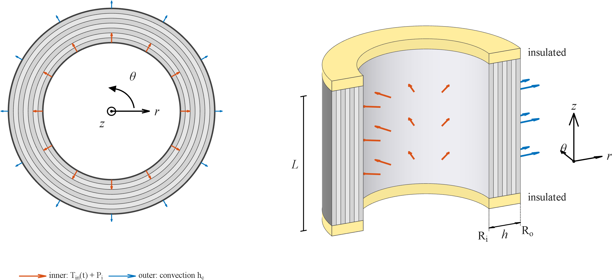{width=100%}

### 2.2 Effective properties of the GPL-reinforced layers

The Young modulus of the layer $e$ ($e = 1, \dots, N_L$, numbered from the inner layer) follows the Halpin–Tsai model for randomly oriented platelets [13, 14, 70, 81]:

$$E_s^{(e)} = \tfrac{3}{8}E_L^{(e)} + \tfrac{5}{8}E_T^{(e)}, \qquad E_j^{(e)} = \frac{1+\xi_j\eta_j V_{GPL}^{(e)}}{1-\eta_j V_{GPL}^{(e)}}\,E_m, \quad j = L, T \qquad (1)$$

$$\xi_L = \frac{2a_{GPL}}{t_{GPL}}, \quad \xi_T = \frac{2b_{GPL}}{t_{GPL}}, \quad \eta_j = \frac{E_{GPL}/E_m - 1}{E_{GPL}/E_m + \xi_j} \qquad (2)$$

where $a_{GPL}$, $b_{GPL}$ and $t_{GPL}$ are the length, width and thickness of a platelet and $E_{GPL}$, $E_m$ the moduli of platelet and matrix. The volume fraction follows from the weight fraction $W_{GPL}^{(e)}$ [17]:

$$V_{GPL}^{(e)} = \frac{W_{GPL}^{(e)}}{W_{GPL}^{(e)} + \left(\rho_{GPL}/\rho_m\right)\left(1 - W_{GPL}^{(e)}\right)} \qquad (3)$$

Poisson's ratio, density, specific heat and thermal expansion coefficient follow the rule of mixtures [15, 70, 73], $P_s^{(e)} = V_{GPL}^{(e)}P_{GPL} + (1 - V_{GPL}^{(e)})P_m$ for $P = \nu, \rho, c, \alpha$ (4). The thermal conductivity is obtained from the percolation-type model of [82, 83]:

$$k_s^{(e)} = \frac{\tfrac{2}{3}\left(V_{GPL}^{(e)} - 1/p\right)^{\gamma}}{H(p) + 1/\left[(k_{GPL}/k_m) - 1\right]}\,k_m + k_m \quad \left(V_{GPL}^{(e)} > 1/p\right), \qquad k_s^{(e)} = k_m \quad \left(V_{GPL}^{(e)} \le 1/p\right) \qquad (5)$$

$$p = \frac{a_{GPL}}{t_{GPL}}, \qquad H(p) = \frac{p\,\ln\left(p + \sqrt{p^2-1}\right)}{\left(p^2-1\right)^{3/2}} - \frac{1}{p^2-1}, \qquad \gamma = \tfrac12 \qquad (6)$$

The conductive network forms only when the platelet volume fraction exceeds $1/p$; below this threshold the conductivity is that of the matrix. This threshold governs the response to the platelet aspect ratio and to small weight fractions (Sect. 7.4).

### 2.3 Porosity

The pores are taken into account by open-cell theory [2, 14, 15, 23, 74]. With the mass factor $P_m^{(e)}$ (the ratio of the layer density to the density of the solid, $P_m = 1$ meaning no pores), the modulus follows $E/E_s = (\rho/\rho_s)^2$, and the effective properties are

$$E^{(e)} = E_s^{(e)}P_E^{(e)}, \quad k^{(e)} = k_s^{(e)}P_E^{(e)}, \quad c^{(e)} = c_s^{(e)}P_E^{(e)}, \quad \rho^{(e)} = \rho_s^{(e)}P_m^{(e)}, \quad P_E^{(e)} = \left(P_m^{(e)}\right)^2 \qquad (7)$$

while $\nu$ and $\alpha$ are unaffected by the pores [14, 16, 17]. Let $\zeta^{(e)} = \left(r_m^{(e)} - (R_i+R_o)/2\right)/h \in [-\tfrac12, \tfrac12]$ be the centred coordinate of the mid-radius $r_m^{(e)} = R_i + h/(2N_L) + (e-1)h/N_L$ of layer $e$. The five porosity patterns are

$$P_m = \begin{cases} e_{m3} & \text{UD}\\ 1 - e_{m1}\cos(\pi\zeta) & \text{O}\\ 1 - e_{m2}\left[1-\cos(\pi\zeta)\right] & \text{X}\\ 2e_{m4}\cos\left(\tfrac{\pi\zeta}{2}-\tfrac{\pi}{4}\right) & \text{V}\\ 2e_{m4}\cos\left(\tfrac{\pi\zeta}{2}+\tfrac{\pi}{4}\right) & \Lambda \end{cases} \qquad (8)$$

with $P_m$ bounded to $[0, 1]$. All patterns carry the same total mass, i.e. $\int_{-1/2}^{1/2}P_m\,d\zeta = e_{m3}$, which fixes the coefficients in terms of the single input $e_{m3}$:

$$e_{m1} = \tfrac{\pi}{2}(1-e_{m3}), \qquad e_{m2} = \frac{1-e_{m3}}{1-2/\pi}, \qquad e_{m4} = \tfrac{\pi}{4}e_{m3} \qquad (9)$$

### 2.4 Distribution patterns

For $N_L$ layers the GPL weight fraction of layer $e$ is [5, 70, 84]

$$W_{GPL}^{(e)} = W_{GPL}\times\begin{cases} 1 & \text{UD}\\ 4\left[(N_L+1)/2 - |e-(N_L+1)/2|\right]/(N_L+2) & \text{O}\\ 4\left[1/2 + |e-(N_L+1)/2|\right]/(N_L+2) & \text{X}\\ 2(N_L+1-e)/(N_L+1) & \text{V}\\ 2e/(N_L+1) & \Lambda \end{cases} \qquad (10)$$

so that the platelet content of pattern O is largest and of pattern X smallest at mid-thickness, and the mean weight fraction of all patterns is within 2 % of $W_{GPL}$. In pattern V the platelet content *decreases* from the inner to the outer layer, and pattern Λ is its mirror image. For the reference $N_L = 7$ and $e_{m3} = 0.8604$, Table 1 lists the resulting layer factors. Note that the pore-content pattern V puts the pores in the *inner* layers (smallest $P_m$) and pattern Λ in the *outer* layers.

**Table 1.** Layer factors for $N_L = 7$, layer 1 = inner. Upper block: $W_{GPL}^{(e)}/W_{GPL}$ from Eq. (10). Lower block: mass factor $P_m^{(e)}$ from Eqs. (8)–(9) with $e_{m3} = 0.8604$ (values marked * are the clipped ones; the raw expression exceeds 1 there).

| pattern | e = 1 | 2 | 3 | 4 | 5 | 6 | 7 |
|---|---|---|---|---|---|---|---|
| GPL UD | 1.000 | 1.000 | 1.000 | 1.000 | 1.000 | 1.000 | 1.000 |
| GPL O | 0.444 | 0.889 | 1.333 | 1.778 | 1.333 | 0.889 | 0.444 |
| GPL X | 1.556 | 1.111 | 0.667 | 0.222 | 0.667 | 1.111 | 1.556 |
| GPL V | 1.750 | 1.500 | 1.250 | 1.000 | 0.750 | 0.500 | 0.250 |
| GPL Λ | 0.250 | 0.500 | 0.750 | 1.000 | 1.250 | 1.500 | 1.750 |
| pores UD | 0.860 | 0.860 | 0.860 | 0.860 | 0.860 | 0.860 | 0.860 |
| pores O | 0.951 | 0.863 | 0.802 | 0.781 | 0.802 | 0.863 | 0.951 |
| pores X | 0.701 | 0.855 | 0.962 | 1.000 | 0.962 | 0.855 | 0.701 |
| pores V | 0.151 | 0.446 | 0.719 | 0.956 | 1.000* | 1.000* | 1.000* |
| pores Λ | 1.000* | 1.000* | 1.000* | 0.956 | 0.719 | 0.446 | 0.151 |

---

## 3. Governing equations

### 3.1 Kinematics, constitutive law and motion

For axisymmetric deformation the strains of layer $e$ are $\varepsilon_{rr} = \partial u/\partial r$, $\varepsilon_{\theta\theta} = u/r$, $\varepsilon_{zz} = \partial w/\partial z$ and $\gamma_{rz} = \partial u/\partial z + \partial w/\partial r$ [30, 32, 47]. With the thermal strain $\varepsilon_T = \alpha\,\Delta T$, $\Delta T = T - T_0$, the stress–strain relation is [13, 33, 64]

$$\begin{Bmatrix}\sigma_{rr}\\\sigma_{\theta\theta}\\\sigma_{zz}\\\tau_{rz}\end{Bmatrix} = \begin{bmatrix}C_{11}&C_{12}&C_{13}&0\\C_{12}&C_{22}&C_{23}&0\\C_{13}&C_{23}&C_{33}&0\\0&0&0&C_{55}\end{bmatrix}\begin{Bmatrix}\varepsilon_{rr}-\varepsilon_T\\\varepsilon_{\theta\theta}-\varepsilon_T\\\varepsilon_{zz}-\varepsilon_T\\\gamma_{rz}\end{Bmatrix} \qquad (11)$$

$$C_{11} = C_{22} = C_{33} = \frac{(1-\nu)E}{(1+\nu)(1-2\nu)}, \quad C_{12} = C_{13} = C_{23} = \frac{\nu E}{(1+\nu)(1-2\nu)}, \quad C_{55} = \frac{E}{2(1+\nu)} \qquad (12)$$

with $E$, $\nu$ the effective values of the layer. The equations of motion are [3, 13, 50]

$$\frac{\partial\sigma_{rr}}{\partial r} + \frac{\partial\tau_{rz}}{\partial z} + \frac{\sigma_{rr}-\sigma_{\theta\theta}}{r} = \rho\frac{\partial^2u}{\partial t^2}, \qquad \frac{\partial\tau_{rz}}{\partial r} + \frac{\partial\sigma_{zz}}{\partial z} + \frac{\tau_{rz}}{r} = \rho\frac{\partial^2w}{\partial t^2} \qquad (13)$$

and are used in displacement form by substituting Eqs. (11) and (12).

### 3.2 Lord–Shulman energy equation

The LS theory replaces Fourier's law by the Cattaneo–Vernotte law $\mathbf{q} + \tau_0\dot{\mathbf{q}} = -k\nabla T$ [55–57]. With it the energy balance of layer $e$ becomes [60, 65, 72]

$$\frac{1}{r}\frac{\partial}{\partial r}\left(rk\frac{\partial T}{\partial r}\right) + \frac{\partial}{\partial z}\left(k\frac{\partial T}{\partial z}\right) = \rho c\left(\frac{\partial T}{\partial t} + \tau_0\frac{\partial^2T}{\partial t^2}\right) + \alpha(3\lambda+2\mu)T_0\left(\frac{\partial}{\partial t}+\tau_0\frac{\partial^2}{\partial t^2}\right)\left(\frac{\partial u}{\partial r}+\frac{u}{r}+\frac{\partial w}{\partial z}\right) \qquad (14)$$

where $\lambda = \nu E/[(1+\nu)(1-2\nu)]$ and $\mu = E/[2(1+\nu)]$ are the Lamé constants and $\tau_0$ is the relaxation time. The last term couples the temperature to the dilatation rate; $\tau_0 = 0$ gives the classical coupled theory [64] and dropping the last term gives the uncoupled theory. The wave speed of the thermal disturbance is $C = \sqrt{\hat\alpha/\tau_0}$ with $\hat\alpha = k/(\rho c)$.

### 3.3 Boundary, interface and initial conditions

*Thermal.* The ends are insulated, $\partial T/\partial z = 0$ at $z = 0, L$. The inner surface follows $T(R_i, z, t) = T_0 + (T_{in} - T_0)(1 - e^{-t/t_0})$ and the outer surface convects, $-k\,\partial T/\partial r = h_c(T - T_\infty)$ at $r = R_o$ [70, 73]. Temperature and heat flux are continuous at the layer interfaces:

$$T^{(e)} = T^{(e+1)}, \qquad k^{(e)}\frac{\partial T^{(e)}}{\partial r} = k^{(e+1)}\frac{\partial T^{(e+1)}}{\partial r} \quad \text{at } r = R_o^{(e)}, \; e = 1, \dots, N_L - 1 \qquad (15)$$

*Mechanical.* The inner surface carries $\sigma_{rr} = -P_i$ ($t > 0$) and $\tau_{rz} = 0$; the outer surface is free, $\sigma_{rr} = \tau_{rz} = 0$. At each end either simple support ($u = 0$, $\sigma_{zz} = 0$) or clamping ($u = w = 0$) is imposed, with $\tau_{rz} = 0$ for the simple support [47, 70, 73]. At the interfaces the displacements $u$, $w$ and the tractions $\sigma_{rr}$, $\tau_{rz}$ are continuous. The initial conditions are $T = T_0$, $u = w = 0$, $\dot T = \dot u = \dot w = 0$ at $t = 0$.

---

## 4. Numerical solution

### 4.1 Layerwise differential quadrature

In DQM the $n$-th derivative of a function at a node is a weighted sum of the function values at all $N$ nodes of the line [13, 48, 54],

$$\left.\frac{\partial^nf}{\partial x^n}\right|_{x_i} = \sum_{j=1}^{N}A_{ij}^{(n)}f_j \qquad (16)$$

where the first-order weights come from Lagrange interpolation,

$$A_{ij} = \frac{1}{x_j - x_i}\prod_{k\ne i,j}\frac{x_i - x_k}{x_j - x_k}\ (i\ne j), \qquad A_{ii} = -\sum_{j\ne i}A_{ij} \qquad (17)$$

and higher-order weights follow by matrix multiplication. Every layer carries its own set of $N_r$ Chebyshev–Gauss–Lobatto nodes in the radial direction, and $N_z$ Chebyshev nodes are shared in the axial direction [47, 52]. The equations of motion (13) and the energy equation (14) are written at the interior nodes; boundary and interface conditions are written at the boundary nodes of the layers as algebraic constraint rows, so the discrete unknown vector collects $[\theta, u, w]$ at all nodes.

### 4.2 Time integration

The semi-discrete system reads

$$\mathbf{M}\ddot{\mathbf{D}} + \mathbf{C}\dot{\mathbf{D}} + \mathbf{K}\mathbf{D} = \mathbf{f}(t) \qquad (18)$$

with zero mass and damping entries in the constraint rows, so it is differential-algebraic. With the Newmark scheme [85] ($\gamma = 1/2$, $\beta = 1/4$, i.e. constant average acceleration; second-order accurate, unconditionally stable for linear systems, no numerical damping),

$$\mathbf{D}_{n+1} = \mathbf{D}_n + \Delta t\,\dot{\mathbf{D}}_n + \tfrac{\Delta t^2}{2}\left[(1-2\beta)\ddot{\mathbf{D}}_n + 2\beta\ddot{\mathbf{D}}_{n+1}\right], \quad \dot{\mathbf{D}}_{n+1} = \dot{\mathbf{D}}_n + \Delta t\left[(1-\gamma)\ddot{\mathbf{D}}_n + \gamma\ddot{\mathbf{D}}_{n+1}\right] \qquad (19)$$

and Eq. (18) at $t_{n+1}$ reduces to $\mathbf{K}_{eff}\mathbf{D}_{n+1} = \mathbf{f}_{n+1} + \mathbf{M}(a_0\mathbf{D}_n + a_2\dot{\mathbf{D}}_n + a_3\ddot{\mathbf{D}}_n) + \mathbf{C}(a_1\mathbf{D}_n + a_4\dot{\mathbf{D}}_n + a_5\ddot{\mathbf{D}}_n)$ with $\mathbf{K}_{eff} = \mathbf{K} + a_0\mathbf{M} + a_1\mathbf{C}$ and $a_0 = 1/(\beta\Delta t^2)$, $a_1 = \gamma/(\beta\Delta t)$, $a_2 = 1/(\beta\Delta t)$, $a_3 = 1/(2\beta) - 1$, $a_4 = \gamma/\beta - 1$, $a_5 = \tfrac{\Delta t}{2}(\gamma/\beta - 2)$ (20). For a fixed time step $\mathbf{K}_{eff}$ is constant, so it is factorised once before the time loop. The thermal, mechanical and constraint rows differ in scale by many orders of magnitude; each row is therefore equilibrated by its largest coefficient before the factorisation, which reduces the condition number of the effective matrix by several orders of magnitude.

---

## 5. Reference problem and dimensionless quantities

The reference cylinder has $R_i = 1$ m, $R_o = 1.5$ m (radius ratio 1.5, $h = 0.5$ m), $L = 2.1$ m and $N_L = 7$; GPL weight fraction $W_{GPL} = 0.3\,\%$ with uniform distribution and uniform porosity $e_{m3} = 0.8604$; $T_0 = T_\infty = 300$ K, $T_{in} = 600$ K, $t_0 = 2$ s, $P_i = 50$ MPa, $h_c = 10$ W/m²K, simply supported ends, and dimensionless relaxation time $\tau^* = 0.15$. The discretisation is $N_r = 11$, $N_z = 13$ and $\Delta t = 1$ s up to 3000 s. The matrix is epoxy and the reinforcement GPL, with the properties of Table 2 [70, 73].

**Table 2.** Material and geometric data of epoxy and GPL.

| | Epoxy | GPL |
|---|---|---|
| $E$ (GPa) | 3 | 1010 |
| $\nu$ | 0.34 | 0.168 |
| $\rho$ (kg/m³) | 1200 | 1062.5 |
| $c$ (J/kg K) | 1110 | 644 |
| $\alpha$ (1/K) | $60\times10^{-6}$ | $5\times10^{-6}$ |
| $k$ (W/m K) | 0.246 | 3000 |
| $a_{GPL}$, $b_{GPL}$, $t_{GPL}$ (m) | – | $2.5\times10^{-6}$, $1.5\times10^{-6}$, $1.5\times10^{-9}$ |

Results are given in dimensionless form with the wall thickness as length scale:

$$T^* = \frac{T-T_\infty}{T_\infty}, \quad \xi = \frac{r-R_i}{h}, \quad Fo = \frac{\hat\alpha t}{h^2}, \quad \tau^* = \frac{\hat\alpha\tau_0}{h^2}, \quad \Sigma_{ii} = \frac{1+\nu}{E\alpha T_\infty}\sigma_{ii}, \quad U^* = \frac{u}{(1-\nu)\alpha T_\infty h} \qquad (21)$$

where $\hat\alpha = k/(\rho c)$ is the thermal diffusivity of the reference material ($\hat\alpha = 8.97\times10^{-5}$ m²/s, so $\tau^* = 0.15$ corresponds to $\tau_0 \approx 418$ s). Since the inner surface is raised to twice the ambient temperature, the boundary is at $T^* = 1$ and any temperature above 1 inside the wall is a genuine overshoot produced by the thermal wave. Unless stated otherwise, "mid-point" means the mid-thickness point of the mid-length section, and the stresses are those of the mid-length section at the final time.

---

## 6. Verification and convergence

### 6.1 Convergence

Convergence is checked separately in each parameter against the finest mesh, with the hoop stress as criterion (Fig. 2). In the radial direction the inner hoop stress changes by about 0.09 % between 7 and 15 nodes per layer and the mid-plane error stays below 0.29 %. The axial direction is the demanding one: with five axial nodes the inner hoop stress has a 9.4 % error, it is within about 1 % from nine nodes on, and the mid-plane error is 0.16 % at eleven. The number of layers has almost no influence from three layers on (inner hoop stress change < 0.05 %, error < 0.26 %), more layers only refine the stepwise hoop-stress pattern at the interfaces. The time-step error is 0.17 % at $\Delta t = 1$ s and 0.25 % at 2 s, but a spurious 3 % jump of the peak temperature appears at $\Delta t = 5$ s. The adopted mesh ($N_r = 11$, $N_z = 13$, $N_L = 7$, $\Delta t = 1$ s) therefore computes the field quantities to better than 0.3 %.

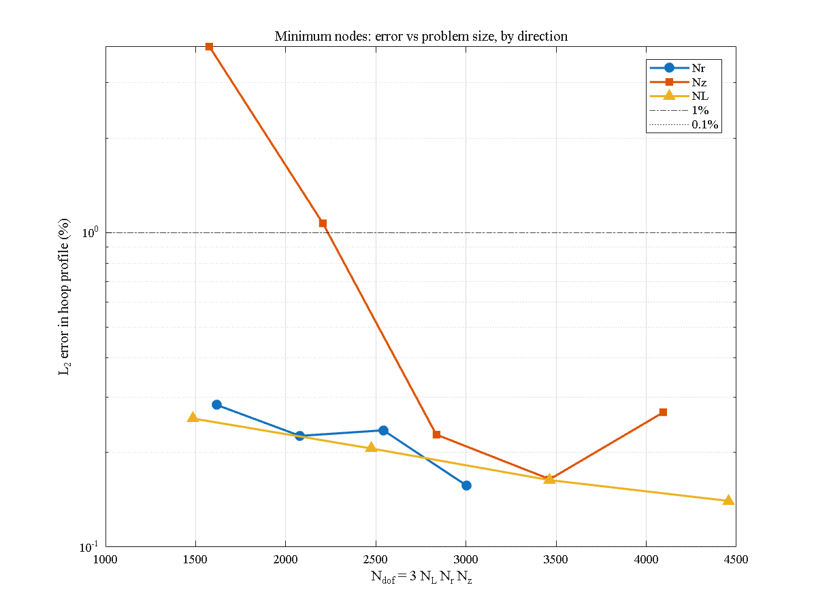{width=100%}

### 6.2 Verification

The present solver was verified in four independent tests. (i) Its static assembly was compared with an independent verified static solver; the maximum displacement difference is of the order of $2\times10^{-11}$. (ii) The dynamic mechanical response of a thick cylinder under internal pressure was compared with Malekzadeh et al. [49], including the finite-element (ANSYS) results reported there; the dimensionless radial displacement agrees within 0.1–0.2 % and the dimensionless radial stress at the inner surface equals minus the applied pressure. (iii) The transient heat conduction was compared with the exact Bessel-series solution, with a relative error of $10^{-5}$–$10^{-6}$. (iv) The Newmark integration was compared with the adaptive stiff solver `ode15s` [86]; the maximum temperature difference over the whole interval is 0.003 K. Together the tests cover static and dynamic cases, and coupled and uncoupled operation.

In a fifth test, an exact Fourier–Bessel eigenfunction solution of the LS wave in a hollow cylinder was derived for the geometry of the solver (with the coupling term switched off, constant properties and axially uniform heating). Its steady limit is satisfied to $1.9\times10^{-16}$ of the temperature step, the field ahead of the wave front vanishes to $4\times10^{-6}$ and the front-jump ratios follow the analytic ray law to 0.16 %. Against this reference the solver has a maximum pointwise error of 0.32 % and an $L_2$ error of 0.065 % of the temperature step, falling monotonically with mesh refinement. The small oscillations that trail the sharp front are therefore a Gibbs-type artefact of the spectral discretisation, not an instability, and they are left unfiltered in all results.

---

## 7. Results and discussion

### 7.1 GPL distribution pattern

Fig. 3 compares the five GPL patterns on the uniform-porosity background. The maximum mid-point temperature is 0.926, 0.867, 0.841, 0.661 and 0.982 for UD, O, X, V and Λ, respectively. Pattern V, in which the platelets are concentrated near the inner surface, is the most favourable and pattern Λ the least, and the two are mirror images with opposite behaviour. The conductive inner region of pattern V spreads the incoming heat quickly through the thickness, so that its peak temperature is about one third lower than that of pattern Λ; placing the stiff, conductive phase where the temperature gradient is steepest both softens the thermal gradient and strengthens the zone in which the hoop stress is critical. Pattern Λ, in contrast, has a poorly conducting region at the inner surface that traps the heat in the inner layers and gives the highest maximum. The inner hoop stress follows the same order: 0.486 for V, about three times smaller than for UD (1.526) and about five times smaller than for Λ; the maximum radial displacement increases from 8.26 for V to 9.08 for Λ. Pattern V therefore gives the lowest temperature, hoop stress and displacement at the same time, and Λ the highest in all three.

Two features are common to all hoop-stress profiles and temperature profiles. The hoop stress is discontinuous at the layer interfaces where the stiffness changes, so the graded patterns show a step profile and the UD pattern a smooth one; the steps become finer with more layers. The temperature profile shows a small local peak near $\xi \approx 0.75$ in all cases: it is the position of the LS thermal wave front, it moves with the relaxation time and with time, it vanishes in the Fourier limit, and it does not grow with time and decreases with mesh refinement (Sect. 6.2). A partial reflection at every interface that the front crosses produces the small notches in the inner layers.

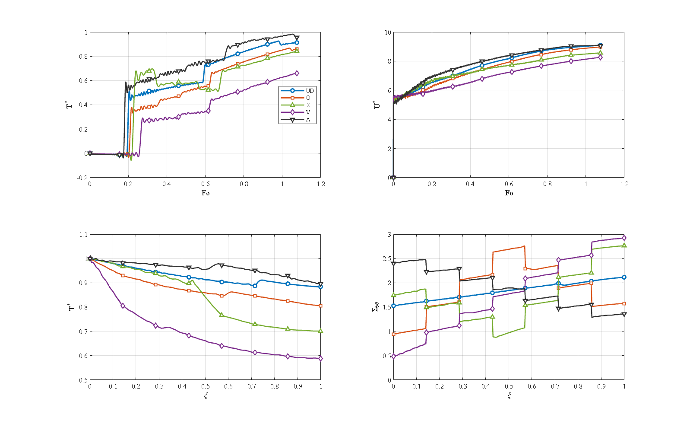{width=100%}

### 7.2 Porosity pattern and level

Fig. 4 shows the porosity patterns on a uniform-GPL background. The pores act as a local thermal resistance and rearrange the heat path. The symmetric patterns UD, O and X give maximum mid-point temperatures of 0.926, 0.927 and 0.867. The two asymmetric patterns are mirror images with opposite response. In pattern V the pores are concentrated near the hotter inner surface; this insulating region traps the incoming heat close to the inner surface and prevents its quick spreading through the thickness, so that the mid-point temperature history shows a pronounced transient maximum, 1.109 (above the inner-surface value), settling at 1.002 at the end of the interval. In pattern Λ the pores are concentrated at the cooler outer surface; instead of trapping the heat in the inner region, they block its way towards the environment and act as a thermal barrier: the outer-surface temperature never exceeds 0.107 and the mid-point maximum remains 0.128.

The thermal benefit of pattern Λ has a mechanical price. Because the heat never penetrates the wall, the thermal expansion is suppressed and the unusual temperature distribution reverses the sign of the inner hoop stress to $-0.359$ (compressive), whereas it is tensile in all other cases. This sign change must be taken into account in the design of cylinders loaded by an internal thermal shock.

The overall porosity level has a milder effect (Fig. 5): increasing the pore content ($e_{m3} = 0.9675$, 0.8604, 0.7776) lowers conductivity and stiffness, so the mid-point maximum increases slowly from 0.905 to 0.926 and 0.942, while the maximum radial displacement increases more strongly, from 7.87 to 9.10 and 10.37, because the wall is softer.

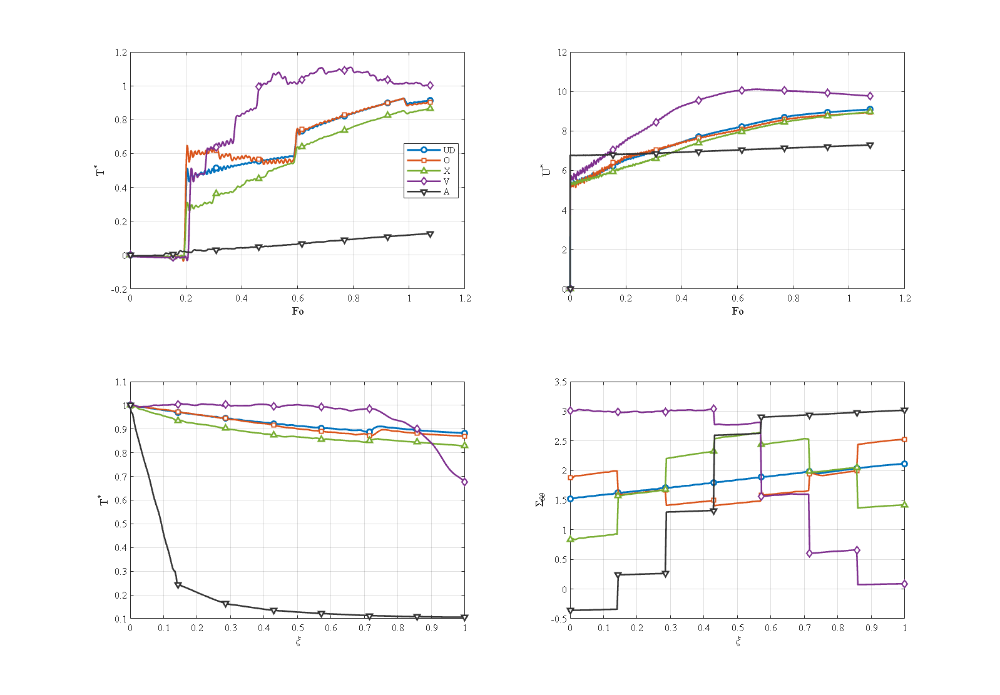{width=100%}

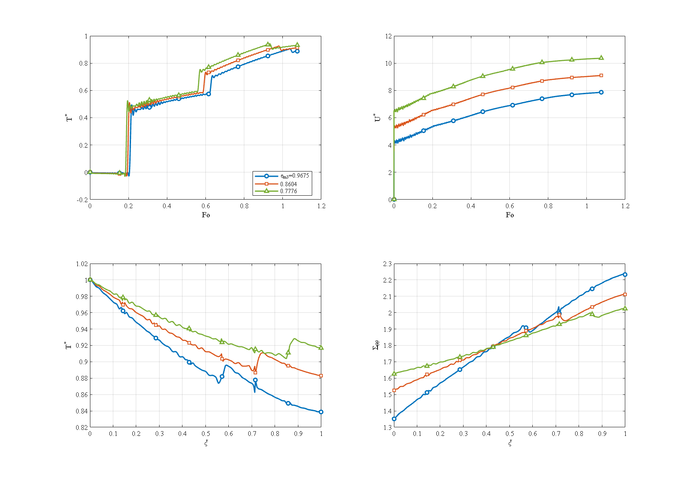{width=100%}

### 7.3 Interaction of the GPL and porosity patterns

All twenty-five pairings were computed (Figs. 6 and 7). Four results stand out.

**The porosity pattern Λ is a universal thermal barrier.** Along the pattern-Λ porosity column the dimensionless outer-surface temperature is 0.107, 0.064, 0.116, 0.034 and 0.134 for GPL patterns UD, O, X, V and Λ, all far below the uniform–uniform value of 0.883, whatever the platelets do. The inner hoop stress along the same column is compressive in all five cases (−0.359, −0.372, −0.343, −0.378, −0.328) against +1.526 for the reference. The porosity grading therefore sets the thermal level, and the GPL grading decides where inside that much lower band the design lies.

**The relative arrangement of the two gradings governs the response.** The best pairing is GPL V with porosity Λ: the outer-surface temperature is the global minimum of 0.034 (26 times lower than 0.883) at a mildly compressive inner hoop stress of −0.378. In this pairing the conductive platelets face the heat source and the insulating pores face the environment, and the two mechanisms add. Pairing the same GPL V with porosity V concentrates both gradings near the inner surface; they weaken each other and the outer-surface temperature returns to 0.692. The worst thermal cases are GPL Λ (conductive platelets at the outer surface) with the symmetric or uniform porosities, up to 0.896. It is thus not the individual pattern but the relative alignment of the two that matters.

**Temperature-only screening is unsafe.** The highest hoop stress of all twenty-five pairings occurs for GPL X with porosity V, i.e. a stiff platelet pattern meeting pores concentrated at the inner surface, and not in the hottest case: the maximum is 4.20, about twice the reference value of 2.11, while the temperature is only moderate. Ranking the combinations on temperature alone would pass this case.

**The GPL ranking is the same on every porosity background.** On each of the five porosity backgrounds (Figs. 8–12) the outer-surface temperature is lowest for GPL V, followed by O, UD and X, and highest for GPL Λ; what changes from one background to the next is the spread among the five curves. Against the uniform porosity or pattern V (pores inside) the curves stay close together, because these porosity distributions put little obstacle in the way of the outward heat flux and the choice of the platelet pattern matters least. Against pattern Λ (pores outside) the spread is wide and the benefit of GPL V is largest, because the outer porosity barrier and the platelet-rich inner layer reinforce each other. The hoop-stress profiles follow the same logic: the mildest interface steps belong to the GPL V backgrounds, where the stiffer, conductive phase sits exactly where the temperature gradient is largest, and the sharpest steps to the porosity V background, which piles both the thermal load and the soft, highly porous material at the hot inner surface. The two gradings therefore act through almost independent channels: the GPL pattern sets how fast the heat is conducted through the wall, and the porosity pattern sets how much of it is stopped near the outer wall.

Fig. 13 collects the corners of the achievable envelope together with the uniform reference. The pairings GPL V–porosity Λ and GPL O–porosity Λ minimise both the outer-surface temperature and the inner hoop stress and are the natural choices when thermal protection is the goal and a slightly larger radial displacement is acceptable; the worst thermal case is GPL Λ with uniform porosity, and the worst mechanical case GPL X with porosity V. The uniform–uniform reference is thermally ordinary but has the lowest peak stress, a safe but unambitious baseline. The design recommendation of this study for internal thermal shock is therefore: *combine the gradings so that the conductive phase faces the heat source and the insulating phase faces the environment (platelet pattern V or O with porosity pattern Λ), and avoid pairing a stiff platelet pattern (X) with a porosity grading that makes the heated inner wall soft and porous (V)*.

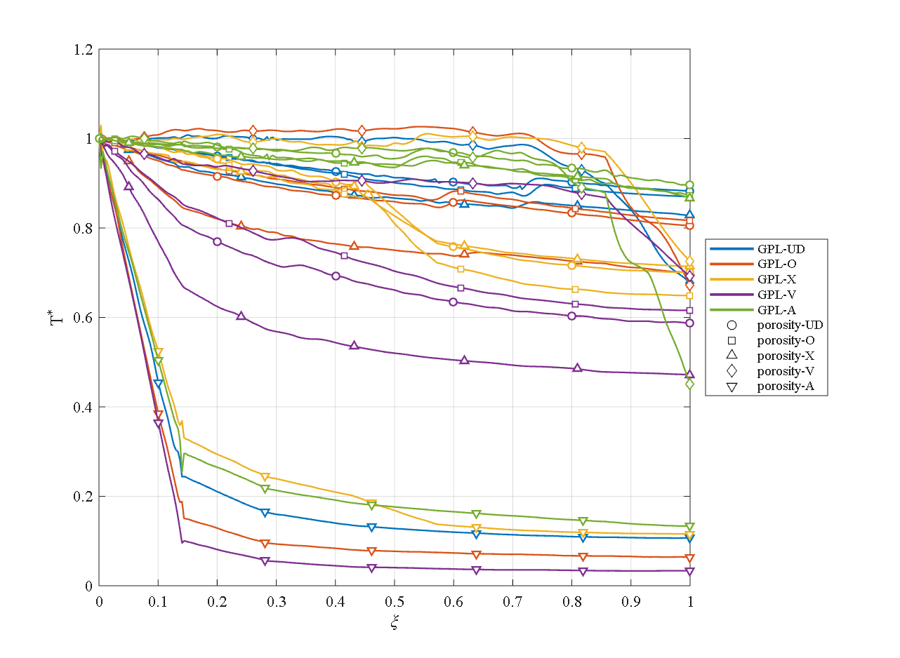{width=100%}

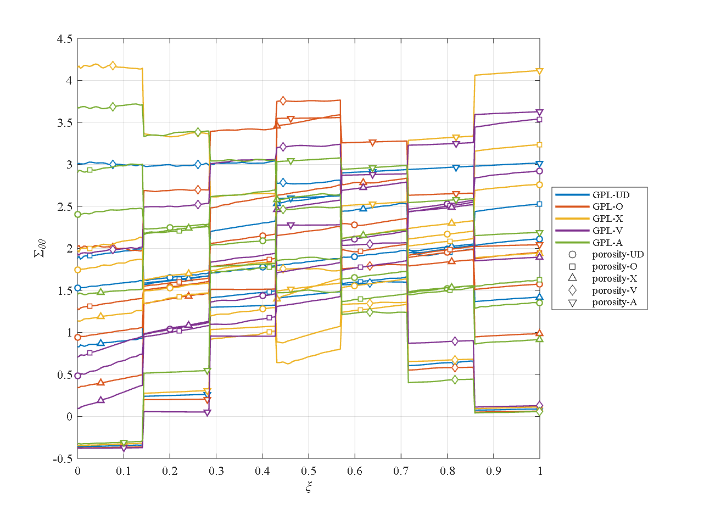{width=100%}

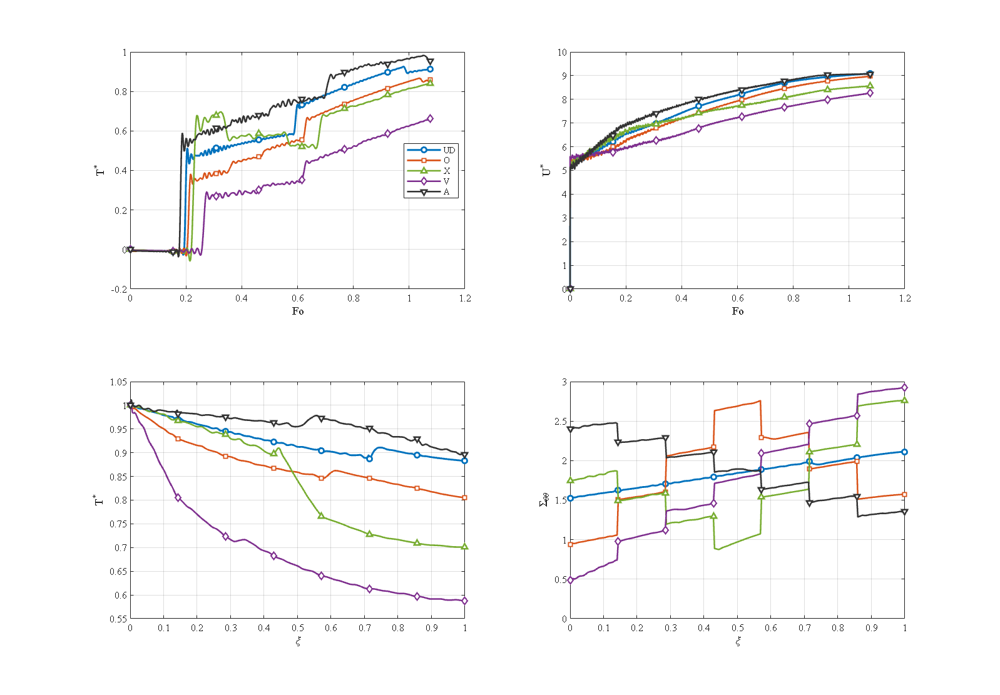{width=100%}

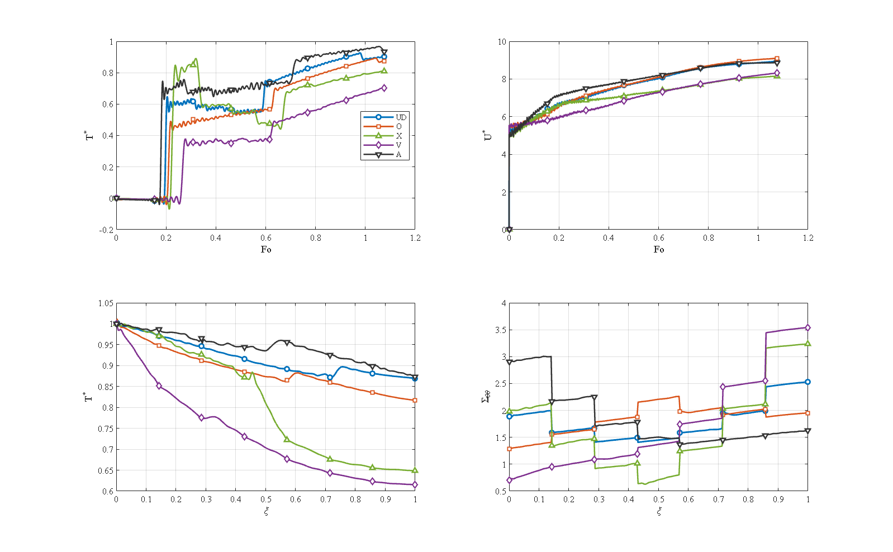{width=100%}

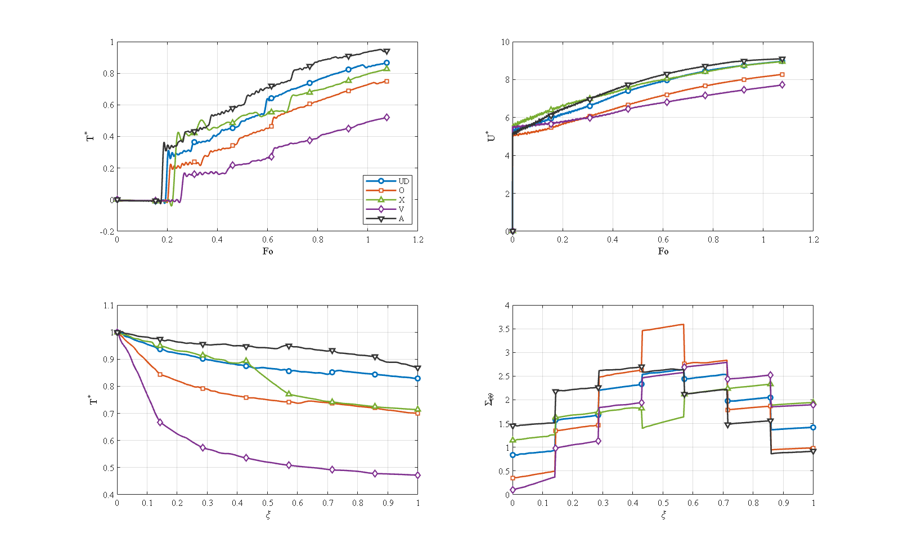{width=100%}

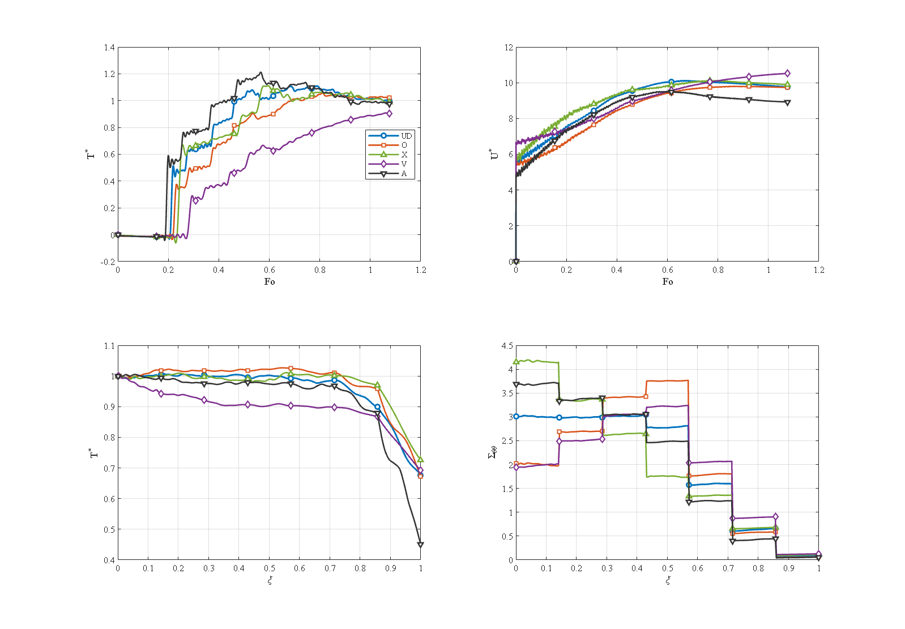{width=100%}

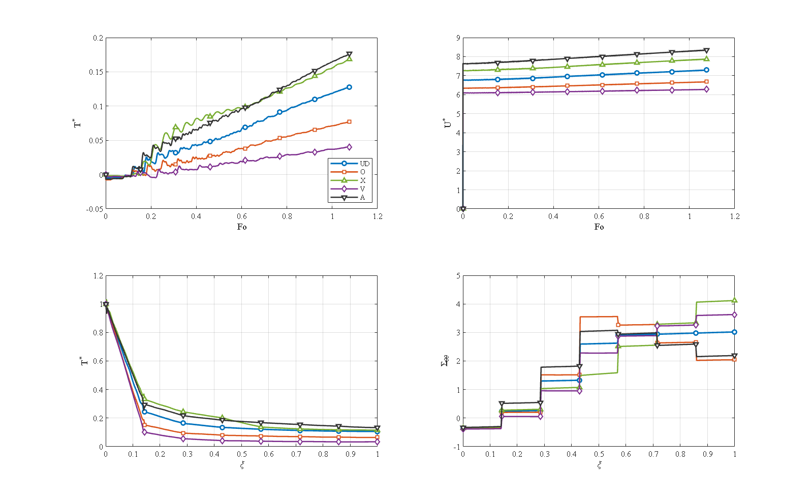{width=100%}

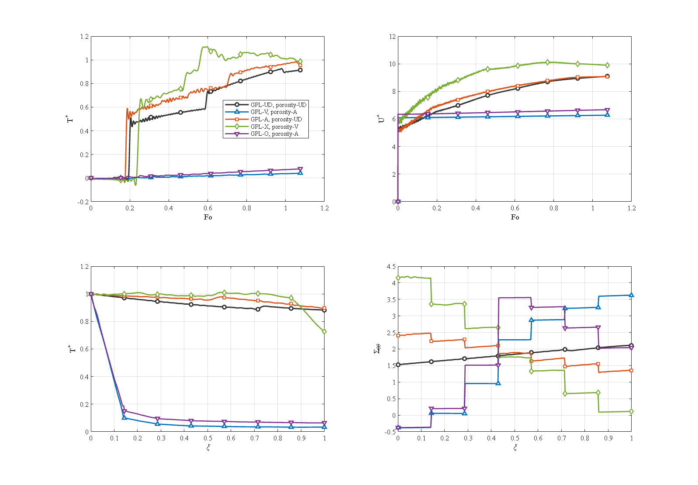{width=100%}

### 7.4 GPL weight fraction and aspect ratios

The platelet weight fraction is the strongest material lever (Fig. 14). At the smallest fraction (0.1 %) the thermal diffusivity is low, the wave penetrates weakly, and the outer-surface temperature reaches only 0.484 and the mid-point maximum 0.631. With increasing weight fraction the diffusivity grows, and at 0.9 % the outer-surface temperature reaches practically 1, i.e. the thermal wave crosses the whole wall. Because the platelets also stiffen the wall, the maximum radial displacement decreases.

The two aspect ratios act differently. Increasing the length-to-width ratio from 0.1 to 10 raises the maximum mid-point temperature only from 0.898 to 0.951, most of it in the first step; from a ratio of 4 on the curves coincide. The width-to-thickness ratio, on the other hand, is a threshold quantity: by Eq. (5) the conductive network exists only if $V_{GPL} > 1/p$. For the reference weight fraction of 0.3 % ($V_{GPL} = 0.003387$) this requires a ratio larger than about 177. Below it the effective conductivity returns to that of the porous matrix without graphene, no heat reaches the mid-point within the interval, and the inner hoop stress is essentially the compressive pressure response. The stiffness, however, still varies continuously with the ratio. At the reference weight fraction the model therefore behaves as a switch, and adding graphene creates no heat path before the network has formed.

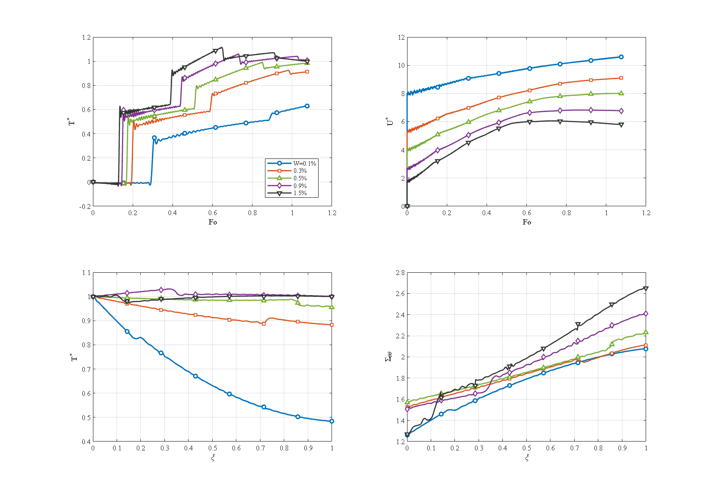{width=100%}

### 7.5 Supports, pressure, length, thickness and convection

*Supports.* The temperature field is practically independent of the end conditions, since the mechanical support does not act directly on the thermal problem. The mechanical response depends strongly on them: with simple support at both ends (S–S), simple/clamped (S–C) and clamped at both ends (C–C), the dimensionless inner hoop stress is 1.526, 1.068 and 0.424, the maximum hoop stress 2.112, 1.803 and 1.535, while the maximum radial displacement changes only from 9.10 to 8.27 because the mid-section of this rather long cylinder is little affected by the ends. The disturbance of a support decays within about one wall thickness from the end.

*Pressure.* For $P_i = 0$, 10, 50 and 100 MPa the temperature is independent of the pressure, because the pressure does not drive the temperature, while the stress and displacement grow linearly: the inner hoop stress rises from $-0.387$ to 3.43 and the maximum radial displacement from 3.75 to 14.44 between 0 and 100 MPa. The solution remains smooth and convergent at 100 MPa, consistent with the linear model. At 50 MPa stress and displacement are dominated by the pressure, whereas the temperature stays governed by the thermal load.

*Length.* The mid-point maximum temperature does not depend on the length. As the length grows, the inner hoop stress of the mid-section turns from compressive (a very short cylinder is dominated by its two supports) to tensile and approaches the long-cylinder limit, and the maximum displacement settles at about 8.5.

*Thickness.* For three radius ratios (each time scale non-dimensionalised with its own thickness) the thin wall is crossed by the thermal wave quickly and heats its outer surface, but the small thickness concentrates the thermal strain and gives a stronger mechanical response. The thick wall behaves in the opposite way: in the interval the thermal wave does not cross the wall completely, the outer region stays cold, the displacement is smaller, and the inner hoop stress is compressive because the hot inner region presses against the cold, stiff outer region. The thickness is therefore a geometric lever between a thin but highly stressed wall and a thick, little stressed and strongly compressed one.

*Convection.* Increasing $h_c$ turns the outer surface from nearly adiabatic into an effective heat sink; the outer-surface temperature falls from 0.883 to 0.107, the mid-point maximum from 0.926 to 0.715 and the inner hoop stress from 1.526 to 0.540. The thermal stress is determined by the temperature difference across the wall, not by the absolute temperature level. The response is nearly independent of convection at the smallest coefficient and strongly convection-dominated at the largest, two regimes that must be distinguished in design.

### 7.6 Thermal wave, coupling and impulsive loading

*Relaxation time.* Fig. 15 compares Fourier conduction ($\tau^* = 0$) with $\tau^* = 0.04$ and 0.15. In the Fourier solution the temperature at the mid-point rises smoothly from the start, because the parabolic diffusion has an infinite speed. With a relaxation time the mid-point stays cold for a while and then rises with a sharp jump; the delay and the sharpness of the jump increase with $\tau^*$. The second step in the history is the reflection of the wave front at the boundaries, which has no counterpart in the Fourier solution. The maximum mid-point temperature rises from 0.950 (Fourier) to only 0.962 at the largest relaxation time of this study, but for this value the maximum no longer occurs at the end of the interval, i.e. the wave imposes a transient temperature above the steady one. The relaxation time hardly influences the stress. It controls both the arrival time of the heat and the level of the transient maximum, and even at the reference value, where its effect on the maximum is small, the wave character is clear in the temperature history; this is the main argument for generalized thermoelasticity in short-time analyses. The reference value $\tau^* = 0.15$ corresponds to a relaxation time of several hundred seconds, much larger than values measured for polymer composites; relaxation times of this size are used here as a parameter to expose the structure of the solution, not as a claim about the material. In the realistic small-$\tau^*$ regime the paper's own results indicate that the choice of the theory matters little under slow loading.

*Coupling.* Comparing the fully coupled model with the uncoupled one (without the dilatation-rate term of Eq. (14)) shows that, at the reference conditions, the uncoupled model overestimates the maximum mid-point temperature and the outer-surface temperature by about 1.2 %. In the coupled model part of the thermal energy is continuously converted into mechanical work, a thermoelastic damping of the thermal wave, and the difference between the two models is largest at the wave fronts. The effect is small at the reference relaxation time but grows with it, so the fully coupled system must be solved whenever the wave matters.

*Impulsive loading.* If the ramp is replaced by a thermal pulse at the inner surface, the intrinsic difference between wave-like and diffusive transport appears (Fig. 16). With Fourier conduction the pulse arrives early at the mid-thickness, is spread and weak, and has practically disappeared at the end of the interval. With the LS theory the pulse arrives later, because it travels at a finite speed, about 2.5 times stronger, because it travels as a coherent packet, and leaves persistent oscillations as it reflects in the wall; a sharp second-sound front is visible. For impulsive loading the classical theory therefore underestimates the peak mid-wall temperature by a factor of about 2.5 and consequently the thermal stress of the shock: a design screened with a Fourier model against an impulsive event is non-conservative.

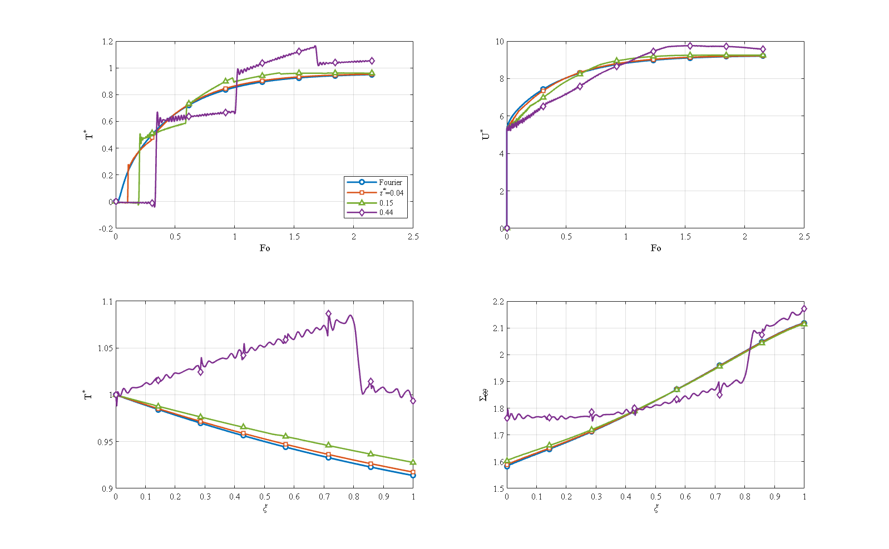{width=100%}

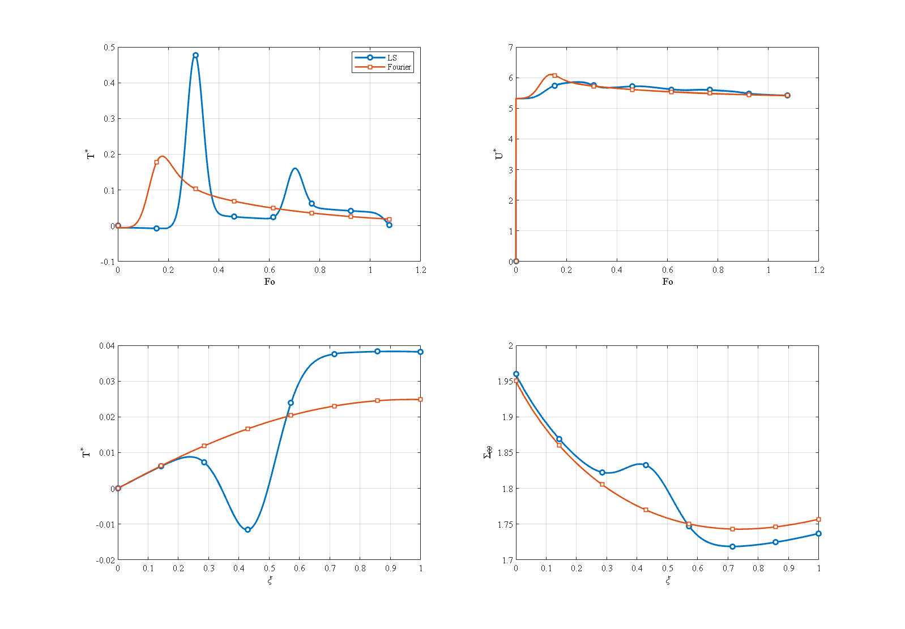{width=100%}

### 7.7 Comparison of generalized thermoelasticity theories

The reference problem was solved with four theories at matched parameters: classical Fourier [64], Lord–Shulman [57], dual-phase-lag [59] and Green–Naghdi type III [58, 66] (Fig. 17). The maximum mid-point temperature increases in the order Fourier (0.950), DPL (0.956), LS (0.962), Green–Naghdi III (1.581). Two observations follow. First, at the reference relaxation time the Fourier, DPL and LS maxima are close, because the wave is weak, and the DPL solution interpolates between the other two as expected. Second, Green–Naghdi III behaves qualitatively differently: it overshoots strongly and early, at $Fo \approx 0.33$, and decays only slowly (0.870 at the end of the interval), because its energy equation has no mechanism to dissipate the thermal wave, so its long-time behaviour differs from the three other theories. A comparison of this kind for GPL-reinforced porous cylinders has, to the authors' knowledge, not been reported before.

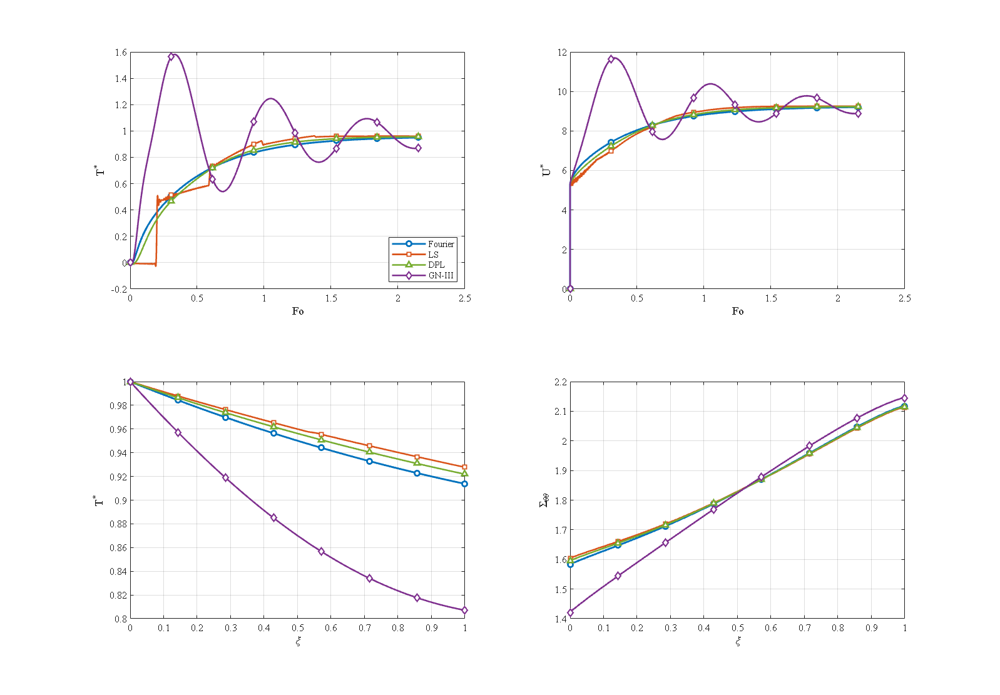{width=100%}

### 7.8 Comparison of numerical methods

*Time integrators.* Six integrators were applied to the same spatial system and the same benchmark (transient conduction with an exact solution, maximum temperature error at 10 s). Table 3 shows that Newmark, Houbolt and HHT-α have practically the same accuracy at equal step; Wilson-θ [87] accepts about five times the error because of its additional numerical dissipation; `ode15s` is about ten times more accurate but eight times more expensive; and the Laplace transform with Durbin inversion [88] is three orders of magnitude slower. The Laplace method cannot be applied to the fully coupled system: its undamped elastic poles lie on the imaginary axis, where the inversion contour samples, so every contour evaluation is a near-singular solve. This also explains why transform methods appear in this literature only for thermal sub-problems. These measurements justify the choice of Newmark for all production runs.

**Table 3.** Time integrators on the same spatial system.

| Method | Maximum error (K) | CPU time (s) |
|---|---|---|
| Newmark ($\gamma = 1/2$, $\beta = 1/4$) | 0.0032 | 0.33 |
| Wilson-θ ($\theta = 1.4$) | 0.0164 | 0.19 |
| Houbolt | 0.0025 | 0.24 |
| HHT-α ($\alpha = -0.1$) | 0.0033 | 0.29 |
| `ode15s` | 0.0003 | 2.57 |
| Laplace–Durbin (thermal part only) | 0.137 | 193 |

*Spatial discretisations.* Differential quadrature (Chebyshev and uniform grids), second-order finite differences and linear and quadratic Galerkin finite elements were compared on the transient conduction problem with the exact Bessel-series solution and the same Newmark march. The number of nodes needed to reach the error floor of the time step is about 9–11 for DQM, about 21 for quadratic finite elements and about 161 for linear finite elements and finite differences (Fig. 18). The linear-FEM and finite-difference curves lie on the reference line of slope $-2$ (second-order convergence); the DQM error falls quasi-exponentially down to the time floor. At equal accuracy the DQM system is thus about fifteen times smaller in each direction, a ratio that is squared in the $(r,z)$ plane; this is why DQM was chosen. Below about 20 nodes DQM with the Chebyshev grid is more accurate than quadratic finite elements; beyond that the quadratic elements are better. DQM also has a usable window rather than a convergence curve: the uniform grid is stable only up to about 30 nodes and diverges beyond, and on the Chebyshev grid the error flattens after about 11 nodes and the solution eventually fails for very many nodes, owing to the ill-conditioning of the weighting matrices. Refining until the answer stops changing is therefore not a safe procedure, but the method's advantage lies in needing few nodes. The result agrees with the convergence study of Sect. 6.1, where a few radial nodes already give three-digit accuracy.

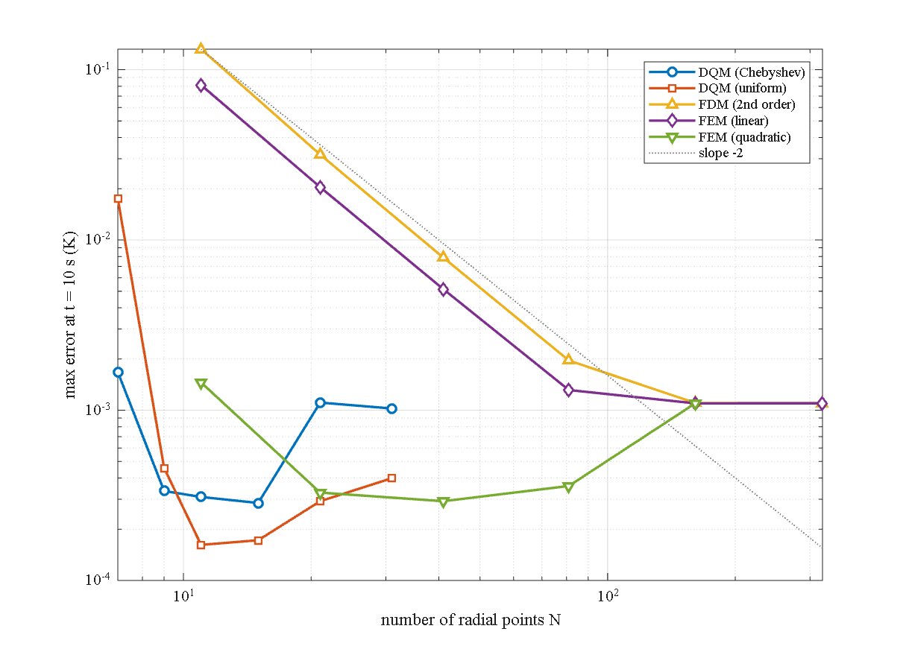{width=85%}

---

## 8. Conclusions

A fully coupled Lord–Shulman thermoelastic model of a multilayer porous GPL-reinforced hollow cylinder has been developed, discretised by layerwise differential quadrature in space and the Newmark method in time, verified against exact and published solutions, and used for a wide parametric study. The main conclusions are:

1. The temperature history shows the pattern of a thermal wave reflected at the boundaries, which has no counterpart in Fourier conduction. Under impulsive loading Fourier conduction underestimates the peak temperature by a factor of about 2.5, so the generalized theory is needed for thermal shock; under slow loading at a mild relaxation time the Fourier, DPL and LS maxima are within about 1.3 % (0.950, 0.956, 0.962). Green–Naghdi type III behaves qualitatively differently (maximum 1.581).
2. The GPL pattern with the platelets concentrated at the inner (hot) surface (V) lowers the peak mid-point temperature by about 29 % (0.661 against 0.926) and the inner hoop stress about three-fold (0.486 against 1.526), so the distribution of the platelets, and not only their amount, matters; its mirror pattern Λ is the worst in temperature, stress and displacement.
3. The porosity pattern with the pores concentrated at the outer surface (Λ) acts as a thermal barrier: the outer-surface temperature falls about eight-fold (0.107 against 0.883), but the inner hoop stress becomes compressive (−0.359), so the temperature benefit comes with a changed stress state.
4. The two gradings interact through their relative alignment. GPL V with porosity Λ (conductive towards the heat source, insulating towards the environment) reduces the outer-surface temperature 26-fold (0.034) at a mildly compressive hoop stress (−0.378); GPL V with porosity V returns it to 0.692. GPL X with porosity V gives the largest hoop stress of the 25 pairings (4.20, about twice the reference), so temperature-only screening is unsafe and the two patterns must be selected jointly on temperature and stress.
5. The platelet weight fraction is the strongest material lever; the effective conductivity has a percolation threshold, so that at 0.3 % weight fraction a platelet width-to-thickness ratio of about 177 is needed for the conductive network to form.
6. End supports and internal pressure do not change the temperature field. Clamping lowers the mid-section inner hoop stress from 1.526 to 0.424; the pressure effect is linear (inner hoop stress from −0.387 to 3.43 between 0 and 100 MPa). A thicker wall is not crossed by the thermal wave in the interval and has a compressive inner hoop stress; convection reduces the stress by reducing the temperature difference across the wall.
7. The fully coupled solution damps the thermal wave by about 1 % (thermoelastic damping), so uncoupled models are non-conservative at the wave fronts.
8. Methodologically, DQM needs about fifteen times fewer nodes per direction than finite differences and linear finite elements, and Newmark integration gives the best accuracy-to-cost ratio of six integrators; the Laplace route is not applicable to the fully coupled system.

**Limitations and future work.** The model is linear elastic without damage or failure criteria, the material properties are independent of temperature although the inner surface is heated from 300 K to 600 K, the layer interfaces are perfectly bonded, the geometry is a right circular cylinder under axisymmetric loading, large relaxation times are used parametrically, and no comparison with experiment is available. Future work should include temperature-dependent properties, radiation at the outer surface, a damage model, stable free and roller end conditions, continuous (non-layerwise) grading, other geometries and loadings, and vibration, buckling and fatigue analyses. A prototype and its experimental testing would allow the theoretical results to be compared with measurements.

---

## Declarations

*CRediT author statement, funding, competing interests and data availability: to be completed by the authors.*

## References

1. S. Zhao, Z. Zhao, Z. Yang, L. Ke, S. Kitipornchai, and J. Yang, "Functionally graded graphene reinforced composite structures: A review," Engineering Structures, vol. 210, p. 110339, 2020.

2. F. Kiarasi, M. Babaei, P. Sarvi, K. Asemi, M. Hosseini, and M. Omidi Bidgoli, "A review on functionally graded porous structures reinforced by graphene platelets," pp. 731-750, 12/31 2021.

3. A. Alibeigloo, "Three-dimensional thermoelasticity analysis of graphene platelets reinforced cylindrical panel," European Journal of Mechanics-A/Solids, vol. 81, p. 103941, 2020.

4. G. Zhang, C. Xiao, A. Rahimi, and M. Safarpour, "Thermal and mechanical buckling and vibration analysis of FG-GPLRC annular plate using higher order shear deformation theory and generalized differential quadrature method," International Journal of Applied Mechanics, vol. 12, no. 02, p. 2050019, 2020.

5. X. Huang, J. Yang, and Z. Yang, "Thermo-elastic analysis of functionally graded graphene nanoplatelets (GPLs) reinforced closed cylindrical shells," Applied Mathematical Modelling, vol. 97, pp. 754-770, 2021.

6. A. Eyvazian, T. A. Sebaey, K. K. Żur, A. Khan, H. Zhang, and S. H. Wong, "On the dynamics of FG-GPLRC sandwich cylinders based on an unconstrained higher-order theory," Composite Structures, vol. 267, p. 113879, 2021.

7. Y. Wang, C. Feng, Z. Zhao, and J. Yang, "Buckling of graphene platelet reinforced composite cylindrical shell with cutout," International Journal of Structural Stability and Dynamics, vol. 18, no. 03, p. 1850040, 2018.

8. Y. Heydarpour et al., "Application of the hybrid DQ- Heaviside-NURBS method for dynamic analysis of FG-GPLRC cylindrical shells subjected to impulse load," Thin-Walled Structures, vol. 155, p. 106914, 2020/10/01/ 2020.

9. J.-R. Cho, "Large amplitude vibration of FG-GPL reinforced conical shell panels on elastic foundation," Materials, vol. 16, no. 17, p. 6056, 2023.

10. I. U. Cagdas and S. Adali, "Optimal graphene platelet reinforcement for filament wound imperfect cylinders under axial compression," Journal of Composite Materials, vol. 60, no. 7, pp. 613-626, 2025.

11. M. Mahdavi and A. Alibeigloo, "Vibrational analysis of a cylindrical panel with an FG viscoelastic core and graphene-reinforced composite face sheets based on the theory of elasticity," Journal of Vibration and Control, vol. 32, no. 19-20, pp. 6021-6040, 2025.

12. J. Azimi, A. Loghman, E. Mohammad-Rezaei Bidgoli, and M. Arefi, "Thermo-mechanical bending and stress analysis of deep GNP-reinforced thick cylindrical shells on an orthotropic Pasternak foundation considering nanoparticle agglomeration," Archives of Civil and Mechanical Engineering, vol. 26, no. 4, p. 185, 2026.

13. A. Rahimi, A. Alibeigloo, and M. Safarpour, "Three-dimensional static and free vibration analysis of graphene platelet–reinforced porous composite cylindrical shell," Journal of Vibration and Control, vol. 26, no. 19-20, pp. 1627-1645, 2020.

14. M.-H. Yas and S. Rahimi, "Thermal buckling analysis of porous functionally graded nanocomposite beams reinforced by graphene platelets using Generalized differential quadrature method," Aerospace Science and Technology, vol. 107, p. 106261, 2020.

15. M. Babaei, F. Kiarasi, K. Asemi, R. Dimitri, and F. Tornabene, "Transient thermal stresses in FG porous rotating truncated cones reinforced by graphene platelets," Applied Sciences, vol. 12, no. 8, p. 3932, 2022.

16. W. Zhang, C. Wang, and Y. Wang, "Thermo-mechanical analysis of porous functionally graded graphene reinforced cylindrical panels using an improved third order shear deformable model," Applied Mathematical Modelling, vol. 118, pp. 453-473, 2023.

17. W. Zhang, H. Ma, Y. Wang, and Y. Wang, "Nonlinear transient thermo-mechanical responses of porous graphene platelet-reinforced cylindrical panels under moving distributed loads," Thin-Walled Structures, vol. 192, p. 111180, 2023.

18. R. Salmani, R. Gholami, R. Ansari, and M. Fakhraie, "Analytical investigation on the nonlinear postbuckling of functionally graded porous cylindrical shells reinforced with graphene nanoplatelets," The European Physical Journal Plus, vol. 136, no. 1, pp. 1-19, 2021.

19. M. Khakpour, Y. Bazargan-Lari, P. Zahedinejad, and M.-J. Kazemzadeh-Parsi, "Vibrations evaluation of functionally graded porous beams in thermal surroundings by generalized differential quadrature method," Shock and Vibration, vol. 2022, 2022.

20. N. L. Le, T. T. Bui, T. N. T. Duong, T. D. Dang, M. D. Vu, and T. P. Nguyen, "Nonlinear thermo-mechanical buckling and postbuckling of sandwich FG-GPLRC spherical caps and circular plates with porous core by using higher-order shear deformation theory," Journal of Thermoplastic Composite Materials, vol. 36, no. 10, pp. 4083-4105, 2023.

21. J.-R. Cho, "Free Vibration Analysis of Functionally Graded Porous Cylindrical Panels Reinforced with Graphene Platelets," Nanomaterials, vol. 13, no. 9, p. 1441, 2023.

22. H. Jafary and M. Taghizadeh, "Nonlinear dynamics response of porous functionally graded annular plates using modified higher order shear deformation theory," SN Applied Sciences, vol. 5, no. 12, p. 368, 2023.

23. X.-l. Huang, W. Mo, W. Sun, and W. Xiao, "Buckling analysis of porous functionally graded GPL-reinforced conical shells subjected to combined forces," Archive of Applied Mechanics, vol. 94, no. 2, pp. 299-313, 2024.

24. Y. Sitli et al., "Investigating the bending and buckling behaviors of composite porous beams reinforced with carbon nanotubes and graphene platelets using a TRPIM path following mesh-free approach," Computers & Structures, vol. 303, p. 107492, 2024.

25. V. H. Nam, N. T. T. Hoai, N. V. Tien, P. T. Hieu, and N. T. Phuong, "Nonlinear thermo-mechanical static and dynamic buckling responses of functionally graded porous graphene-reinforced spherical shells and circular plates with spider-web stiffeners," Journal of Thermoplastic Composite Materials, vol. 39, no. 2, pp. 702-732, 2025.

26. W. Mo, H. Liu, Y. Wei, and X.-L. Huang, "Thermoelastic buckling analysis of functionally graded graphene-reinforced composite porous truncated conical shells," Journal of Mechanical Science and Technology, vol. 39, no. 9, pp. 5263-5276, 2025.

27. V. H. Nam, K. L. Huong, L. N. Ly, C. V. Doan, and P. T. Hieu, "Nonlinear buckling analysis of porous-core FG-GPLRC toroidal shell segments with generalized meridional curvature reinforced by orthogonal stiffeners," Vietnam Journal of Mechanics, vol. 48, no. 3, pp. 268-281, 2026.

28. R. Moradi-Dastjerdi and K. Behdinan, "Stress waves in thick porous graphene-reinforced cylinders under thermal gradient environments," Aerospace Science and Technology, vol. 110, p. 106476, 2021.

29. J. L. Pelletier and S. S. Vel, "An exact solution for the steady-state thermoelastic response of functionally graded orthotropic cylindrical shells," International Journal of solids and structures, vol. 43, no. 5, pp. 1131-1158, 2006.

30. M. Jabbari, A. Bahtui, and M. Eslami, "Axisymmetric mechanical and thermal stresses in thick long FGM cylinders," Journal of Thermal Stresses, vol. 29, no. 7, pp. 643-663, 2006.

31. Y. Chen and X. Lin, "Elastic analysis for thick cylinders and spherical pressure vessels made of functionally graded materials," Computational Materials Science, vol. 44, no. 2, pp. 581-587, 2008.

32. X. Peng and X. Li, "Thermoelastic analysis of a cylindrical vessel of functionally graded materials," International journal of pressure vessels and piping, vol. 87, no. 5, pp. 203-210, 2010.

33. M. Khoshgoftar, G. Rahimi, and M. Arefi, "Exact solution of functionally graded thick cylinder with finite length under longitudinally non-uniform pressure," Mechanics Research Communications, vol. 51, pp. 61-66, 2013.

34. S. H. Kordkheili and R. Naghdabadi, "Thermoelastic analysis of functionally graded cylinders under axial loading," Journal of Thermal Stresses, vol. 31, no. 1, pp. 1-17, 2007.

35. J. Ying and H. Wang, "Axisymmetric thermoelastic analysis in a finite hollow cylinder due to nonuniform thermal shock," International Journal of Pressure Vessels and Piping, vol. 87, no. 12, pp. 714-720, 2010.

36. Y. Tokovyy, A. Chyzh, and C.-C. Ma, "An analytical solution to the axisymmetric thermoelasticity problem for a cylinder with arbitrarily varying thermomechanical properties," Acta Mechanica, vol. 230, no. 4, pp. 1469-1485, 2019.

37. V. Burlayenko, H. Altenbach, T. Sadowski, S. Dimitrova, and A. Bhaskar, "Modelling functionally graded materials in heat transfer and thermal stress analysis by means of graded finite elements," Applied Mathematical Modelling, vol. 45, pp. 422-438, 2017.

38. M. Elfar, R. Sedaghati, and O. R. Abdelsalam, "Transient coupled thermo-elasticity analysis of a temperature-dependent thick-walled cylinder under cyclic thermo-mechanical loads," SN Applied Sciences, vol. 5, no. 1, p. 9, 2023.

39. B. Kanlıkama, A. Abuşoğlu, and İ. H. Güzelbey, "Coupled thermoelastic analysis of thick-walled pressurized cylinders," International Journal of Energy and Power Engineering, vol. 2, no. 2, pp. 60-68, 2013.

40. A. Najibi and R. Talebitooti, "Nonlinear transient thermo-elastic analysis of a 2D-FGM thick hollow finite length cylinder," Composites Part B: Engineering, vol. 111, pp. 211-227, 2017.

41. C. Evci and M. Gülgeç, "Functionally graded hollow cylinder under pressure and thermal loading: Effect of material parameters on stress and temperature distributions," International Journal of Engineering Science, vol. 123, pp. 92-108, 2018.

42. M. Homayouni, M. Shariyat, and O. Rahmani, "Thermally nonlinear generalized thermoelasticity investigation of a functionally graded thick hollow cylinder based on the finite difference method," Thin-Walled Structures, vol. 177, p. 109359, 2022.

43. H.-L. Dai, Y.-N. Rao, and H.-J. Jiang, "Thermoelastic dynamic response for a long functionally graded hollow cylinder," Journal of composite materials, vol. 47, no. 3, pp. 315-325, 2013.

44. R. Ansari, A. Talebian, and M. Zargar Ershadi, "Thermo-mechanical response of axisymmetric cylindrical shells made of FGM subjected to cooling shock," Thin-Walled Structures, vol. 212, p. 113145, 2025.

45. M. Omidi Bidgoli, "Dynamic thermal stresses in functionally graded thick hollow cylinders by a graded finite element method and 2D axisymmetric elasticity," International Journal of Innovative Computational Methods in Engineering Sciences, e229708, 2025.

46. H. Haftchenari, M. Darvizeh, A. Darvizeh, R. Ansari, and C. Sharma, "Dynamic analysis of composite cylindrical shells using differential quadrature method (DQM)," Composite Structures, vol. 78, no. 2, pp. 292-298, 2007.

47. Y. Heydarpour, P. Malekzadeh, M. Golbahar Haghighi, and M. Vaghefi, "Thermoelastic analysis of rotating laminated functionally graded cylindrical shells using layerwise differential quadrature method," Acta Mechanica, vol. 223, no. 1, pp. 81-93, 2012.

48. P. Malekzadeh and Y. Heydarpour, "Free vibration analysis of rotating functionally graded cylindrical shells in thermal environment," Composite Structures, vol. 94, no. 9, pp. 2971-2981, 2012.

49. P. Malekzadeh, Y. Heydarpour, M. G. Haghighi, and M. Vaghefi, "Transient response of rotating laminated functionally graded cylindrical shells in thermal environment," International journal of pressure vessels and piping, vol. 98, pp. 43-56, 2012.

50. P. Malekzadeh and Y. Heydarpour, "Response of functionally graded cylindrical shells under moving thermo-mechanical loads," Thin-walled structures, vol. 58, pp. 51-66, 2012.

51. E. Asadi and M. S. Qatu, "Free vibration of thick laminated cylindrical shells with different boundary conditions using general differential quadrature," Journal of Vibration and Control, vol. 19, no. 3, pp. 356-366, 2013.

52. K. Daneshjou and M. Talebitooti, "Free vibration analysis of rotating stiffened composite cylindrical shells by using the layerwise-differential quadrature (LW-DQ) method," Mechanics of Composite Materials, vol. 50, no. 1, pp. 21-38, 2014.

53. S. Brischetto, F. Tornabene, N. Fantuzzi, and E. Viola, "3D exact and 2D generalized differential quadrature models for free vibration analysis of functionally graded plates and cylinders," Meccanica, vol. 51, no. 9, pp. 2059-2098, 2016.

54. Z. Zong and Y. Zhang, Advanced differential quadrature methods. Chapman and Hall/CRC, 2009.

55. C. Cattaneo, "Sur une forme de l'équation de la chaleur éliminant le paradoxe d'une propagation instantanée," Comptes Rendus de l'Académie des Sciences, vol. 247, pp. 431-433, 1958.

56. P. Vernotte, "Les paradoxes de la théorie continue de l'équation de la chaleur," Comptes Rendus de l'Académie des Sciences, vol. 246, pp. 3154-3155, 1958.

57. H. W. Lord and Y. Shulman, "A generalized dynamical theory of thermoelasticity," Journal of the Mechanics and Physics of Solids, vol. 15, no. 5, pp. 299-309, 1967.

58. A. E. Green and P. M. Naghdi, "Thermoelasticity without energy dissipation," Journal of Elasticity, vol. 31, no. 3, pp. 189-208, 1993.

59. D. Y. Tzou, "A unified field approach for heat conduction from macro- to micro-scales," Journal of Heat Transfer, vol. 117, no. 1, pp. 8-16, 1995.

60. F. Shakeriaski, M. Ghodrat, J. Escobedo-Diaz, and M. Behnia, "Recent advances in generalized thermoelasticity theory and the modified models: a review," Journal of Computational design and Engineering, vol. 8, no. 1, pp. 15-35, 2021.

61. Y. Huang, L. Yan, H. Wu, and Y. Yu, "New insights on generalized heat conduction and thermoelastic coupling models," Applied Mathematics and Mechanics, vol. 46, no. 8, pp. 1533-1550, 2025.

62. A. Bagri and M. Eslami, "A unified generalized thermoelasticity; solution for cylinders and spheres," International Journal of Mechanical Sciences, vol. 49, no. 12, pp. 1325-1335, 2007.

63. A. Bahtui and M. Eslami, "Generalized coupled thermoelasticity of functionally graded cylindrical shells," International journal for numerical methods in engineering, vol. 69, no. 4, pp. 676-697, 2007.

64. A. Bahtui and M. Eslami, "Coupled thermoelasticity of functionally graded cylindrical shells," Mechanics research communications, vol. 34, no. 1, pp. 1-18, 2007.

65. A. Bagri and M. Eslami, "Generalized coupled thermoelasticity of functionally graded annular disk considering the Lord–Shulman theory," Composite Structures, vol. 83, no. 2, pp. 168-179, 2008.

66. S. M. Hosseini and M. H. Abolbashari, "Analytical solution for thermoelastic waves propagation analysis in thick hollow cylinder based on Green–Naghdi model of coupled thermoelasticity," Journal of Thermal Stresses, vol. 35, no. 4, pp. 363-376, 2012.

67. S. M. Hosseini, "Gaussian thermal shock-induced thermoelastic wave propagation in an FG multilayer hybrid nanocomposite cylinder reinforced by GPLs and CNTs," Thin-Walled Structures, vol. 166, p. 108108, 2021.

68. S. M. Hosseini and C. Zhang, "Band structure analysis of Green-Naghdi thermoelastic wave propagation in a GPLs/CNTs-reinforced metamaterial with energy dissipation," Engineering Structures, vol. 272, p. 114984, 2022.

69. M. Kazemi, M. H. G. Rad, and S. M. Hosseini, "Geometrically non-linear vibration and coupled thermo-elasticity analysis with energy dissipation in FG multilayer cylinder reinforced by graphene platelets using MLPG method," Journal of Vibration Engineering & Technologies, vol. 11, no. 1, pp. 355-379, 2023.

70. Y. Heydarpour, P. Malekzadeh, and F. Gholipour, "Thermoelastic analysis of FG-GPLRC spherical shells under thermo-mechanical loadings based on Lord-Shulman theory," Composites Part B: Engineering, vol. 164, pp. 400-424, 2019/05/01/ 2019.

71. Y. Heydarpour and P. Malekzadeh, "Thermoelastic analysis of multilayered FG spherical shells based on Lord–Shulman theory," Iranian Journal of Science and Technology, Transactions of Mechanical Engineering, vol. 43, pp. 845-867, 2019.

72. Y. Heydarpour, P. Malekzadeh, R. Dimitri, and F. Tornabene, "Thermoelastic analysis of functionally graded cylindrical panels with piezoelectric layers," Applied Sciences, vol. 10, no. 4, p. 1397, 2020.

73. Y. Heydarpour, P. Malekzadeh, R. Dimitri, and F. Tornabene, "Thermoelastic analysis of rotating multilayer FG-GPLRC truncated conical shells based on a coupled TDQM-NURBS scheme," Composite Structures, vol. 235, p. 111707, 2020.

74. Y. Heydarpour, P. Malekzadeh, H. Zhu, and M. Mohammadzaheri, "Non-Fourier heat transfer analysis of sandwich conical shells with GPLs reinforced face sheets and porous core under moving heat flux," Results in Physics, vol. 73, p. 108240, 2025.

75. A. E. Abouelregal, M. Marin, A. Foul, and S. S. Askar, "Space-time non-local analysis of a porous thermoelastic hollow cylinder using a heat conduction model featuring a Goufo-Caputo two-parameter fractional derivative with phase lags," Boundary Value Problems, vol. 2025, no. 1, p. 29, 2025.

76. A. Yahya and A. Saidi, "Response of generalized thermoelastic for free vibration of a solid cylinder with voids under a dual-phase lag model," Iranian Journal of Science and Technology, Transactions of Mechanical Engineering, vol. 49, no. 3, pp. 1333-1343, 2025.

77. A. E. Abouelregal, O. Civalek, B. Akgoz, A. Foul, and S. S. Askar, "Analysis of thermoelastic behavior of porous cylinders with voids via a nonlocal space-time elastic approach and Caputo-tempered fractional heat conduction," Mechanics of Time-Dependent Materials, vol. 29, no. 2, p. 38, 2025.

78. Z. Daneshjoo, A. Mostafapour, A. Tarkashvand, and A. Ghomi Foroushani, "Effect of porosity and gradation on transient thermoelastic response of a functionally graded plate: A Lord-Shulman theory-based approach," Journal of Science and Technology of Composites, vol. 12, no. 1, pp. 2669-2680, 2025.

79. P. Malekzadeh, Y. Heydarpour, and H. Zhu, "Thermoelastic analysis of sandwich conical shells with GPLs reinforced face sheets and porous core under moving thermomechanical loading," Composite Structures, vol. 373, p. 119713, 2025.

80. S. F. Megahid, "Analysis of a heterogeneous functionally graded material with a spherical void exposed to time-dependent ramp-type heating according to the TPL heat conduction model," Scientific Reports, vol. 15, no. 1, p. 26942, 2025.

81. J. C. Halpin and J. L. Kardos, "The Halpin-Tsai equations: a review," Polymer Engineering and Science, vol. 16, no. 5, pp. 344-352, 1976.

82. K. Chu, C.-c. Jia, and W.-s. Li, "Effective thermal conductivity of graphene-based composites," Applied physics letters, vol. 101, no. 12, 2012.

83. H. Esmaeili and Y. Kiani, "Vibrations of graphene platelet reinforced composite doubly curved shells subjected to thermal shock," Mechanics Based Design of Structures and Machines, vol. 52, no. 2, pp. 650-679, 2024.

84. A. Mihankhah, Z. K. Maraghi, A. G. Arani, and S. Niknejad, "Vibrations of multi-layer beam with nanocomposite face sheets reinforced with graphene platelets and porous core," Journal of Solid Mechanics, vol. 15, no. 4, pp. 258-273, 2023.

85. N. M. Newmark, "A method of computation for structural dynamics," Journal of the Engineering Mechanics Division, ASCE, vol. 85, no. 3, pp. 67-94, 1959.

86. L. F. Shampine and M. W. Reichelt, "The MATLAB ODE suite," SIAM Journal on Scientific Computing, vol. 18, no. 1, pp. 1-22, 1997.

87. T. A. Ozkul, "A finite element formulation for dynamic analysis of shells of general shape by using the Wilson-θ method," Thin-walled structures, vol. 42, no. 4, pp. 497-513, 2004.

88. F. Durbin, "Numerical inversion of Laplace transforms: an efficient improvement to Dubner and Abate's method," The Computer Journal, vol. 17, no. 4, pp. 371-376, 1974.

---

## Submission checklist (delete before submission)

- [ ] Resolve the V/Λ mapping (author note 1): the patterns are printed in the Chapter 4 convention (V = inner), but the numbers are the solver numbers (solver V = outer). Interchange the labels of the results or reverse the equations; regenerate the pattern figures. Porosity patterns V/Λ and all derived numbers must be regenerated after the porosity-formula revision (author note 2).
- [ ] Author order, corresponding author, affiliation, thesis footnote, CRediT, funding, data availability.
- [ ] Choose the journal and reformat to its template and reference style (the reference list is currently numbered by order of appearance; author–year or other styles need re-formatting). The structure follows the usual IMRaD form of Elsevier-type journals (abstract, highlights, introduction with gap and contributions, methods, verification, results, conclusions); the journal's author guidelines were not available in this session and must be checked.
- [ ] Figures: Figs. 2–18 are the existing colour figures of the thesis; redraw at journal resolution and check that every caption/legend uses the same pattern names as Sect. 2.4. Fig. 1 is `figures_ch123/geometry_schematic_R3.png`.
- [ ] Verify the numbers marked from `papers/PAPER1_pattern_interaction_EN_R1.md` (porosity-Λ column of the 25 pairings: 0.064, 0.116, 0.134, hoop stresses −0.372, −0.343, −0.328; uniform reference peak 2.11) against the solver output.
- [ ] The same value 0.107 appears for the outer-surface temperature in Sect. 4-6 (porosity Λ, UD platelets) and as the high-convection limit in Sect. 4-16; check that this is not a copy error.
- [ ] The fifth verification test (exact LS wave benchmark, Sect. 6.2) is taken from papers/PAPER3 and Chapter 5 ("five tests"), but Chapter 4 of the thesis describes four; keep or remove consistently.
- [ ] Eq. (7): the specific heat is scaled by $P_E = P_m^2$ as in Eq. 3-21 of the thesis, although it is a per-mass property (the product $\rho c$ would then scale as $P_m^3$); confirm that this is intended.
- [ ] Eq. (10), pattern X: Eq. 3-17 of the thesis prints a minus sign ($1/2 - |e-(N_L+1)/2|$), which gives negative weights; the solver and this article use $+$.
- [ ] Citations of the DPL theory ([74] in the thesis) and of the Laplace/FEM methods ([65], [66], [36]) in Sects. 4-18 to 4-20 of the thesis point to unrelated entries; this article cites Tzou (1995) and Durbin (1974) instead.
- [ ] References added to the thesis list (Cattaneo, Vernotte, Green–Naghdi 1993, Tzou 1995, Halpin–Tsai, Newmark, Durbin, Shampine–Reichelt) are classical works; verify the bibliographic data before submission.
