<!-- ARTICLE_FULL_THESIS_EN_R5 — R5 = R4.1 plus the 21 author instructions of 2026-11-23 (handwritten notes Prom8.pdf, 2 pages, see ARTICLE_FULL_THESIS_EN_R5_CHANGES_FA for the transcription and for how each item was applied). Main changes: thermal diffusivity written with the hat alpha; Eq. 7 (conductivity) without the case split; the porosity function and the mass-density function written with Pi; Eqs. 12 to 14 as in the thesis (absolute mid-radius, no centred or normalised coordinate, conflict recorded in the author-notes box); Eqs. 20 and 23 deleted; the inner-surface temperature written with T_i, with r = R_i and an explanation; the layer superscript and its explanation added to the equations of Sect. 3; pattern A written as Lambda in the figures; Sect. 7 reordered (GPL pattern, GPL weight fraction and aspect ratios, porosity pattern, porosity level, interaction) and the interaction section merged and shortened with the 25-pairing maps removed; panel titles of Fig. 30 removed; conclusions shortened; citation numbers are Word fields. The rest of this comment is that of R4.1, which stays frozen. ARTICLE_FULL_THESIS_EN_R4.1 — R4.1 = R4 plus two further author instructions of 2026-11-17 (items 35 and 36 of the Prom7 list, see ARTICLE_FULL_THESIS_EN_R4.1_CHANGES_FA). (35) The reference of the first verification test is written Malekzadeh et al., and the legend of the figure was relabelled in a new figure file, because the paper has four authors. (36) The statement that the Laplace transform applies only to the thermal part and to uncoupled equations is removed (Sect. 7.8.1, Table 4 and conclusion 8). The rest of this comment is that of R4, which stays frozen. R4 = R3 plus the four additional author instructions of 2026-11-17 (items 31 to 34 of the Prom7 list, see ARTICLE_FULL_THESIS_EN_R4_CHANGES_FA). (31) The abstract mentions fewer findings and results (this reverses item 3 of Prom7) and carries no numerical results. (32) Sect. 6.1 shows the radial-node and axial-node convergence as the two-panel figures of the thesis and the layer and time-step convergence as tables; the summary table and Appendix A of R3 and the layer figure are removed. (33) Sect. 6.2 has the two verification tests of Malekzadeh et al. (with the ANSYS results) and of the exact Bessel-series solution; the ANSYS results are credited to Setoodeh et al. [86], who produced them and from whom [49] quotes them; the static-solver test and the ode15s test of R3 are removed, so ode15s moves to [91] and the Laplace–Durbin reference to [92]. (34) The two spatial-discretisation figures are one two-panel figure (script code/extensions/T2_T4_spatial_2panel_R1.m, data = the saved CSV tables of the thesis figures) and the diverging part of the DQM with the uniform grid (N above 31) is left out. The rest of this comment describes R3, from which R4 was made. R3 stays frozen. Basis = latest thesis draft (Google Docs file, modified 2026-11-09, identical to the copy of 2026-11-15; the author calls it R 2.2). Prom7 = handwritten notes (Google Drive file Prom7.pdf, 3 pages, read 2026-11-15). Equations, explanations, tables and figures are taken from the thesis, not from the solver code or from papers/PAPER*; every deviation is listed in ARTICLE_FULL_THESIS_EN_R3_CHANGES_FA (+ the author-notes box below). Changes against R2 (details in the CHANGES file) = abstract from the final thesis abstract (ABSTRACT_EN_R5) with more findings; GPLs / GPLRC abbreviations; cautious wording; no bold/italic and no colons in the running text; numbered equations always displayed, number at the far right, and equations, figures and tables numbered by Word fields (SEQ/REF; F9 updates); boundary, initial and compatibility conditions displayed; Table 1 (layer factors) and Fig. 8 (duplicate of Fig. 3) deleted; integral form of the equal-mass condition; Newmark section reduced to a general description; convergence section rewritten with a summary table (full tables in Appendix A) and the four convergence/verification figures of the thesis; figures = the versions embedded in the thesis; figures added for verification, aspect ratios, supports, pressure, length, thickness, convection and coupling; fifth verification test and other statements without figure or table support removed; numbers re-checked against the thesis; symbol clashes removed (nomenclature added); references re-checked. Source syntax for the build (papers/build_R1/build_article_docx_R1.ps1 with the Lua filter article_R1.lua) = fenced divs {#eq-..., .eq}, {#fig-..., .fig}, {#tbl-..., .tbl} or .tblA and the markers {{eq-...}}, {{fig-...}}, {{tbl-...}} inside the text. R1 and R2 stay frozen. -->

> AUTHOR NOTES. Delete this box before submission.
>
> (1) Basis and exceptions. This version follows the thesis (draft of 2026-11-09) and not the solver. Three equations deviate from the printed thesis equations, because the printed forms are not usable as they stand. (a) V and Λ follow the Chapter 4 convention (author decision of 2026-11-01), so Eqs. ({{eq-wgpl}}) and ({{eq-phim}}) are the mirror image of thesis Eqs. 3-17 and 3-23. (b) Pattern X of Eq. ({{eq-wgpl}}) carries a plus sign as in [5, 70, 84], whereas thesis Eq. 3-17 prints a minus sign that gives negative weight fractions. (c) The mass-density function is bounded to 0 ≤ $\Pi_{m}$ ≤ 1, which the thesis does not state. All three should be corrected in the thesis as well. The fourth deviation of R3 to R4.1, the centred coordinate of the porosity patterns, was removed in R5 on the author instruction of 2026-11-23 (item 5 of Prom8), see (4).
>
> (2) The numbers of Sects. 7.1 to 7.5 are the Chapter 4 numbers, which were produced with the solver. In the solver (and in thesis Eqs. 3-17 and 3-23) pattern V puts the GPLs and the pores in the outer layers, which is the opposite of the text of Chapters 3 to 5 and of this article. The conflict is recorded here and not resolved. The porosity formulas for V and Λ are still under revision, so the V and Λ porosity numbers must be regenerated afterwards.
>
> (3) Other points are listed in the checklist at the end of this file.
>
> (4) Open conflict in Eqs. ({{eq-zeta}}) to ({{eq-mass}}). On the author instruction of 2026-11-23 these three equations are printed as in the thesis, with the absolute mid-radius $r_{m}^{(\ell)}$ of the layer and without a centred or normalised coordinate. The solver, and therefore every number of Sect. 7, uses the coordinate measured from the mid-surface ($-h/2 \le r \le h/2$, clipped to 0 ≤ $\Pi_{m}$ ≤ 1). With the absolute radius of the reference cylinder ($R_{i}$ = 1 m, $h$ = 0.5 m) the argument $\pi r/h$ of pattern O runs over $2\pi r_{m}$, so that the pattern is not symmetric about the mid-surface and its raw value exceeds 1 in the outer layers for any positive $e_{m1}$. In Eq. ({{eq-mass}}) the integral of $\cos(\pi r/h)$ over the wall is zero, so that the pattern O gives no value of $e_{m1}$ for $e_{m3}$ < 1, the pattern Λ gives none either, and the pattern V gives a negative $e_{m4}$. The printed forms therefore cannot reproduce the porosity patterns of the results. The thesis should state that $r$ in these equations is measured from the mid-surface, or use the centred coordinate of R4.1, and the article should then follow. The conflict is recorded here and not resolved.

Alireza Oliasami¹, Saeidreza Mohebpour¹, Yasin Heydarpour¹ (order, corresponding author and affiliations to be confirmed with the supervisors)

¹ Department of Mechanical Engineering, Faculty of Engineering, Persian Gulf University, Bushehr, Iran

Footnote for submission. This article is based in part on the first author's MSc thesis at Persian Gulf University.

---

## Abstract

This paper investigates the thermoelastic response of multilayer porous cylinders reinforced with graphene platelets (GPLs) under thermo-mechanical loading on the basis of the Lord–Shulman (LS) theory. By introducing a relaxation time, the LS theory makes the speed of the thermal wave finite and couples the temperature and displacement fields. The cylindrical shells consist of layers whose properties differ through the thickness, because the GPL volume fraction and the porosity change from layer to layer. The elastic properties of the graphene platelet-reinforced composite (GPLRC) layers are computed with the Halpin–Tsai model and the rule of mixtures, the changes due to porosity are computed with the open-cell theory, and the distribution of each of the two factors through the thickness is considered in five patterns. The equations of motion and the LS energy equation, together with the boundary and layer-compatibility conditions, are used in coupled form and are discretised by the differential quadrature method (DQM) in space and by the Newmark method in time. The accuracy of the solution is confirmed against an exact analytical solution and published results, and its convergence with respect to the radial and axial nodes, the number of layers and the time step is demonstrated. The loading is a sudden rise of the inner-surface temperature together with an internal pressure, both axisymmetric. The temperature history reflects the finite speed of the thermal wave, and under impulsive thermal loading the Fourier theory predicts a lower maximum temperature than the LS theory. The distribution of the GPLs and of the pores through the thickness, and not only their amounts, affects the thermal and mechanical response, and the two distributions cannot be chosen independently of each other. The response is governed mainly by the thermal load, while the internal pressure and the support conditions have a smaller effect. Among the cases studied, the DQM reaches comparable accuracy with fewer nodes than the finite difference and finite element methods, and the Newmark method offers a favourable accuracy-to-cost ratio.

## Keywords

Thermoelastic analysis; porous cylinder; graphene platelets; thermo-mechanical load; Lord–Shulman theory; differential quadrature method

## Highlights

- A fully coupled Lord–Shulman model of a multilayer porous graphene platelet-reinforced composite (GPLRC) hollow cylinder is solved by layerwise differential quadrature in ($r$, $z$) and Newmark integration.
- All 25 pairings of five GPL patterns with five porosity patterns are computed, and the best and the worst pairings are compared in temperature, stress and displacement.
- The relative arrangement of the two gradings, and not either grading alone, governs the response, and a screening on temperature alone can be misleading.
- Fourier conduction gives a lower, non-conservative peak temperature than the LS theory under an impulsive thermal shock.
- Layerwise DQM reaches comparable accuracy with fewer nodes per direction than finite differences or linear finite elements.

---

## 1. Introduction

Graphene platelets (GPLs) combine a high elastic modulus and thermal conductivity with a low mass, and small weight fractions already change the stiffness and the heat-conduction path of a polymer matrix [1, 2]. Functionally graded graphene platelet-reinforced composite (GPLRC) structures place the GPLs non-uniformly through the thickness, so that the property gradient can be matched to the load. Plates, cylindrical panels, cylindrical shells and conical shells with such gradings have been studied under static, vibration, buckling and thermal loads [3–9]. Recent work continues along this line for cylinders and shells with GPL gradings, agglomeration and viscoelastic cores [10–12]. A second grading is obtained by introducing porosity, which lowers the weight and absorbs energy but also lowers the stiffness and the conductivity. The effective properties of porous GPLRC structures are usually obtained from the open-cell theory with prescribed porosity distributions [13–17]. Porous functionally graded and GPLRC beams, plates, panels, spherical, toroidal and conical shells have been analysed for buckling, vibration and thermo-mechanical response [18–27], and stress waves in thick porous GPLRC cylinders under thermal gradients have been studied [28]. In such a structure the GPLs compensate part of the stiffness that the pores remove, and the two phases are usually introduced together.

For thick-walled cylinders the elastic and thermoelastic response has been obtained analytically, semi-analytically and numerically for functionally graded (FG) materials, mostly with Fourier heat conduction and often in the quasi-static or uncoupled form [29–36]. Transient and coupled formulations have been developed with finite elements, finite differences and graded elements [37–45]. The differential quadrature method (DQM) and its layerwise form suit layered and graded cylinders, because a small number of nodes gives high accuracy and the layer interfaces are handled naturally [46–54].

Fourier's law makes the heat equation parabolic and implies that a thermal disturbance is felt instantly everywhere, which is not admissible under thermal shock, laser pulses or blast loading. The Cattaneo–Vernotte flux law [55, 56] introduces a relaxation time and a finite wave speed, and Lord and Shulman built the first generalized thermoelasticity theory on it [57]. Other theories introduce a thermal displacement, as the Green–Naghdi theory [58], or phase lags, as the dual-phase-lag (DPL) model [59]. Reviews are given in [60, 61]. Coupled thermoelasticity, in its classical and Lord–Shulman forms, has been solved for FG cylinders, shells and disks [62–65], Green–Naghdi and related non-Fourier analyses have been reported for thick hollow cylinders and for GPL- and CNT-reinforced multilayer cylinders and metamaterials [66–69], and LS solutions for FG and GPLRC spherical, conical and cylindrical shells have been given by Heydarpour and co-workers [70–73]. Non-Fourier analyses of porous media with voids and of sandwich conical shells with a porous core have appeared only recently [74–80].

Two gaps remain. First, to the authors' knowledge, no fully coupled LS solution exists for a multilayer porous GPLRC hollow cylinder of finite length solved in the ($r$, $z$) plane with layerwise DQM. Second, GPL and pore distributions have been studied individually, so it is not known whether the effect of one grading survives on a different background of the other, or whether the two gradings interact.

This paper addresses both gaps. Its contributions are listed below.

1. A fully coupled LS thermoelastic formulation for the multilayer porous GPLRC cylinder, discretised by layerwise DQM in $r$ and $z$ and by the Newmark method in time, verified against published and exact solutions and shown to converge in every discretisation parameter.
2. All 25 pairings of the GPL pattern with the porosity pattern under combined thermal and pressure loading, of which the best and the worst are compared in temperature, hoop stress and displacement, which shows that the relative arrangement of the two gradings governs the response and that a screening on temperature alone can pass the pairing with the highest hoop stress.
3. A parametric study of the GPL weight fraction and aspect ratios (including a conduction-threshold effect), the pressure, the supports, the length, the thickness, the convection, the relaxation time, the field coupling and the impulsive loading.
4. A comparison of four generalized thermoelasticity theories, six time integrators and five spatial discretisations on the same problem.

The paper is organised as follows. Section 2 gives the geometry and the material model, Section 3 the governing equations, Section 4 the numerical method and Section 5 the reference problem. Section 6 presents the convergence and the verification, Section 7 the results and Section 8 the conclusions and limitations.

---

## 2. Problem statement and material model

### 2.1 Geometry and loading

A hollow circular cylinder of inner radius $R_{i}$, outer radius $R_{o}$, wall thickness $h$ (Eq. ({{eq-zeta}})) and length $L$ is built of $N_{L}$ perfectly bonded layers of equal thickness (Fig. {{fig-geom}}). Within each layer the GPL weight fraction and the porosity take the constant values prescribed by the through-thickness pattern, so that a continuous grading is approximated layerwise. The geometry and the loading are axisymmetric. The cylinder is initially at rest and at the uniform temperature $T_{0}$ = $T_{\infty}$, free of stress. For $t > 0$ the inner surface is loaded by an internal pressure $P_{i}$ and by a temperature that rises exponentially from $T_{0}$ towards the final temperature $T_{i}$ with the time constant $t_{0}$. The outer surface exchanges heat by convection with the environment at $T_{\infty}$ with the coefficient $h_{c}$, and the two ends are thermally insulated and mechanically simply supported (S) or clamped (C). The coordinates ($r$, $\theta$, $z$) and the displacement components $u$ (radial) and $w$ (axial) are as in Fig. {{fig-geom}}.

::: {#fig-geom .fig}
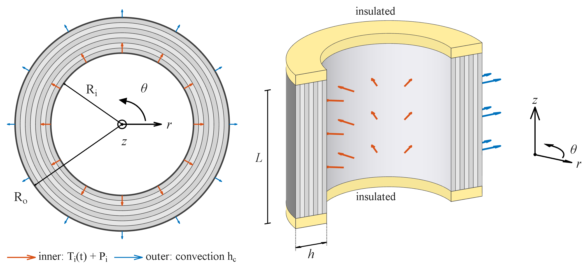{width=100%}

Geometry, coordinate system and loading of the cylindrical shell, with the cross-section on the left and an axial section on the right. The inner surface carries the temperature $T_{i}(t)$ and the pressure $P_{i}$, the outer surface exchanges heat by convection with the coefficient $h_{c}$, and the two ends are thermally insulated.
:::

### 2.2 Effective properties of the GPLRC layers

The effective Young modulus $E_{s}^{(\ell)}$ of the layer $\ell$ ($\ell = 1, \dots, N_L$, numbered from the inner layer) follows the Halpin–Tsai model for randomly oriented GPLs [13, 14, 70, 81],

::: {#eq-es .eq}
$$E_s^{(\ell)} = \tfrac{3}{8}E_L^{(\ell)} + \tfrac{5}{8}E_T^{(\ell)}, \qquad \ell = 1, 2, \dots, N_L$$
:::

::: {#eq-elt .eq}
$$\begin{aligned} E_L^{(\ell)} &= \frac{1+\chi_L\,\eta_L\,V_{\mathrm{GPL}}^{(\ell)}}{1-\eta_L\,V_{\mathrm{GPL}}^{(\ell)}}\,E_m \\ E_T^{(\ell)} &= \frac{1+\chi_T\,\eta_T\,V_{\mathrm{GPL}}^{(\ell)}}{1-\eta_T\,V_{\mathrm{GPL}}^{(\ell)}}\,E_m \end{aligned}$$
:::

::: {#eq-chi .eq}
$$\begin{aligned} \chi_L &= 2\,\frac{a_{\mathrm{GPL}}}{t_{\mathrm{GPL}}}, \qquad \chi_T = 2\,\frac{b_{\mathrm{GPL}}}{t_{\mathrm{GPL}}} \\ \eta_L &= \frac{E_{\mathrm{GPL}}/E_m - 1}{E_{\mathrm{GPL}}/E_m + \chi_L}, \qquad \eta_T = \frac{E_{\mathrm{GPL}}/E_m - 1}{E_{\mathrm{GPL}}/E_m + \chi_T} \end{aligned}$$
:::

where $V_{\mathrm{GPL}}^{(\ell)}$ is the GPL volume fraction of the layer, $\chi_{L}$, $\chi_{T}$, $\eta_{L}$ and $\eta_{T}$ are parameters that depend on the dimensions and properties of the GPLs, $a_{\mathrm{GPL}}$, $b_{\mathrm{GPL}}$ and $t_{\mathrm{GPL}}$ are the length, the width and the thickness of a GPL, and $E_{\mathrm{GPL}}$ and $E_{m}$ are the moduli of the GPL and of the matrix. The volume fraction follows from the weight fraction $W_{\mathrm{GPL}}^{(\ell)}$ of the layer [17],

::: {#eq-vgpl .eq}
$$V_{\mathrm{GPL}}^{(\ell)} = \frac{W_{\mathrm{GPL}}^{(\ell)}}{W_{\mathrm{GPL}}^{(\ell)} + \left(\rho_{\mathrm{GPL}}/\rho_m\right)\left(1 - W_{\mathrm{GPL}}^{(\ell)}\right)}$$
:::

where $\rho_{\mathrm{GPL}}$ and $\rho_{m}$ are the densities of the GPL and of the matrix. The Poisson ratio, the density, the specific heat and the thermal expansion coefficient follow the rule of mixtures [15, 70, 73],

::: {#eq-mix .eq}
$$\begin{aligned} \nu_s^{(\ell)} &= V_{\mathrm{GPL}}^{(\ell)}\,\nu_{\mathrm{GPL}} + V_m^{(\ell)}\,\nu_m \\ \rho_s^{(\ell)} &= V_{\mathrm{GPL}}^{(\ell)}\,\rho_{\mathrm{GPL}} + V_m^{(\ell)}\,\rho_m \\ c_s^{(\ell)} &= V_{\mathrm{GPL}}^{(\ell)}\,c_{\mathrm{GPL}} + V_m^{(\ell)}\,c_m \\ \alpha_s^{(\ell)} &= V_{\mathrm{GPL}}^{(\ell)}\,\alpha_{\mathrm{GPL}} + V_m^{(\ell)}\,\alpha_m \end{aligned}$$
:::

with the matrix volume fraction

::: {#eq-vm .eq}
$$V_m^{(\ell)} = 1 - V_{\mathrm{GPL}}^{(\ell)}$$
:::

The thermal conductivity $k_{s}^{(\ell)}$ is obtained from the percolation-type model of [82, 83],

::: {#eq-ks .eq}
$$k_s^{(\ell)} = \frac{\tfrac{2}{3}\left(V_{\mathrm{GPL}}^{(\ell)} - 1/p\right)^{\delta}}{H(p) + 1/\left[(k_{\mathrm{GPL}}/k_m) - 1\right]}\,k_m + k_m$$
:::

where $p$ is a geometric parameter of the GPL dimensions, $H(p)$ is a dimensionless geometric function and $\delta$ is the connectivity parameter, with the value 1/2. The quantities $p$ and $H(p)$ follow from

::: {#eq-hp .eq}
$$p = \frac{a_{\mathrm{GPL}}}{t_{\mathrm{GPL}}}, \qquad H(p) = \frac{p\,\ln\left(p + \sqrt{p^{2}-1}\right)}{\left(p^{2}-1\right)^{3/2}} - \frac{1}{p^{2}-1}$$
:::

Eq. ({{eq-ks}}) is of percolation type. The conductive network forms only when the GPL volume fraction exceeds $1/p$, and below this threshold the conductivity is that of the matrix. This threshold governs the response to the GPL aspect ratio and to small weight fractions (Sect. 7.2).

Five patterns of the GPL weight fraction through the thickness are considered (Fig. {{fig-gplpat}}). For $N_{L}$ layers the weight fraction of the layer $\ell$ is [5, 70, 84]

::: {#eq-wgpl .eq}
$$W_{\mathrm{GPL}}^{(\ell)} = W_{\mathrm{GPL}}\begin{cases} 1, & \text{UD} \\ \dfrac{4\left[(N_L+1)/2 - \left|\ell-(N_L+1)/2\right|\right]}{N_L+2}, & \text{O} \\ \dfrac{4\left[1/2 + \left|\ell-(N_L+1)/2\right|\right]}{N_L+2}, & \text{X} \\ \dfrac{2\,(N_L+1-\ell)}{N_L+1}, & \text{V} \\ \dfrac{2\,\ell}{N_L+1}, & \Lambda \end{cases}$$
:::

where $W_{\mathrm{GPL}}$ is the reference weight fraction. The uniform pattern (UD) has the same weight fraction in all layers. In pattern O the middle layer has the largest and the inner and outer layers the smallest weight fraction, and in pattern X the middle layer has the smallest and the inner and outer layers the largest weight fraction, so that O and X are symmetric about the mid-surface. In pattern V the inner layer has the largest and the outer layer the smallest weight fraction, and pattern Λ is its mirror image.

::: {#fig-gplpat .fig}
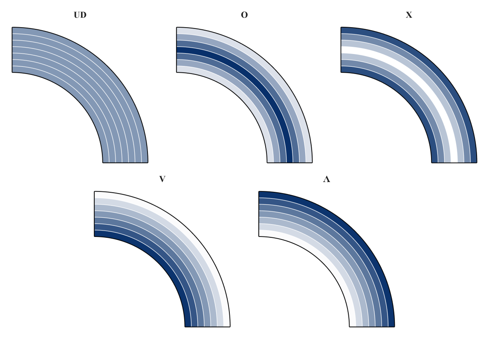{width=75%}

Distribution patterns of the GPL weight fraction through the thickness (UD, O, X, V and Λ). Darker shading denotes a larger weight fraction, and the inner surface is the arc nearest to the centre of each sector.
:::

### 2.3 Porosity

The effective properties of the porous GPLRC layers follow the open-cell theory [2, 14, 15, 23, 74],

::: {#eq-por .eq}
$$\begin{aligned} E^{(\ell)} &= E_s^{(\ell)}\,\Pi^{(\ell)}, \qquad k^{(\ell)} = k_s^{(\ell)}\,\Pi^{(\ell)}, \qquad c^{(\ell)} = c_s^{(\ell)}\,\Pi^{(\ell)} \\ \rho^{(\ell)} &= \rho_s^{(\ell)}\,\Pi_m^{(\ell)} \end{aligned}$$
:::

where $\Pi$ is the porosity function and $\Pi_{m}$ is the mass-density function. The Poisson ratio and the thermal expansion coefficient are not changed noticeably by the pores [14, 16, 17]. The open-cell theory relates the modulus to the density [2, 14], so that

::: {#eq-open .eq}
$$\frac{E}{E_s} = \left(\frac{\rho}{\rho_s}\right)^{2}, \qquad \Pi^{(\ell)} = \left(\Pi_m^{(\ell)}\right)^{2}$$
:::

The mid-radius $r_{m}^{(\ell)}$ of the layer $\ell$ and the wall thickness $h$ are

::: {#eq-zeta .eq}
$$r_m^{(\ell)} = R_i + \frac{h}{2N_L} + (\ell - 1)\,\frac{h}{N_L}, \qquad h = R_o - R_i$$
:::

The five patterns of the mass-density function are

::: {#eq-phim .eq}
$$\Pi_m^{(\ell)} = \begin{cases} e_{m3}, & \text{UD} \\ 1 - e_{m1}\cos\left(\dfrac{\pi r_m^{(\ell)}}{h}\right), & \text{O} \\ 1 - e_{m2}\left[1 - \cos\left(\dfrac{\pi r_m^{(\ell)}}{h}\right)\right], & \text{X} \\ e_{m4}\cos\left(\dfrac{\pi r_m^{(\ell)}}{2h} - \dfrac{\pi}{4}\right), & \text{V} \\ e_{m5}\cos\left(\dfrac{\pi r_m^{(\ell)}}{2h} + \dfrac{\pi}{4}\right), & \Lambda \end{cases}$$
:::

where $e_{mi}$ ($i = 1, \dots, 5$) are the mass-density coefficients, and $\Pi_{m}$ is limited to the range $0 \le \Pi_m \le 1$. In pattern V the inner layer has the largest and the outer layer the smallest porosity, and pattern Λ is its mirror image (Fig. {{fig-porpat}}). The cylinders with the different patterns have the same weight, which gives the condition

::: {#eq-mass .eq}
$$\int_{R_i}^{R_o}\left[1 - e_{m1}\cos\left(\frac{\pi r}{h}\right)\right]dr = \int_{R_i}^{R_o}\left\{1 - e_{m2}\left[1 - \cos\left(\frac{\pi r}{h}\right)\right]\right\}dr = \int_{R_i}^{R_o} e_{m3}\,dr = \int_{R_i}^{R_o} e_{m4}\cos\left(\frac{\pi r}{2h} - \frac{\pi}{4}\right)dr = \int_{R_i}^{R_o} e_{m5}\cos\left(\frac{\pi r}{2h} + \frac{\pi}{4}\right)dr$$
:::

in its integral form, so that the coefficients $e_{m1}$, $e_{m2}$, $e_{m4}$ and $e_{m5}$ follow from the single input $e_{m3}$, which measures the porosity level (a smaller $e_{m3}$ means a more porous layer).

::: {#fig-porpat .fig}
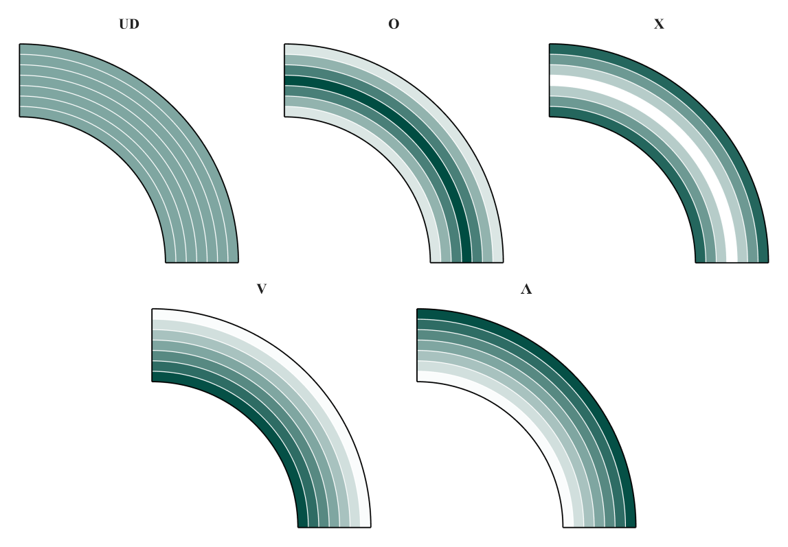{width=75%}

Distribution patterns of the porosity through the thickness (UD, O, X, V and Λ). Darker shading denotes a larger porosity, and the inner surface is the arc nearest to the centre of each sector.
:::

---

## 3. Governing equations

### 3.1 Kinematics, constitutive law and motion

The geometry, the material structure, the loading and the initial conditions are axisymmetric, so that the constitutive relations, the equations of motion and the energy equation are independent of $\theta$. The superscript $(\ell)$ marks a quantity of the layer $\ell$, and each equation of this section is written for every layer. The strains of the layer $\ell$ follow from the displacements $u^{(\ell)}$ and $w^{(\ell)}$ of the layer in the directions $r$ and $z$ [30, 32, 47],

::: {#eq-strain .eq}
$$\begin{aligned} \varepsilon_{rr}^{(\ell)} &= \frac{\partial u^{(\ell)}}{\partial r}, \qquad \varepsilon_{\theta\theta}^{(\ell)} = \frac{u^{(\ell)}}{r} \\ \varepsilon_{zz}^{(\ell)} &= \frac{\partial w^{(\ell)}}{\partial z}, \qquad \gamma_{rz}^{(\ell)} = \frac{\partial u^{(\ell)}}{\partial z} + \frac{\partial w^{(\ell)}}{\partial r} \end{aligned}$$
:::

where $\varepsilon_{rr}^{(\ell)}$, $\varepsilon_{\theta\theta}^{(\ell)}$ and $\varepsilon_{zz}^{(\ell)}$ are the normal strains and $\gamma_{rz}^{(\ell)}$ is the shear strain of the layer $\ell$. The stress–strain relation of the layer contains the thermal strain $\varepsilon_{T}^{(\ell)}$ [13, 33, 64],

::: {#eq-const .eq}
$$\begin{Bmatrix}\sigma_{rr}^{(\ell)}\\ \sigma_{\theta\theta}^{(\ell)}\\ \sigma_{zz}^{(\ell)}\\ \tau_{rz}^{(\ell)}\end{Bmatrix} = \begin{bmatrix}C_{11}^{(\ell)}&C_{12}^{(\ell)}&C_{13}^{(\ell)}&0\\ C_{12}^{(\ell)}&C_{22}^{(\ell)}&C_{23}^{(\ell)}&0\\ C_{13}^{(\ell)}&C_{23}^{(\ell)}&C_{33}^{(\ell)}&0\\ 0&0&0&C_{55}^{(\ell)}\end{bmatrix}\begin{Bmatrix}\varepsilon_{rr}^{(\ell)}-\varepsilon_{T}^{(\ell)}\\ \varepsilon_{\theta\theta}^{(\ell)}-\varepsilon_{T}^{(\ell)}\\ \varepsilon_{zz}^{(\ell)}-\varepsilon_{T}^{(\ell)}\\ \gamma_{rz}^{(\ell)}\end{Bmatrix}$$
:::

where $\sigma_{ii}^{(\ell)}$ ($i = r, \theta, z$) and $\tau_{rz}^{(\ell)}$ are the normal and shear stress components of the layer $\ell$ and $C_{ij}^{(\ell)}$ are the elastic coefficients of the layer $\ell$. The thermal strain of the layer follows from the temperature change [13, 33, 64],

::: {#eq-eps .eq}
$$\varepsilon_T^{(\ell)} = \alpha^{(\ell)}\,\Delta T^{(\ell)}, \qquad \Delta T^{(\ell)} = T^{(\ell)} - T_0$$
:::

and the elastic coefficients follow from the Young modulus $E^{(\ell)}$ and the Poisson ratio $\nu^{(\ell)}$ of the layer [13, 33],

::: {#eq-cij .eq}
$$\begin{aligned} C_{11}^{(\ell)} &= C_{22}^{(\ell)} = C_{33}^{(\ell)} = \frac{\left(1-\nu^{(\ell)}\right)E^{(\ell)}}{\left(1+\nu^{(\ell)}\right)\left(1-2\nu^{(\ell)}\right)} \\ C_{12}^{(\ell)} &= C_{13}^{(\ell)} = C_{23}^{(\ell)} = \frac{\nu^{(\ell)}E^{(\ell)}}{\left(1+\nu^{(\ell)}\right)\left(1-2\nu^{(\ell)}\right)} \\ C_{55}^{(\ell)} &= \frac{E^{(\ell)}}{2\left(1+\nu^{(\ell)}\right)} \end{aligned}$$
:::

The equations of motion of the layer $\ell$ in cylindrical coordinates are [3, 13, 50]

::: {#eq-motion .eq}
$$\begin{aligned} \frac{\partial\sigma_{rr}^{(\ell)}}{\partial r} + \frac{\partial\tau_{rz}^{(\ell)}}{\partial z} + \frac{\sigma_{rr}^{(\ell)}-\sigma_{\theta\theta}^{(\ell)}}{r} &= \rho^{(\ell)}\,\frac{\partial^{2}u^{(\ell)}}{\partial t^{2}} \\ \frac{\partial\tau_{rz}^{(\ell)}}{\partial r} + \frac{\partial\sigma_{zz}^{(\ell)}}{\partial z} + \frac{\tau_{rz}^{(\ell)}}{r} &= \rho^{(\ell)}\,\frac{\partial^{2}w^{(\ell)}}{\partial t^{2}} \end{aligned}$$
:::

and they are used in displacement form, obtained by substituting Eqs. ({{eq-strain}}) to ({{eq-cij}}).

### 3.2 Lord–Shulman energy equation

The LS theory adds the relaxation time $\tau_0$ to the classical energy equation, which replaces Fourier's law by the Cattaneo–Vernotte law [55–57]. The energy balance of the layer $\ell$ is [60, 65, 72]

::: {#eq-energy .eq}
$$\frac{1}{r}\frac{\partial}{\partial r}\left(r\,k^{(\ell)}\,\frac{\partial T^{(\ell)}}{\partial r}\right) + \frac{\partial}{\partial z}\left(k^{(\ell)}\,\frac{\partial T^{(\ell)}}{\partial z}\right) = \rho^{(\ell)}\,c^{(\ell)}\left(\frac{\partial T^{(\ell)}}{\partial t} + \tau_0\frac{\partial^{2}T^{(\ell)}}{\partial t^{2}}\right) + \alpha^{(\ell)}\left(3\lambda^{(\ell)}+2\mu^{(\ell)}\right)T_0\left(\frac{\partial}{\partial t} + \tau_0\frac{\partial^{2}}{\partial t^{2}}\right)\left(\frac{\partial u^{(\ell)}}{\partial r} + \frac{u^{(\ell)}}{r} + \frac{\partial w^{(\ell)}}{\partial z}\right)$$
:::

where $t$ is the time, $k^{(\ell)}$ is the thermal conductivity of the layer and $\tau_0$ is the relaxation time of the LS theory. The term with $\tau_0\,\partial^{2}/\partial t^{2}$ makes the heat conduction hyperbolic and the speed of the thermal wave finite. The Lamé constants of the layer are

::: {#eq-lame .eq}
$$\lambda^{(\ell)} = \frac{\nu^{(\ell)}E^{(\ell)}}{\left(1+\nu^{(\ell)}\right)\left(1-2\nu^{(\ell)}\right)}, \qquad \mu^{(\ell)} = \frac{E^{(\ell)}}{2\left(1+\nu^{(\ell)}\right)}$$
:::

The last term of Eq. ({{eq-energy}}) couples the temperature to the dilatation rate. The case $\tau_0 = 0$ gives the classical coupled theory [64], and dropping the last term gives the uncoupled theory. The effect of the finite speed of the thermal wave is discussed in Sect. 7.7.1.

### 3.3 Boundary, interface and initial conditions

The mechanical conditions at the ends $z = 0$ and $z = L$ are those of a simple support (S) [47, 70, 73],

::: {#eq-bcs .eq}
$$u^{(\ell)} = 0, \qquad \sigma_{zz}^{(\ell)} = 0, \qquad \ell = 1, 2, \dots, N_L$$
:::

or those of a clamped end (C),

::: {#eq-bcc .eq}
$$u^{(\ell)} = 0, \qquad w^{(\ell)} = 0, \qquad \ell = 1, 2, \dots, N_L$$
:::

The inner surface carries the internal pressure, which acts for $t > 0$, and the outer surface is free [47, 70, 73],

::: {#eq-bcri .eq}
$$\sigma_{rr} = \begin{cases} 0, & t \le 0 \\ -P_i, & t > 0 \end{cases}, \qquad \tau_{rz} = 0, \qquad r = R_i$$
:::

::: {#eq-bcro .eq}
$$\sigma_{rr} = 0, \qquad \tau_{rz} = 0, \qquad r = R_o$$
:::

At the interface of two adjacent layers the displacements and the tractions are continuous [47, 70, 73],

::: {#eq-mi .eq}
$$\begin{aligned} u^{(\ell)}\left(R_o^{(\ell)}, z, t\right) &= u^{(\ell+1)}\left(R_i^{(\ell+1)}, z, t\right), \qquad w^{(\ell)}\left(R_o^{(\ell)}, z, t\right) = w^{(\ell+1)}\left(R_i^{(\ell+1)}, z, t\right) \\ \tau_{rz}^{(\ell)}\left.\right|_{r=R_o^{(\ell)}} &= \tau_{rz}^{(\ell+1)}\left.\right|_{r=R_i^{(\ell+1)}}, \qquad \sigma_{rr}^{(\ell)}\left.\right|_{r=R_o^{(\ell)}} = \sigma_{rr}^{(\ell+1)}\left.\right|_{r=R_i^{(\ell+1)}} \end{aligned}$$
:::

for $\ell = 1, \dots, N_L - 1$, where $R_{i}^{(\ell)}$ and $R_{o}^{(\ell)}$ are the inner and outer radii of the layer $\ell$. The thermal conditions are the insulation of the two ends [70, 73],

::: {#eq-tends .eq}
$$\frac{\partial T^{(\ell)}}{\partial z} = 0, \qquad z = 0 \text{ and } z = L$$
:::

the exponential rise of the inner-surface temperature and the convection at the outer surface [70, 73],

::: {#eq-tin .eq}
$$T^{(1)} = T_0 + \left(T_i - T_0\right)\left[1 - \exp\left(-t/t_0\right)\right], \qquad r = R_i^{(1)} = R_i$$
:::

::: {#eq-tout .eq}
$$-k^{(N_L)}\,\frac{\partial T^{(N_L)}}{\partial r} = h_c\left(T^{(N_L)} - T_\infty\right), \qquad r = R_o$$
:::

where $T_i$ is the final temperature of the inner surface (600 K in the reference problem), $t_0$ is the time constant of its rise, $h_c$ is the convection coefficient and $T_\infty$ is the temperature of the environment. The temperature and the heat flux are continuous at the interfaces of the layers,

::: {#eq-ti .eq}
$$T^{(\ell)}\left(R_o^{(\ell)}, t\right) = T^{(\ell+1)}\left(R_i^{(\ell+1)}, t\right), \qquad k^{(\ell)}\left.\frac{\partial T^{(\ell)}}{\partial r}\right|_{r=R_o^{(\ell)}} = k^{(\ell+1)}\left.\frac{\partial T^{(\ell+1)}}{\partial r}\right|_{r=R_i^{(\ell+1)}}$$
:::

for $\ell = 1, \dots, N_L - 1$.

The initial conditions are [70, 73]

::: {#eq-ic .eq}
$$u^{(\ell)} = w^{(\ell)} = 0, \qquad \frac{\partial u^{(\ell)}}{\partial t} = \frac{\partial w^{(\ell)}}{\partial t} = 0, \qquad T^{(\ell)} = T_0, \qquad \frac{\partial T^{(\ell)}}{\partial t} = 0, \qquad t = 0$$
:::

---

## 4. Numerical solution

### 4.1 Layerwise differential quadrature

In the DQM the $d$-th derivative of a function $\psi(x)$ at a node is a weighted sum of the function values at all $N_{x}$ nodes of the line [13, 48, 54],

::: {#eq-dq .eq}
$$\left.\frac{\partial^{d}\psi}{\partial x^{d}}\right|_{x=x_i} = \sum_{j=1}^{N_x} A_{ij}^{(d)}\,\psi_j, \qquad i = 1, 2, \dots, N_x$$
:::

where $A^{(1)} = A$ and $A^{(2)} = B$ are the weighting matrices of the first and second derivative. The weights are derived from Lagrange polynomials [48, 54],

::: {#eq-dqw .eq}
$$\begin{aligned} A_{ij} &= \frac{1}{x_j - x_i}\prod_{m \ne i,\,j}\frac{x_i - x_m}{x_j - x_m}, \quad i \ne j, \qquad A_{ii} = -\sum_{j \ne i} A_{ij} \\ B_{ij} &= 2\left(A_{ij}A_{ii} - \frac{A_{ij}}{x_j - x_i}\right), \quad i \ne j, \qquad B_{ii} = -\sum_{j \ne i} B_{ij} \end{aligned}$$
:::

and the nodes follow the Chebyshev–Gauss–Lobatto distribution [47, 52],

::: {#eq-cgl .eq}
$$x_i = x_1 + \frac{1}{2}\left[1 - \cos\left(\frac{i-1}{N_x-1}\,\pi\right)\right]\left(x_{N_x} - x_1\right), \qquad i = 1, 2, \dots, N_x$$
:::

which concentrates the nodes near the boundaries and therefore models the boundary conditions more accurately. Every layer carries its own set of $N_{r}$ nodes in the radial direction, and $N_{z}$ nodes are shared by all layers in the axial direction. The equations of motion (Eq. ({{eq-motion}})) and the energy equation (Eq. ({{eq-energy}})) are written at the interior nodes of the layers. The boundary conditions and the interface conditions of Sect. 3.3 are imposed at the boundary nodes of the layers by replacing the corresponding equations, so that they are satisfied exactly at every time step. The numbers of nodes of each field and of the degrees of freedom are

::: {#eq-ndof .eq}
$$N_n = N_L\,N_r\,N_z, \qquad N_{\mathrm{dof}} = 3\,N_n$$
:::

### 4.2 Time integration

The discretised equations lead to the semi-discrete system

::: {#eq-sd .eq}
$$\mathbf{M}\,\ddot{\mathbf{D}} + \mathbf{C}_d\,\dot{\mathbf{D}} + \mathbf{K}\,\mathbf{D} = \mathbf{f}(t)$$
:::

where $\mathbf{M}$ is the mass matrix, $\mathbf{C}_d$ the damping matrix, $\mathbf{K}$ the stiffness matrix, $\mathbf{f}(t)$ the load vector, which contains the inner-surface temperature and the internal pressure, and $\mathbf{D}$ the vector of the degrees of freedom, which collects the nodal temperature changes $\Delta T$ and the nodal displacements $u$ and $w$. The rows that carry the boundary and interface conditions are zero in $\mathbf{M}$ and $\mathbf{C}_d$, so that the system is differential–algebraic.

The system is integrated in time with the Newmark method [85]. Given the vectors $\mathbf{D}$, $\dot{\mathbf{D}}$ and $\ddot{\mathbf{D}}$ at the time $t_n$, the vectors at $t_{n+1} = t_n + \Delta t$ are defined by the two approximations

::: {#eq-newmark .eq}
$$\begin{aligned} \mathbf{D}_{n+1} &= \mathbf{D}_n + \Delta t\,\dot{\mathbf{D}}_n + \frac{\Delta t^{2}}{2}\left[\left(1-2\beta_N\right)\ddot{\mathbf{D}}_n + 2\beta_N\,\ddot{\mathbf{D}}_{n+1}\right] \\ \dot{\mathbf{D}}_{n+1} &= \dot{\mathbf{D}}_n + \Delta t\left[\left(1-\gamma_N\right)\ddot{\mathbf{D}}_n + \gamma_N\,\ddot{\mathbf{D}}_{n+1}\right] \end{aligned}$$
:::

Substituting them into Eq. ({{eq-sd}}) at $t_{n+1}$ and eliminating $\dot{\mathbf{D}}_{n+1}$ and $\ddot{\mathbf{D}}_{n+1}$ gives a linear algebraic system for $\mathbf{D}_{n+1}$,

::: {#eq-keff .eq}
$$\mathbf{K}_{\mathrm{eff}}\,\mathbf{D}_{n+1} = \mathbf{f}_{n+1} + \mathbf{M}\left(g_0\mathbf{D}_n + g_2\dot{\mathbf{D}}_n + g_3\ddot{\mathbf{D}}_n\right) + \mathbf{C}_d\left(g_1\mathbf{D}_n + g_4\dot{\mathbf{D}}_n + g_5\ddot{\mathbf{D}}_n\right)$$
:::

with the effective stiffness matrix

::: {#eq-keff2 .eq}
$$\mathbf{K}_{\mathrm{eff}} = \mathbf{K} + g_0\,\mathbf{M} + g_1\,\mathbf{C}_d$$
:::

and the integration constants [85]

::: {#eq-g .eq}
$$\begin{aligned} g_0 &= \frac{1}{\beta_N\Delta t^{2}}, \quad g_1 = \frac{\gamma_N}{\beta_N\Delta t}, \quad g_2 = \frac{1}{\beta_N\Delta t}, \quad g_3 = \frac{1}{2\beta_N} - 1 \\ g_4 &= \frac{\gamma_N}{\beta_N} - 1, \quad g_5 = \frac{\Delta t}{2}\left(\frac{\gamma_N}{\beta_N} - 2\right) \end{aligned}$$
:::

The Newmark method belongs to the family of single-step implicit schemes for second-order systems, and its two parameters $\beta_{N}$ and $\gamma_{N}$ control the accuracy and the numerical damping. Starting from the initial conditions, the method advances the solution step by step. At every step one linear system is solved for the unknowns at the new time level, and the velocity and acceleration are then updated from the new solution. All results of this paper use $\gamma_{N}$ = 1/2 and $\beta_{N}$ = 1/4, which corresponds to the constant average acceleration rule. For a linear system this choice is unconditionally stable, second-order accurate in time and free of numerical damping [85]. After the nodal temperature and displacements are known, the stress components of every layer follow from the constitutive relation of Eq. ({{eq-const}}).

---

## 5. Reference problem and dimensionless quantities

The reference cylinder has $R_{i}$ = 1 m, $R_{o}$ = 1.5 m (radius ratio 1.5, $h = 0.5$ m), $L = 2.1$ m and $N_{L}$ = 7. The GPL weight fraction is $W_{\mathrm{GPL}}$ = 0.3% with the uniform pattern, the porosity is uniform with $e_{m3}$ = 0.8604, $T_{0}$ = $T_{\infty}$ = 300 K, $T_{i}$ = 600 K, $t_{0}$ = 2 s, $P_{i}$ = 50 MPa and $h_{c}$ = 10 W/m²K. The ends are simply supported (S–S) and the dimensionless relaxation time is $\tau^{*}$ = 0.15. The discretisation is $N_{r}$ = 11, $N_{z}$ = 13 and $\Delta t$ = 1 s up to the final time of 3000 s. The matrix is epoxy and the reinforcement is the GPL, with the properties of Table {{tbl-mat}} [70, 73].

::: {#tbl-mat .tbl}
Material and geometric data of the epoxy matrix and of the GPLs.

|  | Epoxy | GPL |
|------------|--------|----------------|
| $E$ (GPa) | 3 | 1010 |
| $\nu$ | 0.34 | 0.168 |
| $\rho$ (kg/m³) | 1200 | 1062.5 |
| $c$ (J/kg K) | 1110 | 644 |
| $\alpha$ (1/K) | 60 × 10⁻⁶ | 5 × 10⁻⁶ |
| $k$ (W/m K) | 0.246 | 3000 |
| $a_{\mathrm{GPL}}$, $b_{\mathrm{GPL}}$, $t_{\mathrm{GPL}}$ (m) | – | 2.5 × 10⁻⁶, 1.5 × 10⁻⁶, 1.5 × 10⁻⁹ |
:::

The results are given in dimensionless form with the wall thickness as the length scale,

::: {#eq-dimless .eq}
$$\begin{aligned} T^{*} &= \frac{T - T_\infty}{T_\infty}, \qquad \xi = \frac{r - R_i}{h}, \qquad \mathrm{Fo} = \frac{\hat{\alpha}\,t}{h^{2}} \\ \tau^{*} &= \frac{\hat{\alpha}\,\tau_0}{h^{2}}, \qquad \Sigma_{ii} = \frac{1+\nu}{E\,\alpha\,T_\infty}\,\sigma_{ii}, \qquad U^{*} = \frac{u}{(1-\nu)\,\alpha\,T_\infty\,h} \\ \hat{\alpha} &= \frac{k}{\rho\,c} \end{aligned}$$
:::

where $i = r, \theta, z$, $T^{*}$ is the dimensionless temperature, $\xi$ the dimensionless radius, $\mathrm{Fo}$ the dimensionless time, $\tau^{*}$ the dimensionless relaxation time, $\Sigma_{ii}$ the dimensionless normal stress and $U^{*}$ the dimensionless radial displacement, and $\hat{\alpha}$ the thermal diffusivity. For the cylinder with the uniform GPL and porosity patterns, $\hat{\alpha} = 8.97 \times 10^{-5}$ m²/s, so that $\tau^{*}$ = 0.15 corresponds to a relaxation time $\tau_{0}$ of about 418 s. Since the inner surface is raised to twice the ambient temperature, $T^{*}$ = 1 at the inner surface, and any temperature above 1 inside the wall is a genuine overshoot produced by the thermal wave. Unless stated otherwise, the mid-point means the mid-thickness point of the mid-length section, and the stresses are those of the mid-length section at the final time.

---

## 6. Convergence and verification

### 6.1 Convergence

Before the verification, the convergence of the solution is checked independently in each discretisation direction. The number of radial nodes per layer is $N_{r}$, the number of axial nodes is $N_{z}$, the number of layers is $N_{L}$, the time step is $\Delta t$ and the number of degrees of freedom is $N_{\mathrm{dof}}$ (Eq. ({{eq-ndof}})). The dimensionless hoop stress is the convergence criterion. It is reported as its value at the inner surface and as the relative error of the mid-plane, both with respect to the finest discretisation of the series, and the temperature profile is compared as well. In each series only one parameter is varied while the others keep their reference values, and the finest member of the series (15 radial nodes, 15 axial nodes, 15 layers or $\Delta t$ = 0.5 s) serves as the reference. The convergence of the radial and axial nodes is shown by the profiles of the hoop stress and of the temperature through the thickness (Figs. {{fig-cvNr}} and {{fig-cvNz}}), and the convergence of the number of layers and of the time step is given in Tables {{tbl-cNL}} and {{tbl-cdt}}.

Fig. {{fig-cvNr}} shows the hoop stress and the temperature through the thickness for different numbers of radial nodes in each layer, and the curves practically coincide. The quantities have converged already with seven radial nodes per layer, which shows the strength of the DQM.

::: {#fig-cvNr .fig}
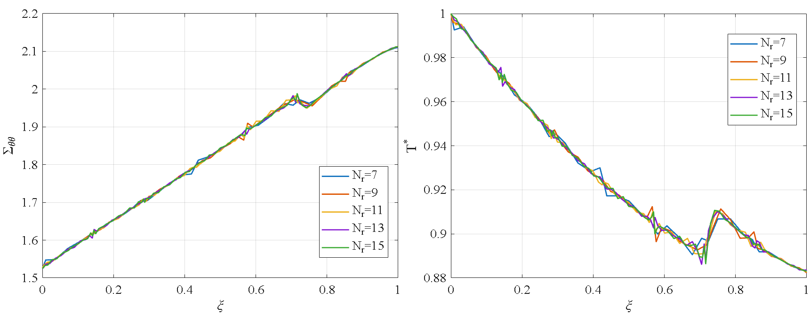{width=100%}

Convergence with the number of radial nodes per layer, hoop stress (left) and temperature (right) through the thickness ($N_{z}$ = 13, $N_{L}$ = 7, $W_{\mathrm{GPL}}$ = 0.3%, $e_{m3}$ = 0.8604, $\tau^{*}$ = 0.15, $P_{i}$ = 50 MPa, S–S).
:::

The axial direction is the demanding one (Fig. {{fig-cvNz}}). With five axial nodes the hoop-stress curve differs clearly from the others, a smaller difference remains with seven nodes, and from nine nodes on the curves practically coincide. The convergence is not monotonic but is established with nine nodes, and the temperature curves coincide for all numbers of axial nodes.

::: {#fig-cvNz .fig}
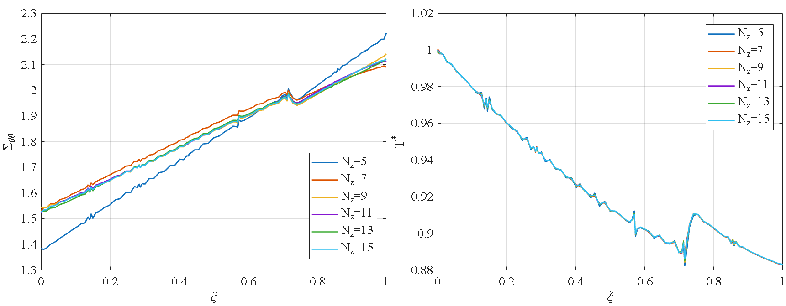{width=100%}

Convergence with the number of axial nodes, hoop stress (left) and temperature (right) through the thickness ($N_{r}$ = 11, $N_{L}$ = 7, $W_{\mathrm{GPL}}$ = 0.3%, $e_{m3}$ = 0.8604, $\tau^{*}$ = 0.15, $P_{i}$ = 50 MPa, S–S).
:::

The number of layers has a small influence (Table {{tbl-cNL}}). The hoop stress at the inner surface changes by about 0.05% between 3 and 15 layers, and the relative error remains below 0.26%.

::: {#tbl-cNL .tbl}
Convergence of the number of layers ($N_{r}$ = 11, $N_{z}$ = 13). The relative error is that of the hoop stress with respect to the finest member of the series (15 layers).

| $N_{L}$ | Hoop stress at the inner surface | Relative error (%) | $N_{\mathrm{dof}}$ |
|---|---|---|---|
| 3 | 1.5261 | 0.26 | 1287 |
| 5 | 1.5257 | 0.21 | 2145 |
| 7 | 1.5264 | 0.16 | 3003 |
| 9 | 1.5264 | 0.14 | 3861 |
| 15 | 1.5265 | 0 | 6435 |
:::

For the time step, the relative error is 0.17% at $\Delta t$ = 1 s, 0.25% at 2 s and 0.64% at 5 s (Table {{tbl-cdt}}).

::: {#tbl-cdt .tbl}
Convergence of the time step ($N_{r}$ = 11, $N_{z}$ = 13, $N_{L}$ = 7). The relative error is that of the hoop stress with respect to the smallest time step (0.5 s).

| Time step (s) | Number of steps | Relative error (%) |
|---|---|---|
| 0.5 | 6000 | 0 |
| 1 | 3000 | 0.17 |
| 2 | 1500 | 0.25 |
| 5 | 600 | 0.64 |
:::

The adopted discretisation ($N_{r}$ = 11, $N_{z}$ = 13, $N_{L}$ = 7, $\Delta t$ = 1 s) is therefore used for all results of Sect. 7. At the adopted number of layers and time step, the relative errors are 0.16% and 0.17% (Tables {{tbl-cNL}} and {{tbl-cdt}}).

### 6.2 Verification

The present solution is verified in two tests, the first against published results and a finite element solution and the second against an exact analytical solution. The mechanical part of the solution is verified in the first test and the thermal part in the second test, and in each test the present result is plotted against the corresponding reference (Figs. {{fig-vM}} and {{fig-vB}}).

In the first test (Fig. {{fig-vM}}) the dynamic mechanical response of a thick-walled functionally graded cylinder under an internal pressure is compared with the results of Malekzadeh et al. [49] and with the ANSYS results. The ANSYS results were produced by Setoodeh et al. [86], who solved the same problem with a three-dimensional finite element model, and they are quoted in [49]. In this problem the modulus of elasticity and the density of the wall vary with the radius as power laws, both ends of the cylinder are clamped, and the pressure on the inner surface varies as a half sine pulse with an amplitude of 100 MPa and a duration of 1 s [49, 86]. The dimensionless radial displacement of the inner surface is reproduced within 0.2% of the results of Malekzadeh et al. [49] and within 1% of the ANSYS results [86].

::: {#fig-vM .fig}
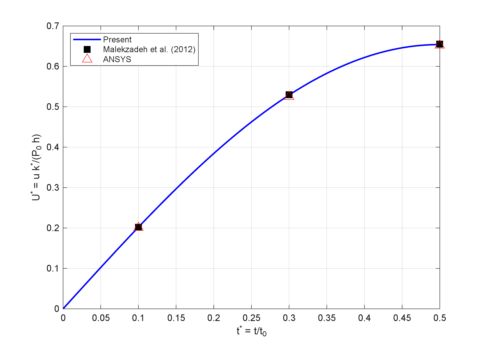{width=75%}

Dimensionless radial displacement of the inner surface of a thick-walled functionally graded cylinder under an internal pressure, present solution against the results of Malekzadeh et al. [49] and the ANSYS results of Setoodeh et al. [86] quoted in [49]. The dimensionless displacement and time are defined in [49].
:::

In the second test (Fig. {{fig-vB}}) the transient heat conduction is compared with the exact Bessel-series solution. The dimensionless temperature profiles at different times coincide with the exact curves with relative errors of 10⁻⁵ to 10⁻⁶.

::: {#fig-vB .fig}
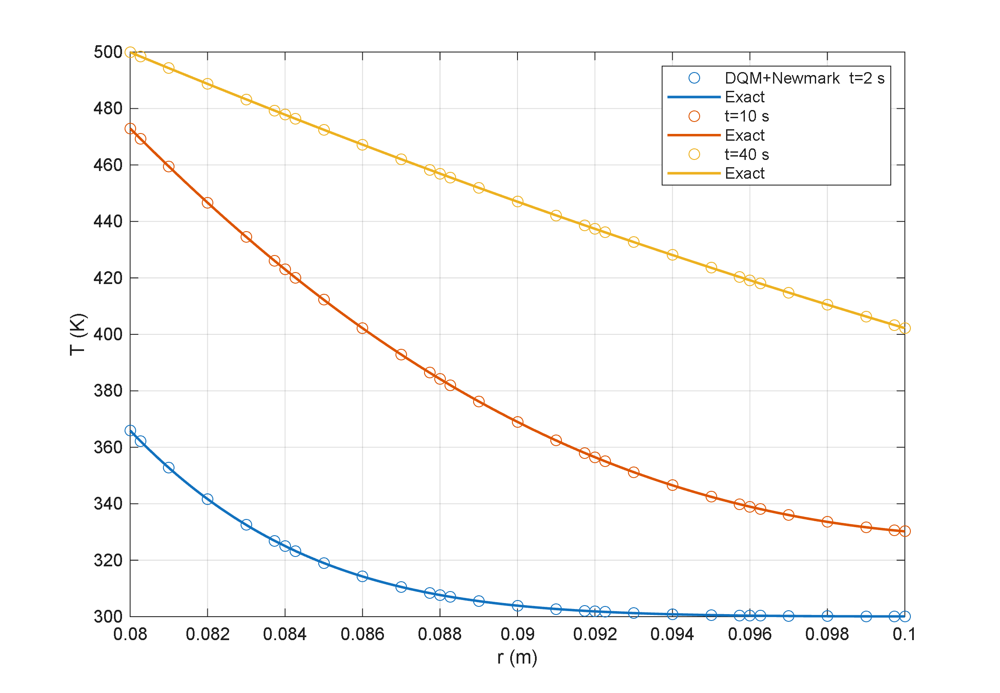{width=75%}

Transient temperature profiles from the present DQM and Newmark solution against the exact Bessel-series solution at $t$ = 2, 10 and 40 s.
:::

Both tests are carried out without thermomechanical coupling, so that each of them verifies one part of the solution.

---

## 7. Results and discussion

All results of this section are for the reference problem of Sect. 5, and in each study only the stated parameter is changed.

### 7.1 GPL distribution pattern

Fig. {{fig-gplp}} compares the five GPL patterns on the uniform-porosity background. The maximum dimensionless mid-point temperature is 0.926, 0.867, 0.841, 0.661 and 0.982 for the patterns UD, O, X, V and Λ, respectively. Pattern V, in which the GPLs are concentrated near the inner surface, gives the lowest value and pattern Λ the highest, and the two patterns are mirror images with opposite behaviour. The conductive inner region of pattern V spreads the incoming heat quickly through the thickness, so that its maximum temperature is about one third lower than that of pattern Λ. Placing the stiff and conductive phase where the temperature gradient is steepest both softens the thermal gradient and strengthens the zone in which the hoop stress is critical. Pattern Λ, in contrast, has a poorly conducting region at the inner surface that concentrates the heat in the inner layers and gives the highest maximum. The symmetric patterns UD, O and X lie between the two.

The same order is found in the mechanical response. The final inner-surface hoop stress of pattern V is 0.486, about three times smaller than that of pattern UD (1.526) and nearly five times smaller than that of pattern Λ, so that the two ends of the mirrored range give the lowest and the highest hoop stress. The maximum radial displacement follows the same trend and changes from 8.26 for pattern V to 9.08 for pattern Λ. Among the five patterns, pattern V therefore gives the lowest temperature, hoop stress and displacement at the same time, and pattern Λ the highest temperature and hoop stress. For GPL distribution in cylinders under an internal thermal shock, pattern V is thus favourable within the cases studied.

::: {#fig-gplp .fig}
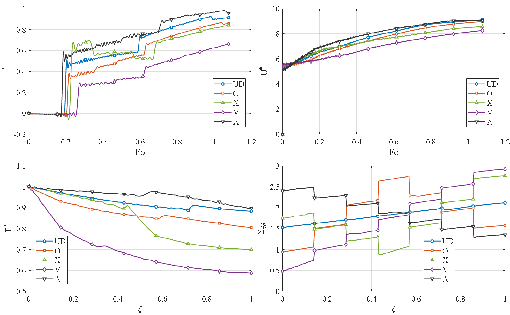{width=100%}

Effect of the GPL pattern (UD, O, X, V and Λ) on the time histories of the dimensionless temperature and radial displacement at the mid-point of the mid-section (top) and on the through-thickness profiles of the temperature and the hoop stress at the final time (bottom). The other parameters are at their reference values ($N_{r}$ = 11, $N_{z}$ = 13, $N_{L}$ = 7, $W_{\mathrm{GPL}}$ = 0.3%, $e_{m3}$ = 0.8604, $\tau^{*}$ = 0.15, $P_{i}$ = 50 MPa, S–S).
:::

Two features are common to the hoop-stress and temperature profiles. The hoop stress is discontinuous at the layer interfaces, because the stiffness changes there, so that the graded patterns (O, X, V and Λ) show a step profile and the UD pattern a smooth one. The steps are the physical result of a layered material. The temperature profiles show a small local peak near $\xi$ ≈ 0.75 in all cases. It is the position of the LS thermal wave front, it moves with the relaxation time and with time, and it disappears in the Fourier limit (Fig. {{fig-relax}}). The weak oscillations that accompany the front are bounded and result from the discrete representation of a discontinuous thermal wave. Whenever the front crosses an interface, the sudden change of the material produces a small partial reflection, which causes the small notches at the interfaces of the inner layers.

### 7.2 GPL weight fraction and aspect ratios

The GPL weight fraction influences the penetration of the thermal wave into the wall markedly (Fig. {{fig-wt}}). At the smallest weight fraction of 0.1% the GPLs produce only a small thermal diffusivity and the wave penetrates weakly, so that the outer-surface temperature reaches only 0.484 and the maximum mid-point temperature 0.631. With increasing weight fraction the diffusivity grows and the maximum mid-point temperature becomes larger, and at 0.9% the outer-surface temperature reaches practically 1, which means that the thermal wave crosses the whole wall. Because the GPLs also stiffen the wall, the maximum radial displacement decreases, and the hoop stress at the outer surface increases with the weight fraction.

::: {#fig-wt .fig}
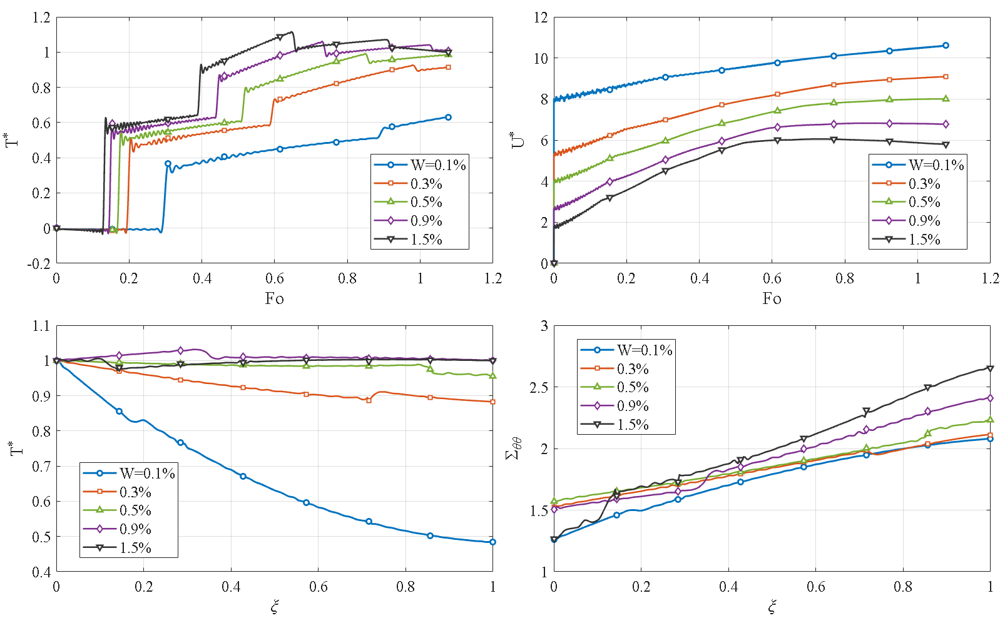{width=100%}

Effect of the GPL weight fraction $W_{\mathrm{GPL}}$ = 0.1%, 0.3%, 0.5%, 0.9% and 1.5% on the time histories at the mid-point of the mid-section (top) and on the through-thickness profiles at the final time (bottom).
:::

The effect of the length-to-width ratio of the GPLs is shown in Fig. {{fig-ab}}. When the ratio increases from 1 to 10, the maximum mid-point temperature increases only from 0.898 to 0.951, and the hoop stress at the inner surface changes little in the same way. Most of the change occurs in the first step, and from a ratio of 4 on the curves practically coincide. Elongating the GPLs beyond a few units therefore brings no noticeable benefit, and the reference ratio of 1.67 lies in the unsaturated range.

::: {#fig-ab .fig}
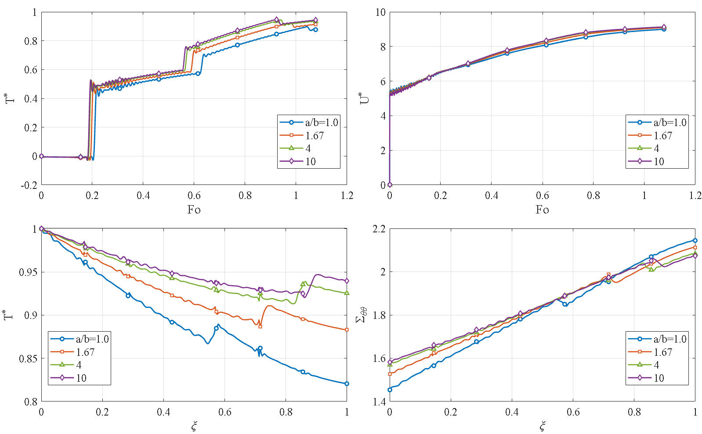{width=100%}

Effect of the length-to-width ratio of the GPLs on the time histories at the mid-point of the mid-section (top) and on the through-thickness profiles at the final time (bottom).
:::

The width-to-thickness ratio acts differently (Fig. {{fig-bt}}), and the length-to-width ratio is kept at its reference value of 1.67 for it. At the two small values of the ratio, 10 and 100, practically no heat reaches the mid-point during the interval, and the wall is heated only for the largest value, 1000. The reason is the threshold character of the effective conductivity model of Eq. ({{eq-ks}}), in which the conductive network of the GPLs forms only when the volume fraction exceeds $1/p$, with $p$ the length-to-thickness ratio of the GPLs. For the reference weight fraction of 0.3% ($V_{\mathrm{GPL}}$ = 0.003387) this condition requires a width-to-thickness ratio larger than about 177. Below this threshold the effective conductivity returns to that of the porous epoxy without GPLs, the thermal wave does not reach the mid-wall within the interval, and the hoop stress at the inner surface is essentially the response to the pressure alone. The stiffness, however, still varies continuously with the ratio. The two aspect ratios therefore act through two different paths. The length-to-width ratio is a continuous factor of second order that saturates early, whereas the width-to-thickness ratio acts as a switch at a dilute weight fraction, and adding GPLs creates no path for the heat before the conductive network has formed.

::: {#fig-bt .fig}
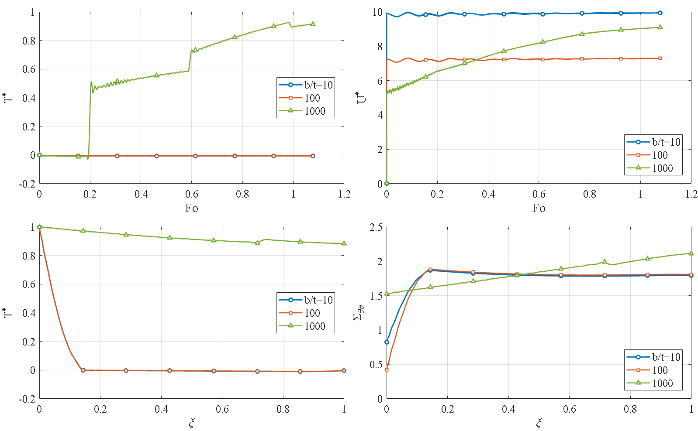{width=100%}

Effect of the width-to-thickness ratio of the GPLs ($b/t$ = 10, 100 and 1000) on the time histories at the mid-point of the mid-section (top) and on the through-thickness profiles at the final time (bottom).
:::

### 7.3 Porosity pattern

Fig. {{fig-porp}} shows the five porosity patterns on the uniform-GPL background. The pores act as a local thermal resistance and rearrange the heat path. The symmetric patterns UD, O and X give maximum mid-point temperatures of 0.926, 0.927 and 0.867, because the porous phase is either spread uniformly or symmetric about the mid-surface and does not make the heat path asymmetric. The two asymmetric patterns are mirror images with opposite thermal response. In pattern V the pores are concentrated near the hotter inner surface. This insulating region concentrates the incoming heat near the inner surface and prevents its fast spreading through the thickness, so that the mid-point temperature history shows a pronounced transient maximum of 1.109, which is above the dimensionless inner-surface value of 1, and settles at 1.002 at the end of the interval. In pattern Λ the pores are concentrated at the cooler outer surface. Instead of concentrating the heat in the inner region they block its way towards the environment and act as a thermal barrier, so that the outer-surface temperature does not exceed 0.107 and the maximum mid-point temperature remains 0.128.

The thermal benefit of pattern Λ has a mechanical price. Because the heat does not penetrate deeply into the wall, the thermal expansion is suppressed, and the unusual temperature distribution reverses the sign of the inner-surface hoop stress to −0.359 (compressive), whereas it is tensile for the other patterns. This sign change has to be taken into account in the design of cylinders under an internal thermal shock.

::: {#fig-porp .fig}
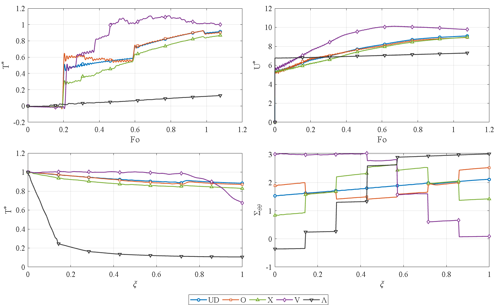{width=100%}

Effect of the porosity pattern (UD, O, X, V and Λ) with the uniform GPL pattern, on the time histories at the mid-point of the mid-section (top) and on the through-thickness profiles at the final time (bottom). The other parameters are at their reference values.
:::

### 7.4 Porosity level

The overall porosity level has a milder effect than the porosity pattern (Fig. {{fig-level}}). Increasing the pore content ($e_{m3}$ = 0.9675, 0.8604 and 0.7776) lowers the conductivity and the stiffness, so that the maximum mid-point temperature increases slowly from 0.905 to 0.926 and 0.942, while the maximum radial displacement increases more strongly, from 7.87 to 9.10 and 10.37, because the softer wall deforms more under the same load.

::: {#fig-level .fig}
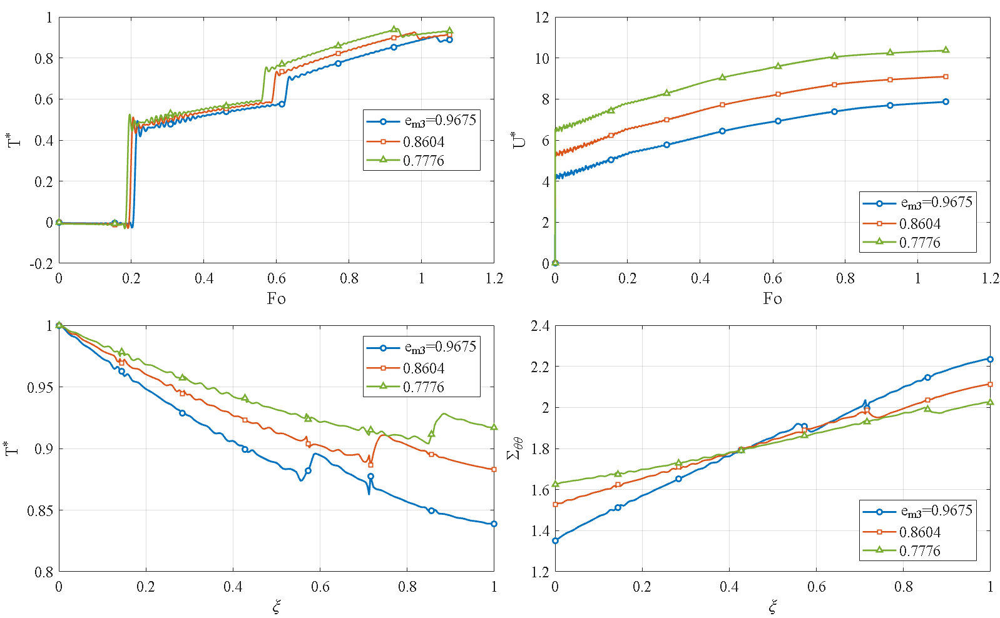{width=100%}

Effect of the porosity level $e_{m3}$ = 0.9675, 0.8604 and 0.7776 on the time histories at the mid-point of the mid-section (top) and on the through-thickness profiles at the final time (bottom).
:::

### 7.5 Interaction of the GPL and porosity patterns

All twenty-five pairings of the five GPL patterns with the five porosity patterns were computed. Fig. {{fig-gplp}} of Sect. 7.1 shows the five GPL patterns on the uniform-porosity background, and Figs. {{fig-bgO}} to {{fig-bgA}} show them on the backgrounds of the porosity patterns O, X, V and Λ.

::: {#fig-bgO .fig}
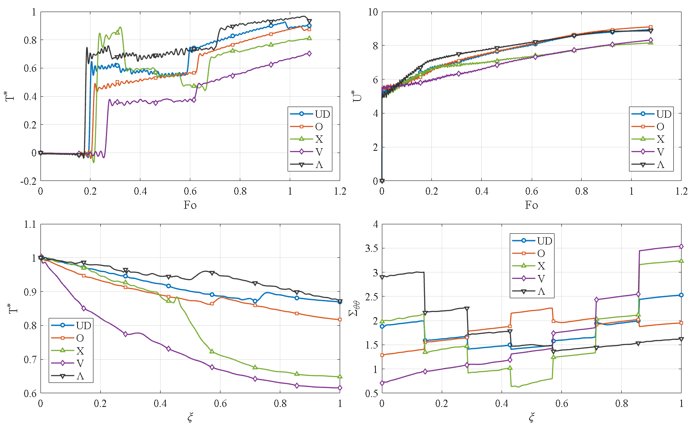{width=100%}

The five GPL patterns on the background of the porosity pattern O (time histories at the mid-point of the mid-section and through-thickness profiles at the final time).
:::

::: {#fig-bgX .fig}
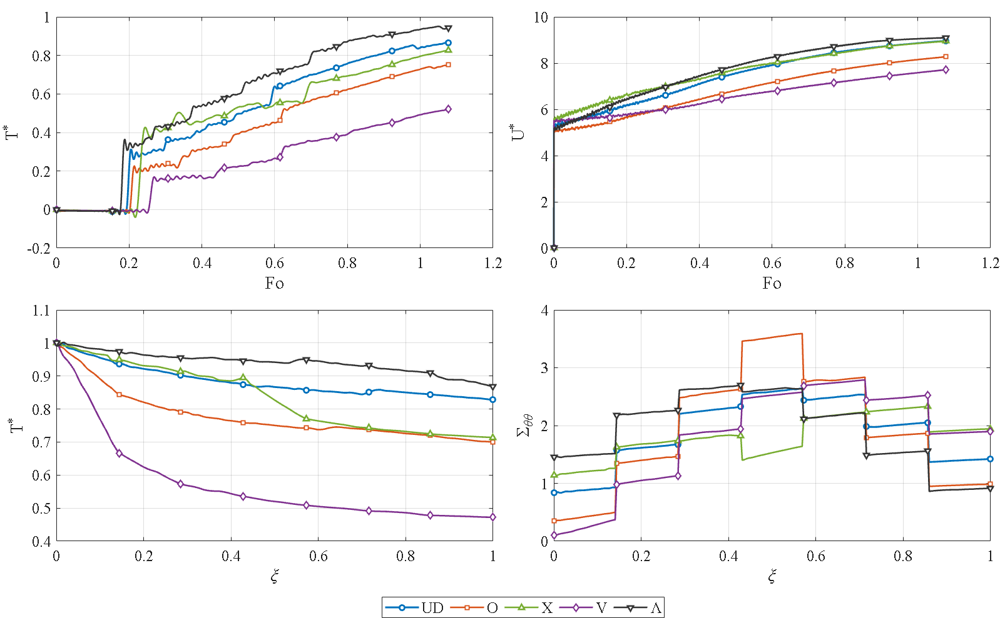{width=100%}

The five GPL patterns on the background of the porosity pattern X (time histories at the mid-point of the mid-section and through-thickness profiles at the final time).
:::

::: {#fig-bgV .fig}
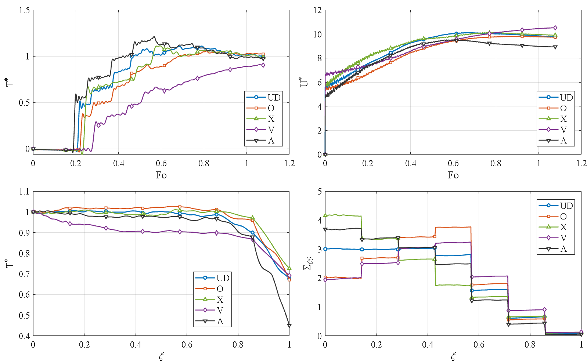{width=100%}

The five GPL patterns on the background of the porosity pattern V (time histories at the mid-point of the mid-section and through-thickness profiles at the final time).
:::

::: {#fig-bgA .fig}
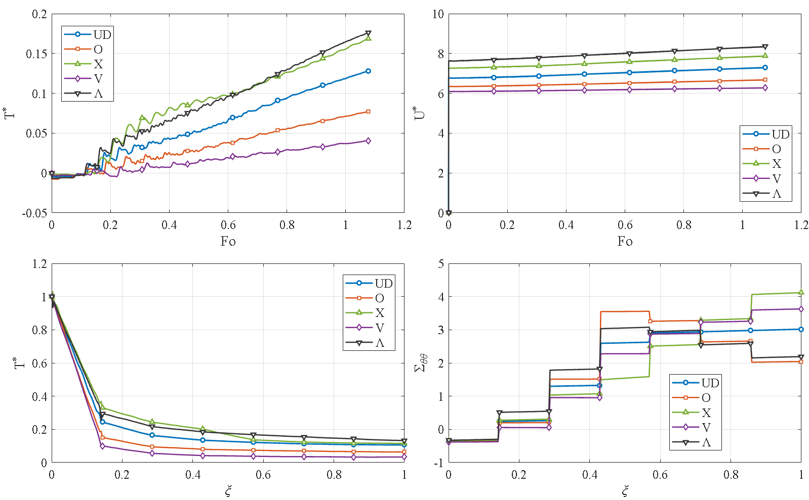{width=100%}

The five GPL patterns on the background of the porosity pattern Λ (time histories at the mid-point of the mid-section and through-thickness profiles at the final time).
:::

On every background the order of the GPL patterns by the outer-surface temperature is the same. The GPL pattern V is the coolest, followed by O, UD and X, and the pattern Λ is the hottest. What changes from one background to the next is the spread among the five curves. Against the uniform porosity or the pattern V (pores inside) the curves stay close together, because these porosity distributions put little obstacle in the way of the outward heat flux, and the choice of the GPL pattern matters least. Against the pattern Λ (pores outside) the curves spread apart, because the outer porosity barrier and the GPL-rich inner layer reinforce each other, and the GPL pattern has its largest effect on this background. The hoop-stress profiles follow the same logic. The mildest interface steps belong to the backgrounds of the GPL pattern V, where the stiffer conductive phase sits exactly where the temperature gradient is largest, and the sharpest steps occur for the porosity pattern V, which accumulates both the thermal load and the soft, highly porous material at the hot inner surface. The two gradings therefore act through almost independent channels. The GPL pattern determines how fast the heat is conducted through the wall, and the porosity pattern determines how much of it is stopped near the outer wall.

It is thus not the individual pattern but the relative alignment of the two patterns that matters. The pairing of the GPL pattern V with the porosity pattern Λ, in which the conductive GPLs face the heat source and the insulating pores face the environment, gives the lowest outer-surface temperature of the 25 pairings (0.034, against 0.883 for the uniform–uniform case) at a mildly compressive inner-surface hoop stress (−0.378). The GPL pattern V with the porosity pattern V concentrates both gradings near the inner surface, the two gradings weaken each other, and the outer-surface temperature rises to 0.692. The highest outer-surface temperatures, up to 0.896, belong to the GPL pattern Λ with the symmetric or uniform porosity patterns. The highest hoop stress of the 25 pairings does not occur for the pairing with the highest outer-surface temperature. It occurs for the GPL pattern X with the porosity pattern V, a stiff GPL pattern meeting pores concentrated at the hot inner surface, where the maximum hoop stress is 4.20, about twice the reference value of 2.11 (Fig. {{fig-best}}). A ranking on temperature alone would therefore pass this pairing, and the temperature and the stress have to be considered together.

Fig. {{fig-best}} collects the best and the worst pairings together with the uniform–uniform reference. The two pairings with the porosity pattern Λ, the GPL patterns V and O, keep the outer-surface temperature low and the inner-surface hoop stress slightly compressive, and they are therefore suitable where thermal protection is the goal and a slightly larger radial displacement is acceptable. The worst thermal case is the GPL pattern Λ with the uniform porosity, where the conductive GPL layer at the outside and the absence of an outer porosity barrier let the heat reach the outer wall almost unhindered. The worst mechanical case is the GPL pattern X with the porosity pattern V. The uniform–uniform reference is thermally ordinary but has the lowest maximum stress among the pairings shown, which makes it a mechanical reference. For an internal thermal shock the gradings should therefore be combined so that the conductive phase faces the heat source and the insulating phase faces the environment (GPL pattern V or O with the porosity pattern Λ), and a stiff GPL pattern (X) should not be paired with a porosity grading that makes the heated inner wall soft and porous (V).

::: {#fig-best .fig}
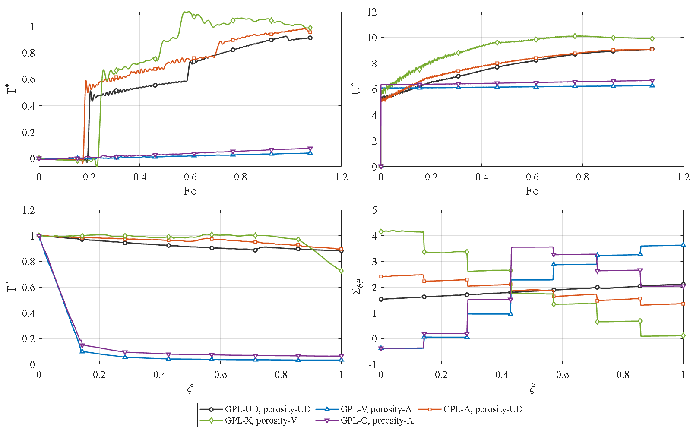{width=100%}

Best and worst pairings of the GPL and porosity patterns together with the uniform–uniform reference (time histories at the mid-point of the mid-section and through-thickness profiles at the final time).
:::

### 7.6 Supports, pressure, length, thickness and convection

#### 7.6.1 End supports

The end supports are studied for a simple support at both ends (S–S), a simple support at one end and a clamped end at the other (S–C) and clamping at both ends (C–C) (Fig. {{fig-bc}}). The temperature field is practically independent of the support type, and the maximum mid-point temperature is in the same range for all three, because the mechanical support does not act directly on the thermal problem. The mechanical response depends on the supports. Clamping the ends adds an axial constraint and reduces the hoop tension of the mid-section, so that the dimensionless inner-surface hoop stress decreases from 1.526 (S–S) to 1.068 (S–C) and 0.424 (C–C), and the maximum hoop stress decreases from 2.112 to 1.803 and 1.535. The inner-surface hoop stress of the S–C case lies between those of the two limiting cases, as expected. The maximum radial displacement is less sensitive and is 9.10 for S–S, 8.05 for S–C and 8.27 for C–C, because the end constraints have a smaller influence on the mid-section of this rather long cylinder.

::: {#fig-bc .fig}
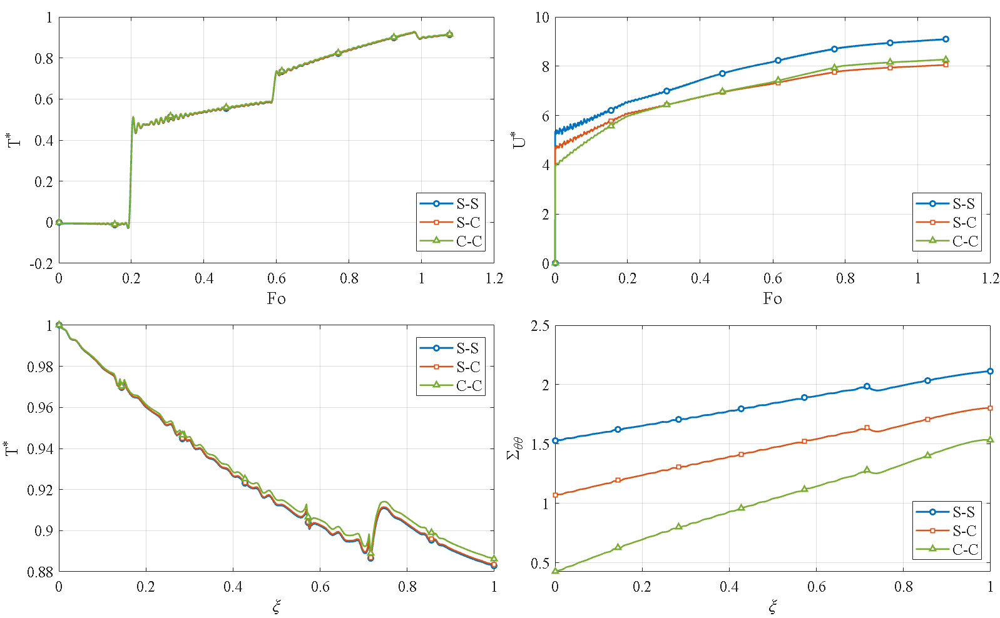{width=100%}

Effect of the end support conditions (S–S, S–C and C–C) on the time histories at the mid-point of the mid-section (top) and on the through-thickness profiles at the final time (bottom).
:::

#### 7.6.2 Internal pressure

The internal pressure is varied as $P_{i}$ = 0, 10, 50 (reference) and 100 MPa, which covers low to high pressures (Fig. {{fig-pres}}). The temperature field is practically independent of the pressure, because the thermal and the mechanical loads are linked only through the coupling term of the energy equation, and the pressure does not drive the temperature directly. The mechanical response grows linearly with the pressure. The inner-surface hoop stress rises from −0.387 without pressure to 3.43 at 100 MPa, and the maximum radial displacement from 3.75 to 14.44. At the reference pressure of 50 MPa the stress and the displacement are dominated by the pressure, whereas the temperature remains governed by the thermal load.

::: {#fig-pres .fig}
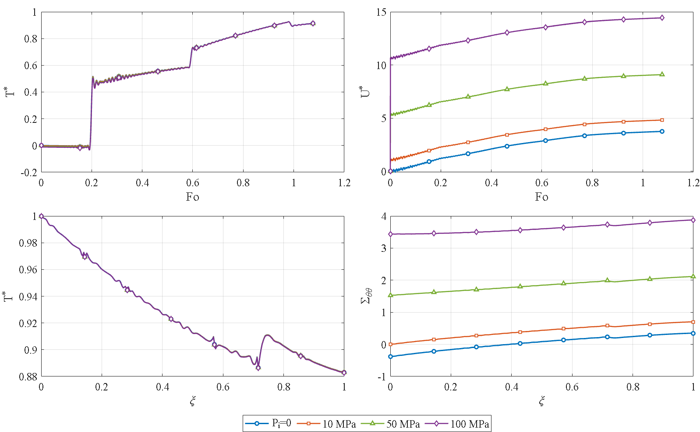{width=100%}

Effect of the internal pressure $P_{i}$ = 0, 10, 50 and 100 MPa on the time histories at the mid-point of the mid-section (top) and on the through-thickness profiles at the final time (bottom).
:::

#### 7.6.3 Cylinder length

To study the limit of a long cylinder, the length is increased in steps ($L$ = 1, 2.1, 5 and 10 m, Fig. {{fig-len}}). The maximum mid-point temperature is independent of the length, but the mechanical response approaches a limit as the length grows. A short cylinder is dominated by the two supports near its ends, and the inner-surface hoop stress of its mid-section is compressive and its displacement small. With increasing length the influence of the two ends on the mid-section decreases, the inner-surface hoop stress becomes tensile and approaches the range of 2.0 to 2.1, and the maximum displacement settles at about 8.5. The response of the mid-section therefore converges to the limit of a long cylinder, in which the mechanical effect of the ends is not felt.

::: {#fig-len .fig}
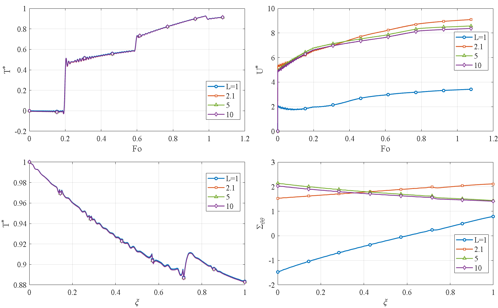{width=100%}

Effect of the cylinder length $L$ = 1, 2.1, 5 and 10 m on the time histories at the mid-point of the mid-section (top) and on the through-thickness profiles at the final time (bottom).
:::

#### 7.6.4 Wall thickness

Three radius ratios are compared in Fig. {{fig-thick}} ($R_{o}$/$R_{i}$ = 1.5, 2.0 and 5.0), and the time scale of each is made dimensionless with its own wall thickness. The thin wall is crossed by the thermal wave faster and its outer surface is heated, but the small thickness concentrates the thermal strain and gives a stronger mechanical response. The thick wall behaves in the opposite way. Within the interval the thermal wave does not cross the wall completely, the outer region stays cold, the displacement decreases, and the inner-surface hoop stress becomes compressive, because the hot inner region presses against the cold and stiff outer region. The wall thickness is thus a geometric parameter that moves the response between a thin but highly stressed wall and a thick wall with low and compressive stress.

::: {#fig-thick .fig}
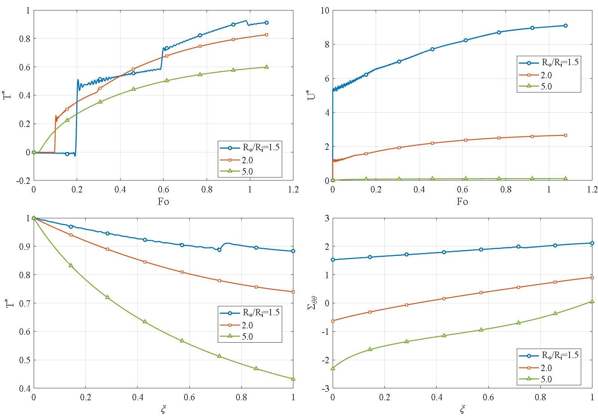{width=100%}

Effect of the wall thickness ($R_{o}$/$R_{i}$ = 1.5, 2.0 and 5.0) on the time histories at the mid-point of the mid-section (top) and on the through-thickness profiles at the final time (bottom).
:::

#### 7.6.5 Convection at the outer surface

With an increasing convection coefficient ($h_{c}$ = 10, 100 and 1000 W/m²K, Fig. {{fig-conv}}) the outer surface changes from nearly adiabatic to an effective heat sink. The outer-surface temperature then decreases from 0.883 to 0.107, the maximum mid-point temperature from 0.926 to 0.715 and the inner-surface hoop stress from 1.526 to 0.540. The thermal stress is governed by the temperature difference across the wall and not by the absolute temperature level. The response is almost independent of the convection at the smallest coefficient and dominated by the convection at the largest coefficient, two regimes that should be distinguished in design.

::: {#fig-conv .fig}
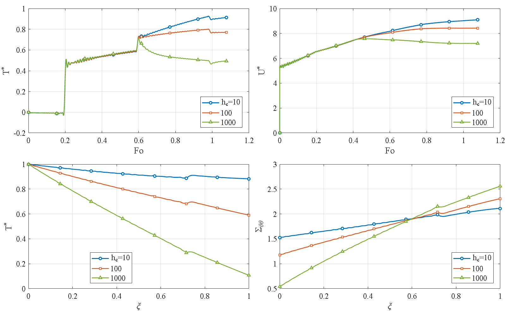{width=100%}

Effect of the convection coefficient at the outer surface ($h_{c}$ = 10, 100 and 1000 W/m²K) on the time histories at the mid-point of the mid-section (top) and on the through-thickness profiles at the final time (bottom).
:::

### 7.7 Thermal wave, coupling and impulsive loading

#### 7.7.1 Relaxation time

In the LS theory the thermal disturbance travels with the finite speed $v_{\mathrm{th}}$, which is the square root of the ratio of the thermal diffusivity $\hat{\alpha}$ to the relaxation time $\tau_0$, so that a larger relaxation time means a slower wave front. Fig. {{fig-relax}} compares the Fourier conduction ($\tau^{*}$ = 0) with the dimensionless relaxation times $\tau^{*}$ = 0.04 and 0.15. The clearest difference is the instant at which the heat reaches the mid-point. In the Fourier solution the temperature rises smoothly from the start, because the parabolic diffusion has an infinite speed. With a relaxation time the mid-point stays cold for a while and then the temperature rises with a sharp jump, and the delay and the sharpness of the jump increase with $\tau^{*}$. The second step in the history is the reflection of the wave front at the boundaries, which has no counterpart in the Fourier solution. The maximum mid-point temperature rises from 0.950 in the Fourier solution to only 0.962 at the largest relaxation time, but for this value the maximum no longer occurs at the end of the interval. The wave therefore imposes a transient temperature above the steady one before the field reaches the steady state. The relaxation time has a negligible effect on the stress, and the hoop-stress curves practically coincide. The relaxation time controls both the arrival time of the thermal wave and the level of the transient maximum. Even at the reference value, where its effect on the maximum is small, the wave character is visible in the temperature history, and this is the main argument for the use of generalized thermoelasticity in short-time analyses [70].

::: {#fig-relax .fig}
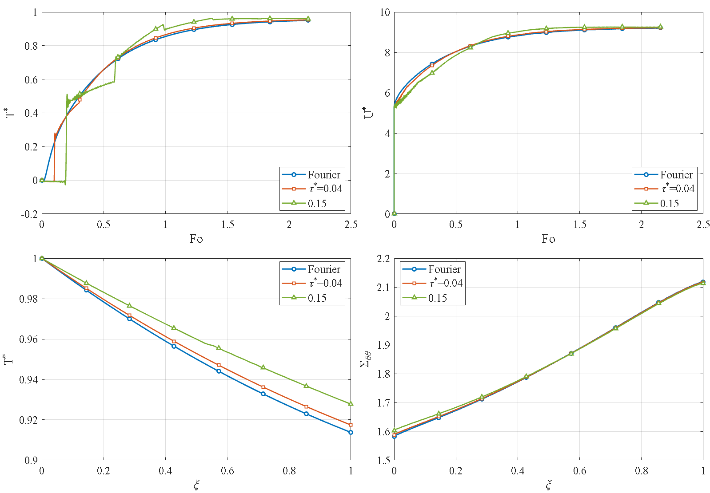{width=100%}

Effect of the relaxation time (Fourier conduction, $\tau^{*}$ = 0.04 and 0.15) on the time histories at the mid-point of the mid-section (top) and on the through-thickness profiles at the final time (bottom).
:::

#### 7.7.2 Field coupling

Fig. {{fig-coup}} compares the fully coupled model with the uncoupled model, in which the dilatation-rate term of Eq. ({{eq-energy}}) is dropped. At the reference conditions the uncoupled model overestimates the maximum mid-point temperature and the outer-surface temperature by about 1.2%. In the coupled model a part of the thermal energy is converted continuously into mechanical work, which is a kind of thermoelastic damping of the thermal wave, and the difference between the two models is largest at the wave fronts. At the reference relaxation time the effect is small but systematic, so that the fully coupled system should be solved whenever the wave effect is important.

::: {#fig-coup .fig}
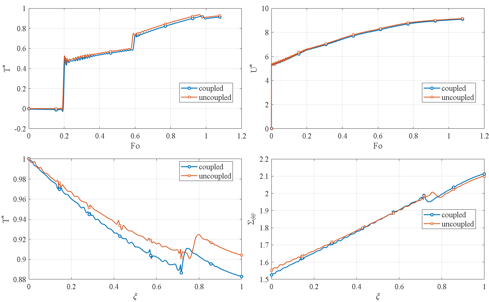{width=100%}

Effect of the coupling of the equations (coupled and uncoupled model) on the time histories at the mid-point of the mid-section (top) and on the through-thickness profiles at the final time (bottom).
:::

#### 7.7.3 Impulsive thermal loading

If the sustained temperature rise is replaced by a thermal pulse at the inner surface, the intrinsic difference between wave-like and diffusive transport appears (Fig. {{fig-shock}}). With Fourier conduction the pulse arrives early at the mid-thickness, is spread and weak, and has practically disappeared at the end of the interval. With the LS theory the pulse arrives later, because it travels with a finite speed, it is about 2.5 times stronger, because it travels as a coherent packet, and it leaves persistent oscillations as it reflects in the wall, so that a sharp second-sound front is visible. For impulsive loading the classical theory therefore underestimates the peak mid-wall temperature by a factor of about 2.5, and a design screened with a Fourier model against an impulsive event is non-conservative with respect to the temperature.

::: {#fig-shock .fig}
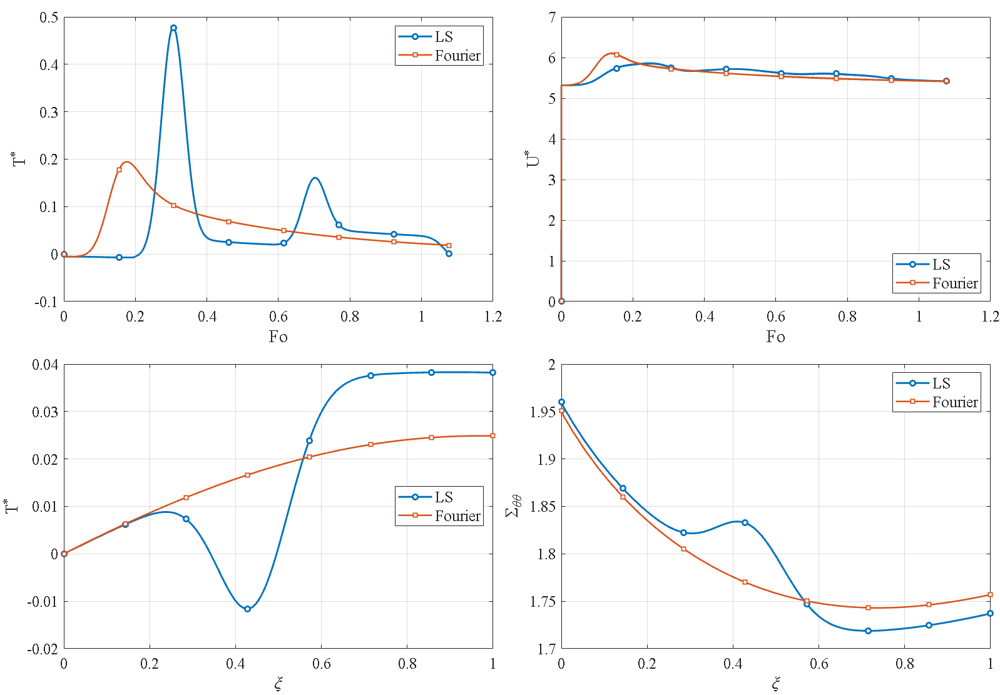{width=100%}

Response to an impulsive thermal load at the inner surface, Lord–Shulman (LS) theory against Fourier conduction (time histories at the mid-point of the mid-section and through-thickness profiles at the final time).
:::

### 7.8 Comparison of generalized thermoelasticity theories

The reference problem was solved with four theories at matched parameters, namely the classical Fourier theory [64], the Lord–Shulman theory [57], the dual-phase-lag theory [59] and the Green–Naghdi theory of type III [58, 66] (Fig. {{fig-theor}}). The maximum mid-point temperature increases in the order of the Fourier, the DPL, the LS and the Green–Naghdi III theory, with 0.950 for the Fourier theory and 0.962 for the LS theory. Two observations follow. First, at the reference relaxation time the maxima of the Fourier, the DPL and the LS solutions are close, because the wave is weak, and the DPL solution interpolates between the other two as expected. Second, the Green–Naghdi III theory behaves qualitatively differently. It produces a large and early overshoot at $\mathrm{Fo}$ of about 0.33, with a maximum of about 1.58, and decays only slowly, because its energy equation has no sufficient dissipative mechanism to damp the thermal wave, so that its long-time behaviour differs from that of the three other theories. A comparison of this kind for porous GPLRC cylinders has, to the authors' knowledge, not been reported before.

::: {#fig-theor .fig}
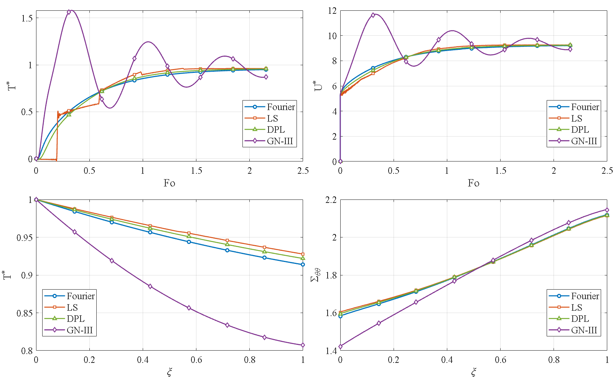{width=100%}

Comparison of four generalized thermoelasticity theories (Fourier, LS, DPL and Green–Naghdi type III, GN-III) on the time histories at the mid-point of the mid-section (top) and on the through-thickness profiles at the final time (bottom).
:::

### 7.9 Comparison of numerical methods

#### 7.9.1 Time integrators

Five time integrators, the Wilson-θ method [87, 88], the Houbolt method [89], the Hilber–Hughes–Taylor (HHT) method [90], the MATLAB solver ode15s [91] and the Laplace transform with Durbin inversion [92], were applied to the same spatial system and the same benchmark as the Newmark method (a transient conduction problem with a known exact solution, with the maximum temperature error at 10 s as the criterion). The results are summarised in Table {{tbl-int}}. The Newmark, Houbolt and HHT methods have practically the same accuracy at an equal time step, and the Wilson-θ method accepts about five times the error because of its additional numerical damping. The solver ode15s is about ten times more accurate but eight times more expensive, and the Laplace transform with numerical inversion is three orders of magnitude slower. These measurements justify the choice of the Newmark method for all production runs of this paper.

::: {#tbl-int .tbl}
Time integrators on the same spatial system.

| Method | Maximum error (K) | CPU time (s) |
|--------------------|----------|----------|
| Newmark ($\gamma_{N}$ = 1/2, $\beta_{N}$ = 1/4) | 0.0032 | 0.33 |
| Wilson-θ ($\theta$ = 1.4) | 0.0164 | 0.19 |
| Houbolt | 0.0025 | 0.24 |
| HHT ($\alpha_{HHT}$ = −0.1) | 0.0033 | 0.29 |
| ode15s | 0.0003 | 2.57 |
| Laplace–Durbin | 0.137 | 193 |
:::

#### 7.9.2 Spatial discretisations

Three spatial discretisation methods were compared, namely the differential quadrature method with Chebyshev and with uniform grids [46, 47], the second-order finite difference method [42, 43] and the finite element method with linear and quadratic elements [39, 63]. They were applied to the transient conduction problem with the exact Bessel-series solution and with the same Newmark time marching, and the maximum error is plotted against the number of radial nodes (Fig. {{fig-sp}}, left panel) and the number of axial nodes (Fig. {{fig-sp}}, right panel). In the radial direction the number of nodes needed to reach the error floor of the time step is about 9 to 11 for the DQM, about 21 for the quadratic finite elements and about 161 for the linear finite elements and the finite differences. The results of the linear finite element and the finite difference methods lie close to the reference line of slope −2 in both directions, which means second-order convergence, in which halving the node spacing reduces the error to one quarter. The error of the quadratic finite element method decreases faster than that of the linear methods until it reaches its floor, and the error of the DQM falls quasi-exponentially down to the time floor. At equal accuracy the system of the DQM is thus about fifteen times smaller in each direction, which is the reason for the choice of the DQM. In the radial direction the DQM with the Chebyshev grid is more accurate than the quadratic finite elements for fewer than 20 nodes, whereas with more nodes the quadratic elements perform better, and in the axial direction the two methods change places at about 30 nodes. These findings agree with the convergence study of Sect. 6.1, where a small number of radial nodes per layer already gives converged profiles (Fig. {{fig-cvNr}}).

::: {#fig-sp .fig}
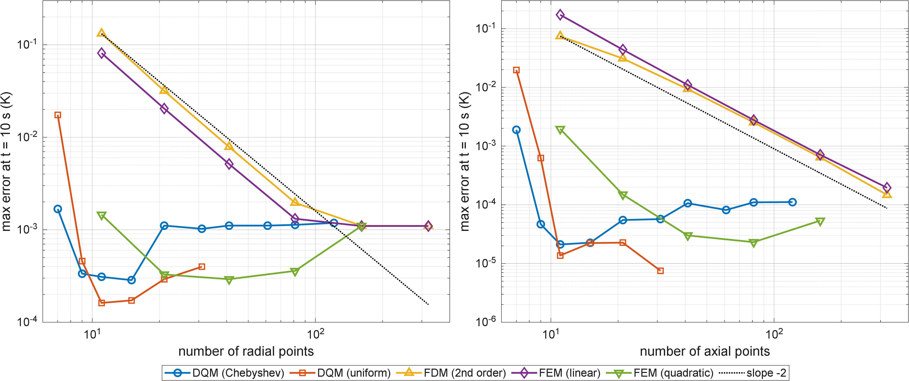{width=100%}

Maximum error of the spatial discretisation methods versus the number of radial nodes (left panel) and the number of axial nodes (right panel), on logarithmic axes. The dotted line is the reference line of slope −2, and the DQM with the uniform grid is shown for up to 31 nodes.
:::

---

## 8. Conclusions and limitations

### 8.1 Conclusions

A fully coupled Lord–Shulman thermoelastic model of a multilayer porous GPLRC hollow cylinder has been developed, discretised by layerwise differential quadrature in space and by the Newmark method in time, verified against exact and published solutions, and used for a wide parametric study. The main conclusions are listed below.

1. The temperature history shows the pattern of a thermal wave that is reflected at the boundaries and has no counterpart in Fourier conduction. Under impulsive loading the Fourier theory underestimates the peak temperature, so that the generalized theory is needed for thermal shock, whereas under slow loading at a mild relaxation time the Fourier and the LS theories differ little. The Green–Naghdi type III theory behaves qualitatively differently.
2. Concentrating the GPLs at the inner (hot) surface (pattern V) gives the lowest temperature, hoop stress and displacement among the five GPL patterns, so that the distribution of the GPLs, and not only their amount, matters. The mirror pattern Λ gives the highest temperature and hoop stress.
3. Concentrating the pores at the outer surface (pattern Λ) acts as a thermal barrier and lowers the outer-surface temperature strongly, but the inner-surface hoop stress becomes compressive, so that the thermal benefit comes with a changed stress state.
4. The two gradings interact through their relative alignment. The GPL pattern V with the porosity pattern Λ (conductive towards the heat source and insulating towards the environment) gives the lowest outer-surface temperature of the 25 pairings, whereas the GPL pattern V with the porosity pattern V weakens this effect. The GPL pattern X with the porosity pattern V gives the largest hoop stress, so that a screening on temperature alone can be misleading and the two patterns have to be selected on temperature and stress together.
5. The GPL weight fraction has a strong effect on the thermal penetration, and the effective conductivity has a percolation-type threshold. At the reference weight fraction a sufficiently large width-to-thickness ratio is needed for the conductive network to form, whereas the length-to-width ratio has a saturating effect.
6. The end supports and the internal pressure do not change the temperature field. Clamping lowers the hoop stress of the mid-section, and the effect of the pressure is linear. A thicker wall is not crossed by the thermal wave within the interval and has a compressive inner-surface hoop stress, and the convection reduces the stress by reducing the temperature difference across the wall.
7. The fully coupled solution damps the thermal wave slightly (thermoelastic damping), so that uncoupled models are non-conservative at the wave fronts.
8. Methodologically, within the cases studied the DQM needs far fewer nodes per direction than the finite difference and linear finite element methods, and the Newmark method gives a favourable ratio of accuracy to cost among the integrators tested.
### 8.2 Limitations and future work

The model is linear elastic without damage or failure criteria, the material properties are independent of temperature although the inner surface is heated from 300 K to 600 K, the layer interfaces are perfectly bonded, the geometry is a right circular cylinder under axisymmetric loading, and no comparison with experiment is available. Future work should include temperature-dependent properties, radiation at the outer surface, a damage model, stable free and roller end conditions, continuous (non-layerwise) grading, other geometries and loadings, and vibration, buckling and fatigue analyses. A prototype and its experimental testing would allow the theoretical results to be compared with measurements.

---

## Nomenclature

| Symbol | Meaning |
|--------|----------------------------|
| $R_i$, $R_o$ | inner and outer radius of the cylinder |
| $h$ | wall thickness, $h = R_o - R_i$ |
| $L$ | length of the cylinder |
| $N_L$ | number of layers |
| $\ell$ | layer index (superscript), $\ell = 1, \dots, N_L$ |
| $r$, $\theta$, $z$ | radial, circumferential and axial coordinate |
| $u$, $w$ | radial and axial displacement |
| $r_m^{(\ell)}$ | mid-radius of the layer $\ell$ |
| $E$, $\nu$, $\rho$, $c$, $\alpha$, $k$ | Young modulus, Poisson ratio, density, specific heat, thermal expansion coefficient and thermal conductivity (subscripts GPL and $m$ for the GPL and the matrix, $s$ for the non-porous GPLRC layer, no subscript for the effective porous layer) |
| $\hat{\alpha}$ | thermal diffusivity, $\hat{\alpha} = k/(\rho c)$ |
| $\lambda$, $\mu$ | Lamé constants |
| $C_{ij}$ | elastic coefficients |
| $a_{\mathrm{GPL}}$, $b_{\mathrm{GPL}}$, $t_{\mathrm{GPL}}$ | length, width and thickness of a GPL |
| $W_{\mathrm{GPL}}$, $V_{\mathrm{GPL}}$, $V_m$ | weight fraction and volume fraction of the GPLs, volume fraction of the matrix |
| $E_L$, $E_T$ | longitudinal and transverse Halpin–Tsai moduli |
| $\chi_L$, $\chi_T$, $\eta_L$, $\eta_T$ | Halpin–Tsai parameters |
| $p$, $H(p)$, $\delta$ | geometric parameter, geometric function and connectivity parameter of the conductivity model |
| $\Pi$, $\Pi_m$ | porosity function and mass-density function |
| $e_{mi}$ | mass-density coefficients of the porosity patterns, $e_{m3}$ is the porosity level |
| $T$, $T_0$, $T_\infty$, $T_{i}$ | temperature, initial temperature, ambient temperature and final inner-surface temperature |
| $\Delta T$ | temperature change, $\Delta T = T - T_0$ |
| $t$, $t_0$ | time and time constant of the inner-surface temperature |
| $\tau_0$ | relaxation time |
| $v_{\mathrm{th}}$ | speed of the thermal wave |
| $\varepsilon_{ii}$, $\gamma_{rz}$, $\varepsilon_T$ | normal strains, shear strain and thermal strain |
| $\sigma_{ii}$, $\tau_{rz}$ | normal stresses and shear stress |
| $P_i$ | internal pressure |
| $h_c$ | convection coefficient at the outer surface |
| $N_r$, $N_z$, $N_x$ | number of radial nodes per layer, of axial nodes and of nodes of a generic line |
| $N_n$, $N_{\mathrm{dof}}$ | number of nodes and of degrees of freedom |
| $A_{ij}$, $B_{ij}$ | DQM weights of the first and second derivative |
| $\psi$, $d$ | generic function and derivative order of the DQM |
| $\mathbf{M}$, $\mathbf{C}_d$, $\mathbf{K}$, $\mathbf{K}_{\mathrm{eff}}$ | mass, damping, stiffness and effective stiffness matrix |
| $\mathbf{D}$, $\mathbf{f}$ | vector of the degrees of freedom and load vector |
| $\Delta t$, $n$ | time step and time level |
| $\beta_N$, $\gamma_N$, $g_0, \dots, g_5$ | Newmark parameters and integration constants |
| $T^{*}$, $\xi$, $\mathrm{Fo}$, $\tau^{*}$, $\Sigma_{ii}$, $U^{*}$ | dimensionless temperature, radius, time, relaxation time, normal stress and radial displacement |

---

## Declarations

CRediT author statement, funding, competing interests and data availability are to be completed by the authors.

## References

1. S. Zhao, Z. Zhao, Z. Yang, L. Ke, S. Kitipornchai, and J. Yang, "Functionally graded graphene reinforced composite structures: A review," Engineering Structures, vol. 210, p. 110339, 2020.

2. F. Kiarasi, M. Babaei, P. Sarvi, K. Asemi, M. Hosseini, and M. Omidi Bidgoli, "A review on functionally graded porous structures reinforced by graphene platelets," pp. 731-750, 12/31 2021.

3. A. Alibeigloo, "Three-dimensional thermoelasticity analysis of graphene platelets reinforced cylindrical panel," European Journal of Mechanics-A/Solids, vol. 81, p. 103941, 2020.

4. G. Zhang, C. Xiao, A. Rahimi, and M. Safarpour, "Thermal and mechanical buckling and vibration analysis of FG-GPLRC annular plate using higher order shear deformation theory and generalized differential quadrature method," International Journal of Applied Mechanics, vol. 12, no. 02, p. 2050019, 2020.

5. X. Huang, J. Yang, and Z. Yang, "Thermo-elastic analysis of functionally graded graphene nanoplatelets (GPLs) reinforced closed cylindrical shells," Applied Mathematical Modelling, vol. 97, pp. 754-770, 2021.

6. A. Eyvazian, T. A. Sebaey, K. K. Żur, A. Khan, H. Zhang, and S. H. Wong, "On the dynamics of FG-GPLRC sandwich cylinders based on an unconstrained higher-order theory," Composite Structures, vol. 267, p. 113879, 2021.

7. Y. Wang, C. Feng, Z. Zhao, and J. Yang, "Buckling of graphene platelet reinforced composite cylindrical shell with cutout," International Journal of Structural Stability and Dynamics, vol. 18, no. 03, p. 1850040, 2018.

8. Y. Heydarpour et al., "Application of the hybrid DQ- Heaviside-NURBS method for dynamic analysis of FG-GPLRC cylindrical shells subjected to impulse load," Thin-Walled Structures, vol. 155, p. 106914, 2020/10/01/ 2020.

9. J.-R. Cho, "Large amplitude vibration of FG-GPL reinforced conical shell panels on elastic foundation," Materials, vol. 16, no. 17, p. 6056, 2023.

10. I. U. Cagdas and S. Adali, "Optimal graphene platelet reinforcement for filament wound imperfect cylinders under axial compression," Journal of Composite Materials, vol. 60, no. 7, pp. 613-626, 2025.

11. M. Mahdavi and A. Alibeigloo, "Vibrational analysis of a cylindrical panel with an FG viscoelastic core and graphene-reinforced composite face sheets based on the theory of elasticity," Journal of Vibration and Control, vol. 32, no. 19-20, pp. 6021-6040, 2025.

12. J. Azimi, A. Loghman, E. Mohammad-Rezaei Bidgoli, and M. Arefi, "Thermo-mechanical bending and stress analysis of deep GNP-reinforced thick cylindrical shells on an orthotropic Pasternak foundation considering nanoparticle agglomeration," Archives of Civil and Mechanical Engineering, vol. 26, no. 4, p. 185, 2026.

13. A. Rahimi, A. Alibeigloo, and M. Safarpour, "Three-dimensional static and free vibration analysis of graphene platelet–reinforced porous composite cylindrical shell," Journal of Vibration and Control, vol. 26, no. 19-20, pp. 1627-1645, 2020.

14. M.-H. Yas and S. Rahimi, "Thermal buckling analysis of porous functionally graded nanocomposite beams reinforced by graphene platelets using Generalized differential quadrature method," Aerospace Science and Technology, vol. 107, p. 106261, 2020.

15. M. Babaei, F. Kiarasi, K. Asemi, R. Dimitri, and F. Tornabene, "Transient thermal stresses in FG porous rotating truncated cones reinforced by graphene platelets," Applied Sciences, vol. 12, no. 8, p. 3932, 2022.

16. W. Zhang, C. Wang, and Y. Wang, "Thermo-mechanical analysis of porous functionally graded graphene reinforced cylindrical panels using an improved third order shear deformable model," Applied Mathematical Modelling, vol. 118, pp. 453-473, 2023.

17. W. Zhang, H. Ma, Y. Wang, and Y. Wang, "Nonlinear transient thermo-mechanical responses of porous graphene platelet-reinforced cylindrical panels under moving distributed loads," Thin-Walled Structures, vol. 192, p. 111180, 2023.

18. R. Salmani, R. Gholami, R. Ansari, and M. Fakhraie, "Analytical investigation on the nonlinear postbuckling of functionally graded porous cylindrical shells reinforced with graphene nanoplatelets," The European Physical Journal Plus, vol. 136, no. 1, pp. 1-19, 2021.

19. M. Khakpour, Y. Bazargan-Lari, P. Zahedinejad, and M.-J. Kazemzadeh-Parsi, "Vibrations evaluation of functionally graded porous beams in thermal surroundings by generalized differential quadrature method," Shock and Vibration, vol. 2022, 2022.

20. N. L. Le, T. T. Bui, T. N. T. Duong, T. D. Dang, M. D. Vu, and T. P. Nguyen, "Nonlinear thermo-mechanical buckling and postbuckling of sandwich FG-GPLRC spherical caps and circular plates with porous core by using higher-order shear deformation theory," Journal of Thermoplastic Composite Materials, vol. 36, no. 10, pp. 4083-4105, 2023.

21. J.-R. Cho, "Free Vibration Analysis of Functionally Graded Porous Cylindrical Panels Reinforced with Graphene Platelets," Nanomaterials, vol. 13, no. 9, p. 1441, 2023.

22. H. Jafary and M. Taghizadeh, "Nonlinear dynamics response of porous functionally graded annular plates using modified higher order shear deformation theory," SN Applied Sciences, vol. 5, no. 12, p. 368, 2023.

23. X.-l. Huang, W. Mo, W. Sun, and W. Xiao, "Buckling analysis of porous functionally graded GPL-reinforced conical shells subjected to combined forces," Archive of Applied Mechanics, vol. 94, no. 2, pp. 299-313, 2024.

24. Y. Sitli et al., "Investigating the bending and buckling behaviors of composite porous beams reinforced with carbon nanotubes and graphene platelets using a TRPIM path following mesh-free approach," Computers & Structures, vol. 303, p. 107492, 2024.

25. V. H. Nam, N. T. T. Hoai, N. V. Tien, P. T. Hieu, and N. T. Phuong, "Nonlinear thermo-mechanical static and dynamic buckling responses of functionally graded porous graphene-reinforced spherical shells and circular plates with spider-web stiffeners," Journal of Thermoplastic Composite Materials, vol. 39, no. 2, pp. 702-732, 2025.

26. W. Mo, H. Liu, Y. Wei, and X.-L. Huang, "Thermoelastic buckling analysis of functionally graded graphene-reinforced composite porous truncated conical shells," Journal of Mechanical Science and Technology, vol. 39, no. 9, pp. 5263-5276, 2025.

27. V. H. Nam, K. L. Huong, L. N. Ly, C. V. Doan, and P. T. Hieu, "Nonlinear buckling analysis of porous-core FG-GPLRC toroidal shell segments with generalized meridional curvature reinforced by orthogonal stiffeners," Vietnam Journal of Mechanics, vol. 48, no. 3, pp. 268-281, 2026.

28. R. Moradi-Dastjerdi and K. Behdinan, "Stress waves in thick porous graphene-reinforced cylinders under thermal gradient environments," Aerospace Science and Technology, vol. 110, p. 106476, 2021.

29. J. L. Pelletier and S. S. Vel, "An exact solution for the steady-state thermoelastic response of functionally graded orthotropic cylindrical shells," International Journal of solids and structures, vol. 43, no. 5, pp. 1131-1158, 2006.

30. M. Jabbari, A. Bahtui, and M. Eslami, "Axisymmetric mechanical and thermal stresses in thick long FGM cylinders," Journal of Thermal Stresses, vol. 29, no. 7, pp. 643-663, 2006.

31. Y. Chen and X. Lin, "Elastic analysis for thick cylinders and spherical pressure vessels made of functionally graded materials," Computational Materials Science, vol. 44, no. 2, pp. 581-587, 2008.

32. X. Peng and X. Li, "Thermoelastic analysis of a cylindrical vessel of functionally graded materials," International journal of pressure vessels and piping, vol. 87, no. 5, pp. 203-210, 2010.

33. M. Khoshgoftar, G. Rahimi, and M. Arefi, "Exact solution of functionally graded thick cylinder with finite length under longitudinally non-uniform pressure," Mechanics Research Communications, vol. 51, pp. 61-66, 2013.

34. S. H. Kordkheili and R. Naghdabadi, "Thermoelastic analysis of functionally graded cylinders under axial loading," Journal of Thermal Stresses, vol. 31, no. 1, pp. 1-17, 2007.

35. J. Ying and H. Wang, "Axisymmetric thermoelastic analysis in a finite hollow cylinder due to nonuniform thermal shock," International Journal of Pressure Vessels and Piping, vol. 87, no. 12, pp. 714-720, 2010.

36. Y. Tokovyy, A. Chyzh, and C.-C. Ma, "An analytical solution to the axisymmetric thermoelasticity problem for a cylinder with arbitrarily varying thermomechanical properties," Acta Mechanica, vol. 230, no. 4, pp. 1469-1485, 2019.

37. V. Burlayenko, H. Altenbach, T. Sadowski, S. Dimitrova, and A. Bhaskar, "Modelling functionally graded materials in heat transfer and thermal stress analysis by means of graded finite elements," Applied Mathematical Modelling, vol. 45, pp. 422-438, 2017.

38. M. Elfar, R. Sedaghati, and O. R. Abdelsalam, "Transient coupled thermo-elasticity analysis of a temperature-dependent thick-walled cylinder under cyclic thermo-mechanical loads," SN Applied Sciences, vol. 5, no. 1, p. 9, 2023.

39. B. Kanlıkama, A. Abuşoğlu, and İ. H. Güzelbey, "Coupled thermoelastic analysis of thick-walled pressurized cylinders," International Journal of Energy and Power Engineering, vol. 2, no. 2, pp. 60-68, 2013.

40. A. Najibi and R. Talebitooti, "Nonlinear transient thermo-elastic analysis of a 2D-FGM thick hollow finite length cylinder," Composites Part B: Engineering, vol. 111, pp. 211-227, 2017.

41. C. Evci and M. Gülgeç, "Functionally graded hollow cylinder under pressure and thermal loading: Effect of material parameters on stress and temperature distributions," International Journal of Engineering Science, vol. 123, pp. 92-108, 2018.

42. M. Homayouni, M. Shariyat, and O. Rahmani, "Thermally nonlinear generalized thermoelasticity investigation of a functionally graded thick hollow cylinder based on the finite difference method," Thin-Walled Structures, vol. 177, p. 109359, 2022.

43. H.-L. Dai, Y.-N. Rao, and H.-J. Jiang, "Thermoelastic dynamic response for a long functionally graded hollow cylinder," Journal of composite materials, vol. 47, no. 3, pp. 315-325, 2013.

44. R. Ansari, A. Talebian, and M. Zargar Ershadi, "Thermo-mechanical response of axisymmetric cylindrical shells made of FGM subjected to cooling shock," Thin-Walled Structures, vol. 212, p. 113145, 2025.

45. M. Omidi Bidgoli, "Dynamic thermal stresses in functionally graded thick hollow cylinders by a graded finite element method and 2D axisymmetric elasticity," International Journal of Innovative Computational Methods in Engineering Sciences, e229708, 2025.

46. H. Haftchenari, M. Darvizeh, A. Darvizeh, R. Ansari, and C. Sharma, "Dynamic analysis of composite cylindrical shells using differential quadrature method (DQM)," Composite Structures, vol. 78, no. 2, pp. 292-298, 2007.

47. Y. Heydarpour, P. Malekzadeh, M. Golbahar Haghighi, and M. Vaghefi, "Thermoelastic analysis of rotating laminated functionally graded cylindrical shells using layerwise differential quadrature method," Acta Mechanica, vol. 223, no. 1, pp. 81-93, 2012.

48. P. Malekzadeh and Y. Heydarpour, "Free vibration analysis of rotating functionally graded cylindrical shells in thermal environment," Composite Structures, vol. 94, no. 9, pp. 2971-2981, 2012.

49. P. Malekzadeh, Y. Heydarpour, M. G. Haghighi, and M. Vaghefi, "Transient response of rotating laminated functionally graded cylindrical shells in thermal environment," International journal of pressure vessels and piping, vol. 98, pp. 43-56, 2012.

50. P. Malekzadeh and Y. Heydarpour, "Response of functionally graded cylindrical shells under moving thermo-mechanical loads," Thin-walled structures, vol. 58, pp. 51-66, 2012.

51. E. Asadi and M. S. Qatu, "Free vibration of thick laminated cylindrical shells with different boundary conditions using general differential quadrature," Journal of Vibration and Control, vol. 19, no. 3, pp. 356-366, 2013.

52. K. Daneshjou and M. Talebitooti, "Free vibration analysis of rotating stiffened composite cylindrical shells by using the layerwise-differential quadrature (LW-DQ) method," Mechanics of Composite Materials, vol. 50, no. 1, pp. 21-38, 2014.

53. S. Brischetto, F. Tornabene, N. Fantuzzi, and E. Viola, "3D exact and 2D generalized differential quadrature models for free vibration analysis of functionally graded plates and cylinders," Meccanica, vol. 51, no. 9, pp. 2059-2098, 2016.

54. Z. Zong and Y. Zhang, Advanced differential quadrature methods. Chapman and Hall/CRC, 2009.

55. C. Cattaneo, "Sur une forme de l'équation de la chaleur éliminant le paradoxe d'une propagation instantanée," Comptes Rendus de l'Académie des Sciences, vol. 247, pp. 431-433, 1958.

56. P. Vernotte, "Les paradoxes de la théorie continue de l'équation de la chaleur," Comptes Rendus de l'Académie des Sciences, vol. 246, pp. 3154-3155, 1958.

57. H. W. Lord and Y. Shulman, "A generalized dynamical theory of thermoelasticity," Journal of the Mechanics and Physics of Solids, vol. 15, no. 5, pp. 299-309, 1967.

58. A. E. Green and P. M. Naghdi, "Thermoelasticity without energy dissipation," Journal of Elasticity, vol. 31, no. 3, pp. 189-208, 1993.

59. D. Y. Tzou, "A unified field approach for heat conduction from macro- to micro-scales," Journal of Heat Transfer, vol. 117, no. 1, pp. 8-16, 1995.

60. F. Shakeriaski, M. Ghodrat, J. Escobedo-Diaz, and M. Behnia, "Recent advances in generalized thermoelasticity theory and the modified models: a review," Journal of Computational design and Engineering, vol. 8, no. 1, pp. 15-35, 2021.

61. Y. Huang, L. Yan, H. Wu, and Y. Yu, "New insights on generalized heat conduction and thermoelastic coupling models," Applied Mathematics and Mechanics, vol. 46, no. 8, pp. 1533-1550, 2025.

62. A. Bagri and M. Eslami, "A unified generalized thermoelasticity; solution for cylinders and spheres," International Journal of Mechanical Sciences, vol. 49, no. 12, pp. 1325-1335, 2007.

63. A. Bahtui and M. Eslami, "Generalized coupled thermoelasticity of functionally graded cylindrical shells," International journal for numerical methods in engineering, vol. 69, no. 4, pp. 676-697, 2007.

64. A. Bahtui and M. Eslami, "Coupled thermoelasticity of functionally graded cylindrical shells," Mechanics research communications, vol. 34, no. 1, pp. 1-18, 2007.

65. A. Bagri and M. Eslami, "Generalized coupled thermoelasticity of functionally graded annular disk considering the Lord–Shulman theory," Composite Structures, vol. 83, no. 2, pp. 168-179, 2008.

66. S. M. Hosseini and M. H. Abolbashari, "Analytical solution for thermoelastic waves propagation analysis in thick hollow cylinder based on Green–Naghdi model of coupled thermoelasticity," Journal of Thermal Stresses, vol. 35, no. 4, pp. 363-376, 2012.

67. S. M. Hosseini, "Gaussian thermal shock-induced thermoelastic wave propagation in an FG multilayer hybrid nanocomposite cylinder reinforced by GPLs and CNTs," Thin-Walled Structures, vol. 166, p. 108108, 2021.

68. S. M. Hosseini and C. Zhang, "Band structure analysis of Green-Naghdi thermoelastic wave propagation in a GPLs/CNTs-reinforced metamaterial with energy dissipation," Engineering Structures, vol. 272, p. 114984, 2022.

69. M. Kazemi, M. H. G. Rad, and S. M. Hosseini, "Geometrically non-linear vibration and coupled thermo-elasticity analysis with energy dissipation in FG multilayer cylinder reinforced by graphene platelets using MLPG method," Journal of Vibration Engineering & Technologies, vol. 11, no. 1, pp. 355-379, 2023.

70. Y. Heydarpour, P. Malekzadeh, and F. Gholipour, "Thermoelastic analysis of FG-GPLRC spherical shells under thermo-mechanical loadings based on Lord-Shulman theory," Composites Part B: Engineering, vol. 164, pp. 400-424, 2019/05/01/ 2019.

71. Y. Heydarpour and P. Malekzadeh, "Thermoelastic analysis of multilayered FG spherical shells based on Lord–Shulman theory," Iranian Journal of Science and Technology, Transactions of Mechanical Engineering, vol. 43, pp. 845-867, 2019.

72. Y. Heydarpour, P. Malekzadeh, R. Dimitri, and F. Tornabene, "Thermoelastic analysis of functionally graded cylindrical panels with piezoelectric layers," Applied Sciences, vol. 10, no. 4, p. 1397, 2020.

73. Y. Heydarpour, P. Malekzadeh, R. Dimitri, and F. Tornabene, "Thermoelastic analysis of rotating multilayer FG-GPLRC truncated conical shells based on a coupled TDQM-NURBS scheme," Composite Structures, vol. 235, p. 111707, 2020.

74. Y. Heydarpour, P. Malekzadeh, H. Zhu, and M. Mohammadzaheri, "Non-Fourier heat transfer analysis of sandwich conical shells with GPLs reinforced face sheets and porous core under moving heat flux," Results in Physics, vol. 73, p. 108240, 2025.

75. A. E. Abouelregal, M. Marin, A. Foul, and S. S. Askar, "Space-time non-local analysis of a porous thermoelastic hollow cylinder using a heat conduction model featuring a Goufo-Caputo two-parameter fractional derivative with phase lags," Boundary Value Problems, vol. 2025, no. 1, p. 29, 2025.

76. A. Yahya and A. Saidi, "Response of generalized thermoelastic for free vibration of a solid cylinder with voids under a dual-phase lag model," Iranian Journal of Science and Technology, Transactions of Mechanical Engineering, vol. 49, no. 3, pp. 1333-1343, 2025.

77. A. E. Abouelregal, O. Civalek, B. Akgoz, A. Foul, and S. S. Askar, "Analysis of thermoelastic behavior of porous cylinders with voids via a nonlocal space-time elastic approach and Caputo-tempered fractional heat conduction," Mechanics of Time-Dependent Materials, vol. 29, no. 2, p. 38, 2025.

78. Z. Daneshjoo, A. Mostafapour, A. Tarkashvand, and A. Ghomi Foroushani, "Effect of porosity and gradation on transient thermoelastic response of a functionally graded plate: A Lord-Shulman theory-based approach," Journal of Science and Technology of Composites, vol. 12, no. 1, pp. 2669-2680, 2025.

79. P. Malekzadeh, Y. Heydarpour, and H. Zhu, "Thermoelastic analysis of sandwich conical shells with GPLs reinforced face sheets and porous core under moving thermomechanical loading," Composite Structures, vol. 373, p. 119713, 2025.

80. S. F. Megahid, "Analysis of a heterogeneous functionally graded material with a spherical void exposed to time-dependent ramp-type heating according to the TPL heat conduction model," Scientific Reports, vol. 15, no. 1, p. 26942, 2025.

81. J. C. Halpin and J. L. Kardos, "The Halpin-Tsai equations: a review," Polymer Engineering and Science, vol. 16, no. 5, pp. 344-352, 1976.

82. K. Chu, C.-c. Jia, and W.-s. Li, "Effective thermal conductivity of graphene-based composites," Applied physics letters, vol. 101, no. 12, 2012.

83. H. Esmaeili and Y. Kiani, "Vibrations of graphene platelet reinforced composite doubly curved shells subjected to thermal shock," Mechanics Based Design of Structures and Machines, vol. 52, no. 2, pp. 650-679, 2024.

84. A. Mihankhah, Z. K. Maraghi, A. G. Arani, and S. Niknejad, "Vibrations of multi-layer beam with nanocomposite face sheets reinforced with graphene platelets and porous core," Journal of Solid Mechanics, vol. 15, no. 4, pp. 258-273, 2023.

85. N. M. Newmark, "A method of computation for structural dynamics," Journal of the Engineering Mechanics Division, ASCE, vol. 85, no. 3, pp. 67-94, 1959.

86. A. R. Setoodeh, M. Tahani, and E. Selahi, "Hybrid layerwise-differential quadrature transient dynamic analysis of functionally graded axisymmetric cylindrical shells subjected to dynamic pressure," Composite Structures, vol. 93, no. 11, pp. 2663-2670, 2011.

87. E. L. Wilson, I. Farhoomand, and K. J. Bathe, "Nonlinear dynamic analysis of complex structures," Earthquake Engineering & Structural Dynamics, vol. 1, no. 3, pp. 241-252, 1972.

88. T. A. Ozkul, "A finite element formulation for dynamic analysis of shells of general shape by using the Wilson-θ method," Thin-walled structures, vol. 42, no. 4, pp. 497-513, 2004.

89. J. C. Houbolt, "A recurrence matrix solution for the dynamic response of elastic aircraft," Journal of the Aeronautical Sciences, vol. 17, no. 9, pp. 540-550, 1950.

90. H. M. Hilber, T. J. R. Hughes, and R. L. Taylor, "Improved numerical dissipation for time integration algorithms in structural dynamics," Earthquake Engineering & Structural Dynamics, vol. 5, no. 3, pp. 283-292, 1977.

91. L. F. Shampine and M. W. Reichelt, "The MATLAB ODE suite," SIAM Journal on Scientific Computing, vol. 18, no. 1, pp. 1-22, 1997.

92. F. Durbin, "Numerical inversion of Laplace transforms: an efficient improvement to Dubner and Abate's method," The Computer Journal, vol. 17, no. 4, pp. 371-376, 1974.

---

## Submission checklist (delete before submission)

- V and Λ. The patterns are printed in the Chapter 4 convention (V = inner), but the numbers are the solver numbers (solver V = outer). Interchange the labels of the results or reverse the equations, and regenerate the pattern figures. The porosity patterns V and Λ and all derived numbers must be regenerated after the porosity-formula revision.
- Equations that deviate from the printed thesis equations (see the author-notes box). The thesis should be corrected in the same way, so that thesis and article agree. These are the plus sign of pattern X in Eq. ({{eq-wgpl}}), the bound $0 \le \Pi_m \le 1$ and the V and Λ orientation.
- Eqs. ({{eq-zeta}}) to ({{eq-mass}}). Printed as in the thesis since R5, with the absolute mid-radius. This conflicts with the solver and with every porosity number of Sect. 7, which use the coordinate measured from the mid-surface. See item (4) of the author-notes box. The thesis or the article has to be corrected before submission.
- Eq. ({{eq-por}}). The specific heat is scaled by $\Pi = \Pi_m^2$ as in thesis Eq. 3-21, although it is a per-mass property (the product $\rho c$ would then scale as $\Pi_m^3$). Confirm that this is intended.
- Wave speed. Thesis Sect. 4-5 prints $v = (\tau_0/\hat{\alpha})^{1/2}$, which is dimensionally inverted. Eq. 23 of R4.1 was deleted in R5, and Sect. 7.7.1 states in words that the speed of the thermal wave is the square root of the ratio of $\hat{\alpha}$ to $\tau_0$.
- Eq. ({{eq-ks}}). Printed as the single expression of the thesis. For $V_{\mathrm{GPL}} < 1/p$ the base of the power $\delta$ is negative, and the solver uses the matrix conductivity there, as the text after Eq. ({{eq-hp}}) says.
- Table {{tbl-cNL}}. The $N_{\mathrm{dof}}$ value of the last row is 6435 from Eq. ({{eq-ndof}}), whereas thesis Table 4-5 prints 4719. The thesis text says that the adopted mesh computes the field quantities with an accuracy better than 0.2%, whereas its Table 4-3 gives 0.24% for the adopted number of radial nodes. R4 does not quote this figure, because the tables of the radial and the axial convergence (thesis Tables 4-3 and 4-4) are not part of the article. They remain in the thesis and can be moved to supplementary material.
- Figures. All figures except Figs. {{fig-geom}}, {{fig-gplpat}}, {{fig-porpat}}, {{fig-vM}}, {{fig-sp}} and those of Sects. 7.1, 7.3 and 7.5 are the versions embedded in the thesis draft of 2026-11-09 (byte-identical copies in the repository folders figures_ch123, figures_validation, figures_ch4_master and results_extensions). The excepted figures are described below. Fig. {{fig-sp}} is new. It was drawn from the saved csv tables of thesis Figs. 4-32 and 4-33 with the script code/extensions/T2_T4_spatial_2panel_R2.m (R2 = R1 without the titles and the letters (a) and (b) above the panels, instruction of 2026-11-23), so the data points are those of the thesis, and the diverging points of the DQM with the uniform grid (more than 31 nodes) are left out. In R5 the pattern name A of the figures is Λ (instruction of 2026-11-23). Figs. {{fig-gplpat}} and {{fig-porpat}} are the thesis images with only the label of the fifth sector replaced (script code/catalog/schematics_Lambda_relabel_R1.ps1), and the figures of Sects. 7.1, 7.3 and 7.5 are the saved thesis .fig files with only the legend entries changed (script code/catalog/figures_Lambda_relabel_R1.m, new files in figures_article). Fig. {{fig-geom}} is geometry_schematic_R4_6, which writes $T_{i}(t)$ instead of $T_{\mathrm{in}}(t)$ in the legend. The thesis figures still carry the label A. The legends use $e_{m3}$ for the porosity level. Fig. {{fig-vM}} is the thesis figure with one change. The legend entry Malekzadeh & Heydarpour (2012) is now Malekzadeh et al. (2012), because [49] has four authors (new file figures_validation/bench1_U_malekzadeh_etal_R1.png and .fig, made from the saved Validation/bench1_U_NL10.fig by code/validation/validation_fig_bench1_malekzadeh_etal_R1.m). The thesis Fig. 4-6 still has the old legend, and its caption calls the ANSYS solution independent, whereas it was taken from [49] and produced by [86].
- Verification numbers (Sect. 6.2). The thesis text gives a relative difference of 0.1% to 0.2% for the first test without saying against which reference. The saved table of the benchmark (Validation/bench1_table_NL10.csv) gives 0.05% to 0.16% against Malekzadeh et al. and 0.31% to 0.78% against the ANSYS results, which is why the text says 0.2% and 1%. The problem data of the first test (power-law wall, clamped ends, half sine pressure pulse of 100 MPa and 1 s) are those of [49]. The thesis does not state them, and the alt text of its Fig. 4-6 calls the pressure a step, which does not agree with [49] and with the shape of the curve.
- Numbers read from figures. The maximum of the Green–Naghdi III curve (about 1.58 at $\mathrm{Fo}$ of about 0.33, Sect. 7.8) and the diffusivity $\hat{\alpha} = 8.97 \times 10^{-5}$ m²/s with $\tau_0$ of about 418 s (Sect. 5) are not stated in the thesis text. Check them against the saved results.
- Support study (Sect. 7.6.1). Thesis Sect. 4-10 gives 8.05 as the maximum displacement of the C–C case and says that S–C lies between the limits in every quantity, whereas Fig. 4-23 (here Fig. {{fig-bc}}) shows 8.05 for S–C and 8.27 for C–C. The article follows the figure. Correct the thesis text.
- Removed from R2 because the thesis gives no figure or table for them. These are the fifth verification test (exact LS wave benchmark), the 3% jump of the peak temperature at $\Delta t$ = 5 s, the decrease of the wave-front oscillation with mesh refinement, the failure of the Chebyshev grid for very many nodes, the decay of the support disturbance within one wall thickness, and the claim that the pressure study stays convergent at 100 MPa.
- Removed from R3 by the instructions of 2026-11-17. These are the static-solver test and the ode15s test of the verification, the summary convergence table, Appendix A with the tables of the radial and axial convergence, the figure of the layer convergence (and the clause of Sect. 7.1 that cited it), the thesis sentences on the equality of the inner-surface radial stress to minus the pressure and on the false jump of the maximum temperature at a time step of 5 s, and the statement that the DQM with the uniform grid diverges beyond about 30 nodes. The thesis passages are not wrong, but they have no figure or table in the article. The statement that the Laplace transform applies only to the thermal part and to uncoupled equations (thesis Sect. 4-19, the label of the last row of thesis Table 4-7 and Appendix A-1) was removed on the author instruction of 2026-11-17, and the thesis still contains it.
- Author order, corresponding author, affiliation, thesis footnote, CRediT, funding and data availability.
- Choose the journal and reformat to its template and reference style (the reference list is numbered by order of appearance). The abstract has about 330 words, which still exceeds the limit of some journals, and the article has 28 figures, which may have to be reduced, for example by moving Figs. {{fig-cvNz}}, {{fig-sp}} and the porosity-background figures to supplementary material.
- References added to the thesis list (Cattaneo, Vernotte, Green–Naghdi 1993, Tzou 1995, Halpin–Kardos, Newmark, Wilson et al., Houbolt, Hilber et al., Durbin, Shampine–Reichelt) are classical works whose bibliographic data must be verified. The thesis cites a finite element textbook for Newmark, an application paper for Houbolt and for the Hilber–Hughes–Taylor method, and entries unrelated to the DPL theory and the Laplace method, and this article cites the original works instead.
- Reference [86] (Setoodeh et al., Composite Structures 93(11), 2011, 2663-2670) is the source of the ANSYS results of the first verification test. Its title, authors, journal, volume and pages are taken from the reference list of [49], and the issue number and the DOI 10.1016/j.compstruct.2011.06.011 from an indexing record. The full text of [86] was not read, and the description of its finite element model (a three-dimensional model with 18000 solid elements) is the one given in [49]. Check the entry against the publisher page.
- Citations were re-checked against the reference list. The statements on beams ([3]–[9]), on Green–Lindsay theory ([58]) and on the classical coupled theory ([64]) of R2 were corrected, and the thesis reference numbers of the DQM, FD and FE methods were converted to the numbering of this article.
